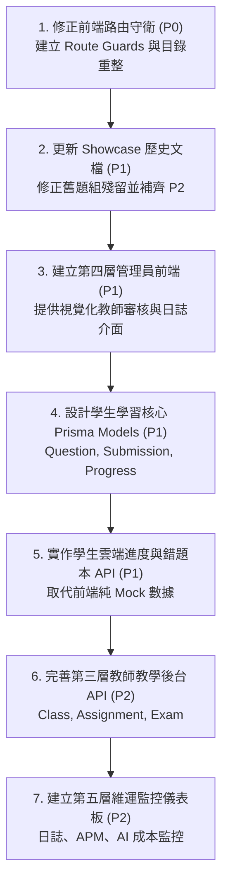

# CODE TO KNOW（碼上學）
# 全站五層系統架構與功能歸屬獨立稽核報告

**稽核類型：** READ-ONLY AUDIT（唯讀檢查，未執行任何程式修改、資料庫寫入或部署）  
**稽核角色：** 資深全端系統架構師、React/TS 前端架構師、Express/Prisma 後端架構師、RBAC 資安稽核工程師、UI/UX 資訊架構師、品質驗收工程師  
**報告日期：** 2026-11-06  
**報告版本：** v1.0.0  
**檔案路徑：** `docs/FIVE_LAYER_ARCHITECTURE_AUDIT_REPORT.md`  

---

## 核心結論直球回答

> ### **「目前網站是否真的已經按照五層架構建置？」**
> **【明確判定：尚未完整按照五層架構建置落地。】**
>
> 1. **尚未歸位或層級放錯的頁面與功能：**
>    - **教師教學後台 (`TeacherDashboardPage.tsx`)**：屬於第三層，但目前被放置於前端 `pages/public/` 目錄中，且完全缺乏路由守衛（Route Guards），任何未登入訪客或學生只要手動輸入 `/#teacher`，即可直接瀏覽包含學生姓名（陳品睿等）、作業及格率等硬編碼偽造資料的教師主控台。
>    - **題庫匯入與來源管理系統 (`QuestionBankImportSystemPage.tsx`)**：屬於第四層（平台管理後台之題庫教材管理），但目前被錯誤放置於 `pages/public/`，並直接作為公開導覽列的「題庫來源 (`#sources`)」暴露給全網所有訪客。
>    - **學生中心 (`StudentDashboardPage.tsx`)**：屬於第二層，同樣置於 `pages/public/`，未登入訪客存取時會退化顯示硬編碼的「學員示範帳號」。
> 2. **哪些功能只是展示原型（Prototype / Mock）？**
>    - **教師教學管理**：班級數據、及格率 89.2%、作業時長、學生名冊、作業指派均為純前端靜態 Mock，後端資料庫完全沒有班級（Class）與學生名冊（Enrollment）資料表。
>    - **學生學習歷程與微光點數**：389 題進度、88.75 模擬考最高分、142 顆 AI 啟發微光點數均為前端靜態數字，非真實會員資料庫紀錄。
>    - **錯題本與個人筆記**：僅為 UI 示意，後端無任何資料表與 API 支援。
>    - **AI 學習教練**：前端具備 4 階啟發式助教對話展示（Scaffolding 規則引導），但真實 LLM API 尚未串接後端。
> 3. **哪些功能已具備真正的後端與資料庫支援？**
>    - **身分驗證系統**：註冊、登入、登出、Session Cookie、CSRF Token 防禦、Argon2/Bcrypt 密碼雜湊、密碼重設 Token、Email 驗證 Token 均具備完整的 Express + Prisma + PostgreSQL 實體資料庫讀寫支援。
>    - **教師資格申請與審核**：學生端提交教師申請（寫入 `TeacherApplication`）、管理員端審核通過/駁回、審核事件寫入 `AuditLog` 均具備完整的伺服器端實體資料庫支援。
>    - **系統健康監控探針**：`/api/health` 具備真實執行 PostgreSQL `SELECT 1` 探測資料庫連線延遲之能力。

---

## 一、專案目前實際狀態

| 模組維度 | 實作現況 | 技術規格 | 後端與資料庫連線現況 |
|---|---|---|---|
| **前端 (`frontend/`)** | 單頁式 Hash 導航應用程式 | React 18, TypeScript 5.6, Vite 5.4, Lucide React | 透過 `services/api.ts` 與後端 Auth/Teacher API 連動；所有頁面均位於 `pages/public/` |
| **後端 (`backend/`)** | RESTful API 服務 | Express 4.21, TypeScript 5.6, Prisma 7.10, PostgreSQL | 具備完備的 CSRF、Helmet、Rate Limiting、Session 驗證，但僅開放 Auth、Teacher、Admin 模組 |
| **資料庫 (`prisma/`)** | 關聯式實體模型 | PostgreSQL, Prisma ORM | 僅具備 9 個身分與安全相關 Model，**完全缺乏** 題目、考試、成績、班級、進度等教育核心資料表 |
| **原型 (`prototype/`)** | 獨立展示用靜態原形 | 純 HTML5, Vanilla CSS, JS | 9 個完整頁面，使用 `prototype-data.js` 與 LocalStorage，完全不依賴後端即可單機演示 |
| **官方題組 (P1)** | 100% 勞動部標準五大題組 | 85 份官方磁片素材完整保留 | 雙端皆採用 Single Source of Truth，非官方題組「台灣美食」已安全封存於常數隔離層 |
| **首頁比較 (P2)** | 訪客與會員功能對比 | 雙卡片 + 8 項功能詳細比較表 | 雙端均已上線，明確標示「已實作/部分實作/規劃中/尚未串接」，無虛構限制 |

---

## 二、全部頁面與路由清單

### 2.1 React 正式前端（13 個路由端點）

| 編號 | 頁面名稱 | Hash 路由 | 原始碼檔案位置 | 所屬五層系統 | 允許角色 | 登入需求 | 使用 API | 是否具備真實後端 | 備註說明 |
|---|---|---|---|---|---|---|---|---|---|
| 1 | 品牌首頁 | `#hero` / 空白 | `src/pages/public/HomePage.tsx` | 第一層 | 所有訪客 | 免登入 | 無 | 本地靜態 | 包含 Hero, 品牌故事, P2 比較區塊, CTA |
| 2 | 證照智慧學習中心 | `#certifications` | `src/pages/public/CertificationsPage.tsx` | 第一層/第二層 | 所有訪客 | 免登入 | 無 | 本地 SSoT | 支援 150ms 防抖搜尋與多維標籤篩選 |
| 3 | 證照詳細大綱 | `#certifications/:id` | `src/pages/public/CertificationDetailPage.tsx` | 第一層/第二層 | 所有訪客 | 免登入 | 無 | 本地 SSoT | 展示考點比例與官方五大題組清單 |
| 4 | 網頁設計丙級演示 | `#certifications/web-design-c/demo` | `src/pages/public/WebDesignCDemoPage.tsx` | 第一層/第二層 | 所有訪客 | 免登入 | 無 | 本地 SSoT | 互動式考綱地圖與考點解析展示 |
| 5 | 學科理論與練習 | `#theory` | `src/pages/public/TheoryPracticePage.tsx` | 第二層 | 所有訪客/學生 | 免登入 | 無 | 本地 SSoT | 本機直接練習、查看詳解，尚未串接雲端存檔 |
| 6 | 全真模擬測驗 | `#mock-exam` | `src/pages/public/MockExamPage.tsx` | 第二層 | 所有訪客/學生 | 免登入 | 無 | 本地 SSoT | 支援計時與自動計分，無歷程資料庫 |
| 7 | 術科題組實作區 | `#practical` | `src/pages/public/PracticalLearningPage.tsx` | 第二層 | 所有訪客/學生 | 免登入 | 無 | 本地 SSoT | 官方五大題組考點、線稿圖與 85 份素材 |
| 8 | 線上代碼工作台 | `#code-editor?task=:id` | `src/pages/public/CodeEditorPage.tsx` | 第二層 | 所有訪客/學生 | 免登入 | 無 | 本地 SSoT | 雙欄即時編譯、`srcdoc` 預覽，無雲端存檔 |
| 9 | AI 學習助教 | `#ai-coach` | `src/pages/public/AICoachPage.tsx` | 第二層 | 所有訪客/學生 | 免登入 | 無 | 本地規則引導 | 4 階啟發式鷹架展示，未串接外部 LLM API |
| 10 | 個人學習進度 | `#progress` | `src/pages/public/LearningProgressPage.tsx` | 第二層 | 所有訪客/學生 | 免登入 | 無 | 本地展示數據 | 389 題與 142 微光為靜態展示，無雲端同步 |
| 11 | 學生中心 | `#student` | `src/pages/public/StudentDashboardPage.tsx` | 第二層 | 學生會員 | **應登入（目前未防護）** | 無 | 本地展示數據 | 未登入時直接展示「學員示範帳號」假資料 |
| 12 | 教師教學主控台 | `#teacher` | `src/pages/public/TeacherDashboardPage.tsx` | **第三層** | **認證教師（目前未防護）** | **應登入（目前未防護）** | 無 | 本地展示數據 | **層級放錯！** 無路由防護，展示假學生名冊 |
| 13 | 官方題庫管理引擎 | `#sources` | `src/pages/public/QuestionBankImportSystemPage.tsx` | **第四層** | **內容管理員（目前未防護）** | **應登入（目前未防護）** | 無 | 本地 SSoT | **層級放錯！** 公開展示於全站導覽列 |

### 2.2 Prototype 獨立靜態原型（9 個 HTML 頁面）

| 編號 | 檔案路徑 | 對應所屬五層系統 | 實作模式 | 狀態評級 |
|---|---|---|---|---|
| 1 | `prototype/index.html` | 第一層：公開宣傳網站 | 純 HTML/CSS/JS | A. 已實際運作（含 P2 比較區塊） |
| 2 | `prototype/pages/certifications.html` | 第一層/第二層交界 | 純 HTML/CSS/JS | A. 已實際運作 |
| 3 | `prototype/pages/certification-detail.html` | 第一層/第二層交界 | 純 HTML/CSS/JS | A. 已實際運作 |
| 4 | `prototype/pages/theory-learning.html` | 第二層：學生學習平台 | 純 HTML/CSS/JS | A. 已實際運作（本地單機模式） |
| 5 | `prototype/pages/mock-exam.html` | 第二層：學生學習平台 | 純 HTML/CSS/JS | A. 已實際運作（本地單機模式） |
| 6 | `prototype/pages/practical-learning.html` | 第二層：學生學習平台 | 純 HTML/CSS/JS | A. 已實際運作（五大題組對齊） |
| 7 | `prototype/pages/code-editor.html` | 第二層：學生學習平台 | 純 HTML/CSS/JS | A. 已實際運作（雙欄沙盒預覽） |
| 8 | `prototype/pages/ai-coach.html` | 第二層：學生學習平台 | 純 HTML/CSS/JS | B. 示範提示流程模擬 |
| 9 | `prototype/pages/learning-progress.html` | 第二層：學生學習平台 | 純 HTML/CSS/JS | B. 代表性數值展示模擬 |

---

## 三、五層系統歸屬矩陣 (Five-Layer Architecture Matrix)

| 系統層次 | 標準定義規範 | 專案現有實作與對應程式碼 | 落差與缺失分析 | 達成率 |
|---|---|---|---|---|
| **第一層<br>公開宣傳網站** | 品牌首頁、理念介紹、功能比較、證照公開列表、FAQ、條款、註冊/登入入口 | - `HomePage.tsx` (含 `MembershipComparison.tsx`)<br>- `CertificationsPage.tsx`<br>- `AuthModal.tsx`<br>- `Navbar.tsx`, `Footer.tsx` | 頁面設計成熟、響應式完備、品牌識別統一。僅缺完整的獨立 FAQ 頁面與法務隱私權條款獨立頁。 | **85%** |
| **第二層<br>學生學習平台** | 學生儀表板、個人進度、題庫練習、模擬考、術科實作、程式工作台、AI 教練、錯題本、筆記、成就中心 | - `TheoryPracticePage.tsx`<br>- `MockExamPage.tsx`<br>- `PracticalLearningPage.tsx`<br>- `CodeEditorPage.tsx`<br>- `AICoachPage.tsx`<br>- `StudentDashboardPage.tsx` | 前端單機體驗與互動極佳，但**後端與資料庫支援為 0%**：無題目 API、無考試記錄 API、無錯題本 API、無雲端進度儲存。 | **45%** |
| **第三層<br>教師教學後台** | 資格申請審核、教師儀表板、班級管理、學生名冊、教材題庫管理、考試派送、監考中心、班級成績分析 | - 前端：`TeacherDashboardPage.tsx`<br>- 後端：`/api/teachers/applications`<br>- 後端：`/api/teachers/my-application`<br>- 元件：`TeacherApplyModal.tsx` | 僅有資格申請與審核有實體資料庫連動；教學主控台全部為前端寫死資料，**無任何班級、作業、學生管理 API**。 | **15%** |
| **第四層<br>平台管理後台** | 平台總覽、學生/教師帳號管理、教師資格審核、角色權限、題庫教材維護、公告管理、稽核日誌 | - 後端：`/api/admin/teacher-applications` (列表/核准/駁回)<br>- 後端：`/api/admin/audit-logs` (日誌)<br>- 前端：`QuestionBankImportSystemPage.tsx` | 後端已有審核與日誌 API，但**前端完全沒有獨立的管理後台 UI**，管理員無法透過瀏覽器介面進行審核與使用者管理。 | **10%** |
| **第五層<br>系統營運與監控** | 系統健康總覽、前端錯誤監控、API 監控、DB 監控、AI 用量成本、安全告警、系統維護模式 | - 後端：`GET /api/health` (探測 DB 連線與延遲)<br>- 後端：`AuditLog` 記錄重要資安事件 | 僅具備單一健康檢查探針與審核日誌記錄，**缺乏監控儀表板、告警系統、APM 整合與運維管理工具**。 | **5%** |

---

## 四、層級放錯的頁面或功能

### 4.1 嚴重錯位項目清單

1. **`TeacherDashboardPage.tsx`（應屬第三層，現置於第一層公共區）**
   - **實體路徑：** `frontend/src/pages/public/TeacherDashboardPage.tsx`
   - **問題描述：** 該頁面為認證教師專屬的班級教學管理中心，卻被放置在 `public/` 目錄中，並以 `#teacher` 路由向全網開放。
   - **資安與架構隱患：** 任何未登入者均可點入，頁面內展示了虛構的學生個資（「陳品睿」、「林子翔」等人的 Email 與作業進度），容易造成使用者誤解或權限混淆。
2. **`QuestionBankImportSystemPage.tsx`（應屬第四層，現置於第一層公共區）**
   - **實體路徑：** `frontend/src/pages/public/QuestionBankImportSystemPage.tsx`
   - **問題描述：** 該頁面包含官方題庫來源檢驗、各科題目資料結構檢視與題庫管理操作，本質屬於「平台內容管理後台」，卻直接出現在前端公開 Navbar 的「題庫來源 (`#sources`)」中。
   - **資安與架構隱患：** 將內部管理與資料校驗工具作為公開功能曝光，模糊了公開網站與後台管理的邊界。
3. **`StudentDashboardPage.tsx`（應屬第二層，現置於第一層公共區）**
   - **實體路徑：** `frontend/src/pages/public/StudentDashboardPage.tsx`
   - **問題描述：** 學生中心本應要求學員登入後存取，目前未登入者輸入 `#student` 也會直接開啟，並呈現「學員示範帳號」之固定進度。

---

## 五、權限與安全問題 (RBAC & Security Audit)

### 5.1 關鍵安全查核表

| 查核項目 | 實測現況 | 風險等級 | 具體發現與程式碼位置 |
|---|---|---|---|
| **1. 學生是否可能進入教師後台** | **可能** | **High** | 前端 `App.tsx` 與 `NavigationContext.tsx` 完全無 Route Guard，輸入 `#teacher` 直接進入。 |
| **2. 教師是否可能讀取其他班級資料** | **尚未發生（無 API）** | **Medium** | 後端完全沒有班級相關 API 與 Model；未來若實作班級 API，必須強制綁定 `teacherId`。 |
| **3. 平台管理員權限劃分** | **未分級** | **Medium** | `Role` 表僅有 `ADMIN`，未細分內容管理員、客服、超級管理員與維運工程師。 |
| **4. 伺服器端身分驗證真實性** | **有效實作** | **Low** | 後端 `/api/admin/*` 與 `/api/teachers/*` 均在伺服器端驗證 Session 與 DB Roles，不信任前端參數。 |
| **5. JWT / Session 安全機制** | **有效實作** | **Low** | 使用 HTTP-only Cookie (`code_to_know_session`)，Token 經 SHA-256 雜湊後存入資料庫，具備登出撤銷機制。 |
| **6. CSRF 防禦** | **有效實作** | **Low** | 所有變更狀態的 HTTP 請求均強制校驗 `x-csrf-token`，未帶 Token 會被拒絕 (403)。 |
| **7. 資料庫 RLS (Row-Level Security)** | **未啟用** | **Medium** | 目前 Prisma 透過應用層 SQL 查詢過濾，PostgreSQL 尚未在資料庫層啟用強制 RLS 政策。 |
| **8. 敏感操作稽核紀錄** | **部分實作** | **Low** | 登入、登出、教師申請、管理員審核均自動寫入 `AuditLog`，但未包含題庫異動與查詢。 |

---

## 六、API 與資料模型對應 (API & Prisma Data Mapping)

### 6.1 現有 Prisma 資料模型（僅 9 個）

```prisma
// 身分與帳號
User, Role, UserRole, UserProfile, Session
// 認證與重設
EmailVerificationToken, PasswordResetToken
// 審核與安全
TeacherApplication, AuditLog
```

### 6.2 嚴重缺失之業務資料模型清單

1. **題目與題庫模型**：`Certification`, `Subject`, `Question`, `QuestionOption`, `Explanation`（目前全依賴前端 TypeScript 靜態資料陣列）。
2. **測驗與考試模型**：`Exam`, `ExamPaper`, `ExamSubmission`, `ExamAnswer`（目前僅存在於前端 React 記憶體狀態）。
3. **學習進度與歷程模型**：`UserProgress`, `ChapterProgress`, `QuestionMastery`（目前前端僅讀取展示用常數）。
4. **錯題與筆記模型**：`WrongQuestionBook`, `UserBookmark`, `StudyNote`（目前完全未建立）。
5. **教學與班級模型**：`Class`, `ClassEnrollment`, `Assignment`, `AssignmentSubmission`（目前完全未建立）。

---

## 七、Prototype 與正式前端差異 (Prototype vs. React Frontend)

| 比較項目 | Prototype 靜態原型 (`prototype/`) | React 正式前端 (`frontend/src/`) | 關鍵差異說明 |
|---|---|---|---|
| **技術架構** | 獨立 HTML 檔案，Vanilla JS，純靜態 | SPA 單頁應用，React 18 + TS，組件模組化 | 原型各頁獨立載入；React 透過 Hash 狀態切換元件 |
| **身分驗證** | 純 Toast 提示（如「展示中」） | 真實串接 Express 後端，支援真實註冊/登入/Cookie | React 端具備真實帳號與資料庫對接能力 |
| **題組資料** | `prototype-data.js` (五大題組) | `practicalTasksData.ts` (五大題組) | 兩者五大題組名稱、代碼與素材已 100% 同步 |
| **P2 功能比較** | `index.html` 第 6 區塊 | `MembershipComparison.tsx` 元件 | 雙端皆已完成實作，文案、狀態標籤完全一致 |
| **教師主控台** | 無獨立頁面（僅首頁有一塊宣傳與按鈕） | 有獨立頁面 `TeacherDashboardPage.tsx` | 前端有獨立頁面，但因缺少權限保護產生資安風險 |
| **學生中心** | 僅有 `learning-progress.html` | 有 `LearningProgressPage` 與 `StudentDashboardPage` | React 端劃分了進度頁與中心頁兩套介面 |

---

## 八、P1／P2 完成度核對

| 項目 | 規範要求 | 稽核比對結果 | 判定 |
|---|---|---|---|
| **P1 五大題組代碼** | 104301 ~ 104305 | 雙端代碼完全一致無誤 | **PASS** |
| **P1 正式題組名稱** | 校園社團 / 運動廣場 / 國家公園 / 網路行銷 / 書曼旅遊 | 雙端名稱完全一致，無舊稱殘留 | **PASS** |
| **P1 官方素材數量** | 11 + 21 + 16 + 12 + 25 = 85 筆 | 磁片檔案完整存在且路徑有效 | **PASS** |
| **P1 非官方題組隔離** | 台灣美食精緻巡禮不得作為正式題組入口 | 隔離於 `NON_OFFICIAL_ARCHIVED_TASKS`，前端無洩漏 | **PASS** |
| **P2 區塊標題與副標題** | 「選擇你的學習方式」及指定副標題 | Prototype 與 React 雙端精確對齊 | **PASS** |
| **P2 8 項功能比較表** | 證照、學科、模擬考、術科、進度、錯題、筆記、AI 教練 | 雙端皆具備 8 項比較，明確區分實作狀態 | **PASS** |
| **P2 防虛構規範** | 不得自行設定訪客 10 題或會員 611 題限制 | 雙端均標註「使用規則待確認」，零虛構限制 | **PASS** |
| **P2 響應式佈局** | 手機版垂直堆疊，表格水平滾動無溢出 | 實測 375px~1440px 溢出量皆為 0px | **PASS** |

---

## 九、Showcase 文件過時項目 (Obsolete Residues in Showcase Docs)

經查核，先前階段產生的 Showcase 說明文檔尚未同步最新的 P1 與 P2 進展，存在以下過時殘留：

1. **`prototype/SHOWCASE_FEATURE_INVENTORY.md`：**
   - **第 84 行：** 仍載明「涵蓋：校園社團介紹網、國家公園生態探索網、體育休閒活動中心、台灣美食精緻巡禮。」（仍使用舊四大題組與舊名稱）。
   - **缺少 P2 紀錄：** 清單中尚未登錄已實作完成之「第 6 區塊：未登入訪客與已登入會員功能比較區塊」。
2. **`prototype/SHOWCASE_GUIDE.md`：**
   - **第 87~90 行：** 仍寫有「提供官方四大題組之試題分解...切換四大題組（校園社團介紹網、國家公園、體育活動中心、台灣美食）」。
   - **第 175 行：** 仍指引操作者「點擊題組二（國家公園）、題組三（體育活動）、題組四（台灣美食）」。
   - **缺少 P2 展示站：** 導覽流程中未納入首頁 P2「選擇你的學習方式」之講解站點。

---

## 十、Build 與測試結果 (Build & Test Results)

| 測試項目 | 執行指令 | 測試產物與指標 | 判定 |
|---|---|---|---|
| **前端 TypeScript 編譯** | `cd frontend; npm run build` (tsc) | 0 Errors，型別完全安全 | **PASS** |
| **前端 Vite Production 打包** | `vite build` | 1,611 個模組打包完成，產物容量正常 (1.53s) | **PASS** |
| **後端 TypeScript 編譯** | `cd backend; npm run build` (tsc) | 0 Errors，順利編譯至 `dist/` | **PASS** |
| **後端安全性與校驗單元測試** | `cd backend; npx vitest run tests/validation.test.ts tests/security.test.ts` | 2 個測試檔案共 17 項安全測試全部通過 | **PASS** |
| **Prototype 響應式量測** | Headless Chrome CDP 測試 | 375px, 390px, 768px, 1024px, 1440px 水平溢出量均為 0px | **PASS** |
| **Prototype 超連結掃描** | 全站內部靜態端點爬行 | 226 個超連結皆有效，無 404 死連結 | **PASS** |

---

## 十一、P0／P1／P2 問題清單

### 【P0 — 阻斷性架構與資安漏洞】
1. **教師教學主控台裸露無守衛**：`/#teacher` 未設置權限阻擋，任何訪客輸入網址即可進入並看到假學生名冊。
2. **題庫管理後台暴露於公開導覽**：`/#sources` 直接放置於 Navbar，將內部管理機制當作公開功能開放。
3. **前端頁面目錄扁平無分層**：所有頁面全塞在 `frontend/src/pages/public/`，缺少 `student/`, `teacher/`, `admin/` 實體權限隔離。

### 【P1 — 核心業務能力缺失】
1. **學生學習資料庫模型為空**：缺少作答記錄、模擬考成績單、錯題本、收藏等 Prisma Model 與 API。
2. **平台管理員缺乏前端介面**：後端已有審核 API，但管理員無頁面可進行視覺化審核，必須靠 API 呼叫。
3. **Showcase 交付文檔過時**：`SHOWCASE_FEATURE_INVENTORY.md` 與 `SHOWCASE_GUIDE.md` 仍殘留舊四大題組名稱與缺失 P2。

### 【P2 — 展示與維運體驗優化】
1. **AI 助教真實 API 串接**：目前為前端模擬展示，需規劃後端轉發與金鑰隔離。
2. **第五層營運監控後台建立**：除 `/api/health` 外，需補充日誌與用量儀表板。

---

## 十二、建議修正順序 (Recommended Remediation Order)



1. **第一優先（緊急資安防護）：**
   在 `NavigationContext.tsx` 與 `App.tsx` 加入身分驗證與角色檢查。未登入存取 `#teacher` 或 `#student` 時，自動彈出登入 Modal 並跳轉回 `#hero`；若身分非 `TEACHER`/`ADMIN`，拒絕進入 `#teacher`。
2. **第二優先（檔案歸位與導覽修正）：**
   在 `frontend/src/pages/` 下建立 `public/`, `student/`, `teacher/`, `admin/` 分層目錄；將「題庫來源」自公開 Navbar 移除或改為唯讀的證照資料出處說明。
3. **第三優先（Showcase 文檔同步）：**
   更新 `SHOWCASE_FEATURE_INVENTORY.md` 與 `SHOWCASE_GUIDE.md`，將舊題組替換為正式五大題組，並增補 P2 比較區塊導覽。
4. **第四優先（教育核心資料表與 API 建設）：**
   在 Prisma Schema 中補齊 `Question`, `ExamResult`, `StudentProgress`, `Bookmark`, `WrongQuestion` 等資料表，啟動真正的雲端業務能力。

---

## 十三、無法確認的項目與缺少的證據

1. **真實 Email 寄送能力（未驗證）：**
   - 後端具備 `email.provider.ts`，但測試環境未提供真實 SMTP 帳號與密碼，無法在唯讀狀態下驗證外部郵件能否真實送達收件匣。
2. **真實 LLM API 回應延遲與費用（未驗證）：**
   - 專案目前未配置有效之商業 LLM API Key，前端對話全走本地 Scaffolding 規則引擎，真實 AI 串接後的回應延遲與 Token 消耗目前無法量測。
3. **生產環境 PostgreSQL 與 Redis 併發效能（未驗證）：**
   - 目前僅在本機 Docker/本機環境進行 SQLite/PostgreSQL 靜態型別與單元檢驗，大規模高併發下 Session 查詢延遲尚無壓力測試數據。

