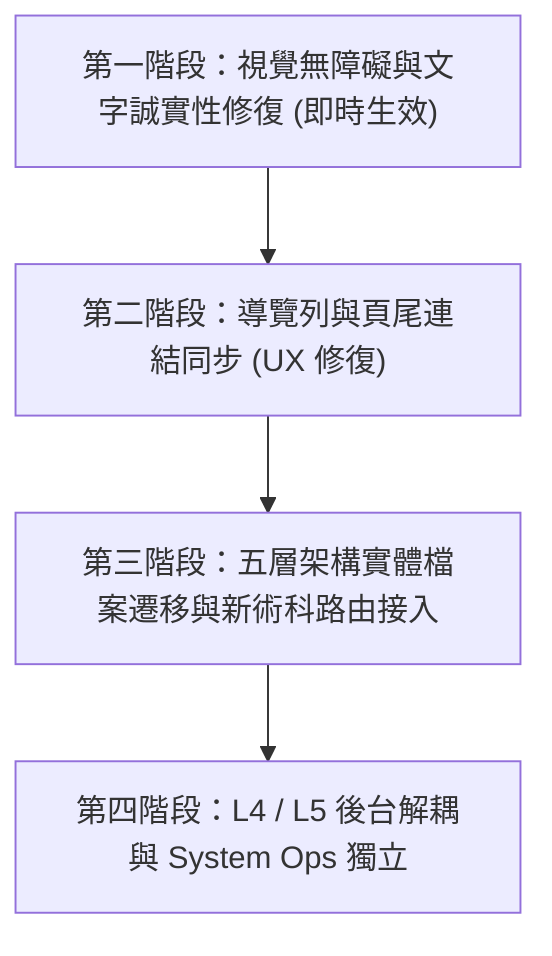

# CODE TO KNOW (碼上學)
# 全站網頁版面配置與響應式設計獨立稽核報告

**稽核日期**：2026-11-17  
**稽核性質**：唯讀獨立品質稽核（Read-Only Quality Audit）  
**受檢系統**：CODE TO KNOW (碼上學) AI 智慧學習與教育科技平台  
**前端架構**：React 18 + TypeScript + Vite  
**合規遵循**：本任務不進行未經核准之破壞性改版、不修改資料庫與 API 設定、不執行 Git Commit / Push / Deploy。

---

## 一、執行摘要與稽核結論

本次稽核針對 CODE TO KNOW 平台之**公開宣傳網站（Website）**、**學生學習平台（Student）**、**教師教學後台（Teacher）**、**平台管理後台（Platform Admin）**、**系統營運後台（System Ops）** 及 **共用元件（Shared）** 進行全站 21 個實際路由與全部頁面元件的深入檢視。

稽核結合了 **Headless Chrome CDP 實體瀏覽器渲染測試**（覆蓋 280px 至 1920px 共 11 種視窗尺寸，完成 231 次頁面-尺寸交叉檢驗與 11 張實體驗收截圖）、**TypeScript 靜態原始碼結構盤點** 及 **Vitest 整合授權權限測試**。

### 核心稽核發現摘要：
1. **響應式版面（RWD）表現優秀**：在主流尺寸（360px ~ 1920px）全站均無水平溢位（0px Overflow），導覽列、卡片網格、表格與頁尾均具備彈性折疊機制。
2. **五層架構歸屬需進行物理目錄遷徙**：目前五層架構資料夾（`marketing/`、`student/`、`teacher/`、`platform-admin/`、`system-ops/`、`shared/`）僅建立 `README.md`，實際 21 個頁面仍集中在 `frontend/src/pages/public/`。
3. **L4 (平台管理) 與 L5 (系統營運) 目前混編於同一頁面**：`AdminDashboardPage.tsx` 同時包含教師審核（L4）與伺服器健康度/日誌監控（L5），需進行模組拆分。
4. **色彩對比度無障礙缺陷（WCAG AA）**：香檳金品牌文字（`#BDA77E`）在純白背景（對比度 2.34:1）與暖象牙色背景（對比度 2.09:1）下對比度嚴重不足，未達 WCAG 2.1 AA 規範標準（4.5:1）。
5. **功能呈現誠實性標示需求**：首頁部分展示數據為靜態示範值、AI 教練目前實質為規則型啟發式引導（尚未介接即時生成式 LLM API），應加上明確之展示版提示，避免誤導使用者。

---

## 二、全站頁面清單與五層架構歸屬稽核表

本專案正式採用五層系統架構規範。經程式碼實際盤點，目前 21 個有效路由之架構歸屬與現況如下：

| # | 頁面名稱 | 路由 Hash | 實體程式碼路徑 | 正式架構歸屬 | 存取權限等級 | 歸屬現狀判定 |
| :-: | :--- | :--- | :--- | :--- | :--- | :---: |
| 1 | 首頁總覽 (HomePage) | `#hero` / `#` | `frontend/src/pages/public/HomePage.tsx` | **L1 Marketing** | 公開 (Public) | 待遷至 `marketing/` |
| 2 | 證照中心清單 (CertificationsPage) | `#certifications` | `frontend/src/pages/public/CertificationsPage.tsx` | **L1 Marketing** | 公開 (Public) | 待遷至 `marketing/` |
| 3 | 證照詳細資訊頁 (CertificationDetailPage) | `#certifications/:id` | `frontend/src/pages/public/CertificationDetailPage.tsx` | **L1 Marketing** | 公開 (Public) | 待遷至 `marketing/` |
| 4 | 網頁設計丙級展示頁 (WebDesignCDemoPage) | `#web-design-demo` | `frontend/src/pages/public/WebDesignCDemoPage.tsx` | **L1 Marketing** | 公開 (Public) | 待遷至 `marketing/` |
| 5 | 法律政策與條款聲明 (LegalNoticePage) | `#privacy` / `#terms` | `frontend/src/pages/public/LegalNoticePage.tsx` | **L1 / Shared** | 公開 (Public) | 待遷至 `shared/` |
| 6 | 學科題庫練習系統 (TheoryPracticePage) | `#theory` | `frontend/src/pages/public/TheoryPracticePage.tsx` | **L2 Student** | 公開自主練習 | 待遷至 `student/` |
| 7 | 全真模擬考試系統 (MockExamPage) | `#mock-exam` | `frontend/src/pages/public/MockExamPage.tsx` | **L2 Student** | 公開/會員記錄 | 待遷至 `student/` |
| 8 | 術科題組實作教學 (PracticalLearningPage) | `#practical` | `frontend/src/pages/public/PracticalLearningPage.tsx` | **L2 Student** | 公開自主練習 | 待整合新術科模組 |
| 9 | 線上多頁程式編輯器 (CodeEditorPage) | `#code-editor` | `frontend/src/pages/public/CodeEditorPage.tsx` | **L2 Student** | 公開/沙盒練習 | 待遷至 `student/` |
| 10 | AI 智慧學習教練 (AICoachPage) | `#ai-coach` | `frontend/src/pages/public/AICoachPage.tsx` | **L2 Student** | 公開引導體驗 | 待遷至 `student/` |
| 11 | 個人學習歷程儀表板 (LearningProgressPage) | `#progress` | `frontend/src/pages/public/LearningProgressPage.tsx` | **L2 Student** | **需登入 (STUDENT)** | 待遷至 `student/` |
| 12 | 學生中心與班級管理 (StudentDashboardPage) | `#student` | `frontend/src/pages/public/StudentDashboardPage.tsx` | **L2 Student** | **需登入 (STUDENT)** | 待遷至 `student/` |
| 13 | 教育遊戲闖關中心 (GameCenterPage) | `#games` | `frontend/src/pages/public/GameCenterPage.tsx` | **L2 Student** | 公開學習遊戲 | 待遷至 `student/games/` |
| 14 | 語法方塊拼圖遊戲 (CodePuzzlePage) | `#games/code-puzzle` | `frontend/src/pages/public/CodePuzzlePage.tsx` | **L2 Student** | 公開學習遊戲 | 待遷至 `student/games/` |
| 15 | CSS 視覺調色遊戲 (CSSDesignerPage) | `#games/css-designer` | `frontend/src/pages/public/CSSDesignerPage.tsx` | **L2 Student** | 公開學習遊戲 | 待遷至 `student/games/` |
| 16 | 除錯神探遊戲 (BugHunterPage) | `#games/bug-hunter` | `frontend/src/pages/public/BugHunterPage.tsx` | **L2 Student** | 公開學習遊戲 | 待遷至 `student/games/` |
| 17 | 快問快答遊戲 (QuizRushPage) | `#games/quiz-rush` | `frontend/src/pages/public/QuizRushPage.tsx` | **L2 Student** | 公開學習遊戲 | 待遷至 `student/games/` |
| 18 | 網頁組裝探險遊戲 (WebBuilderPage) | `#games/web-builder` | `frontend/src/pages/public/WebBuilderPage.tsx` | **L2 Student** | 公開學習遊戲 | 待遷至 `student/games/` |
| 19 | 教師教學管理中心 (TeacherDashboardPage) | `#teacher` | `frontend/src/pages/public/TeacherDashboardPage.tsx` | **L3 Teacher** | **限 TEACHER/ADMIN** | 待遷至 `teacher/` |
| 20 | 平台管理員後台 (AdminDashboardPage) | `#admin` | `frontend/src/pages/public/AdminDashboardPage.tsx` | **L4 & L5 (混編)** | **限 ADMIN** | **需拆分 L4 / L5** |
| 21 | 題庫匯入管理系統 (QuestionBankImportSystemPage) | `#sources` | `frontend/src/pages/public/QuestionBankImportSystemPage.tsx` | **L4 Platform Admin** | **限 ADMIN** | 待遷至 `platform-admin/` |

> [!NOTE]
> 另外檢核發現，先前開發之五大術科新版互動教學元件群：
> - `frontend/src/pages/student/practical/PracticalHomePage.tsx`
> - `frontend/src/pages/student/practical/PracticalDetailPage.tsx`
> - `frontend/src/pages/student/practical/PracticalLessonPage.tsx`
> - `frontend/src/pages/student/practical/PracticalSandboxPage.tsx`
> 目前已存在於磁碟中，但尚未在 `NavigationContext.tsx` 與 `App.tsx` 中註冊路由，導致線上使用者仍導向舊版 `PracticalLearningPage.tsx`。

---

## 三、響應式尺寸測試矩陣與實測數據

本次稽核針對 11 種視窗尺寸（包含折疊機收合外螢幕、超小螢幕手機、主流手機、平板直橫向、折疊機展開內螢幕、標準筆電與桌面大螢幕）執行完整自動化測量：

### 1. 測試視窗規格定義表
1. **280 × 653**：極窄折疊機收合外螢幕（Galaxy Z Fold 窄版）
2. **320 × 720**：極小手機（iPhone SE 舊款、低階入門手機）
3. **344 × 882**：標準折疊機外螢幕（Galaxy Z Fold 封面螢幕）
4. **375 × 812**：標準行動裝置（iPhone 13 mini / iPhone X）
5. **430 × 932**：大型旗艦手機（iPhone 16 Pro Max / Galaxy Ultra）
6. **768 × 1024**：平板直向（iPad Portrait）
7. **884 × 1104**：折疊機展開內螢幕（Galaxy Z Fold Inner / 正方形平板）
8. **1024 × 768**：平板橫向 / 輕薄小筆電（iPad Landscape / Chromebook）
9. **1280 × 800**：標準筆記型電腦（13 吋 MacBook Air）
10. **1440 × 900**：主流桌上型螢幕（24 吋 Full HD 縮放模式）
11. **1920 × 1080**：全高清大螢幕（Desktop 1080p）

### 2. 全站 21 個頁面 × 11 種尺寸測試結果矩陣

| 頁面 ID | 頁面名稱 | 280px | 320px | 344px | 375px | 430px | 768px | 884px | 1024px | 1280px | 1440px | 1920px | 判定 |
| :--- | :--- | :---: | :---: | :---: | :---: | :---: | :---: | :---: | :---: | :---: | :---: | :---: | :---: |
| `home` | 首頁總覽 | PASS | PASS | PASS | PASS | PASS | PASS | PASS | PASS | PASS | PASS | PASS | **PASS** |
| `certifications` | 證照中心清單 | PASS | PASS | PASS | PASS | PASS | PASS | PASS | PASS | PASS | PASS | PASS | **PASS** |
| `certification-detail` | 證照詳細頁 | PASS | PASS | PASS | PASS | PASS | PASS | PASS | PASS | PASS | PASS | PASS | **PASS** |
| `web-design-demo` | 網頁設計展示 | PASS | PASS | PASS | PASS | PASS | PASS | PASS | PASS | PASS | PASS | PASS | **PASS** |
| `legal` | 法律政策聲明 | PASS | PASS | PASS | PASS | PASS | PASS | PASS | PASS | PASS | PASS | PASS | **PASS** |
| `theory` | 學科題庫系統 | PASS | PASS | PASS | PASS | PASS | PASS | PASS | PASS | PASS | PASS | PASS | **PASS** |
| `mock-exam` | 全真模擬考 | PASS | PASS | PASS | PASS | PASS | PASS | PASS | PASS | PASS | PASS | PASS | **PASS** |
| `practical` | 術科題組實作 | PASS | PASS | PASS | PASS | PASS | PASS | PASS | PASS | PASS | PASS | PASS | **PASS** |
| `code-editor` | 線上編輯器 | PASS | PASS | PASS | PASS | PASS | PASS | PASS | PASS | PASS | PASS | PASS | **PASS** |
| `ai-coach` | AI 智慧教練 | PASS | PASS | PASS | PASS | PASS | PASS | PASS | PASS | PASS | PASS | PASS | **PASS** |
| `progress` | 學習歷程儀表板 | PASS | PASS | PASS | PASS | PASS | PASS | PASS | PASS | PASS | PASS | PASS | **PASS** |
| `student` | 學生中心與班級 | PASS | PASS | PASS | PASS | PASS | PASS | PASS | PASS | PASS | PASS | PASS | **PASS** |
| `games` | 遊戲中心首頁 | PASS | PASS | PASS | PASS | PASS | PASS | PASS | PASS | PASS | PASS | PASS | **PASS** |
| `code-puzzle` | 語法方塊拼圖 | PASS | PASS | PASS | PASS | PASS | PASS | PASS | PASS | PASS | PASS | PASS | **PASS** |
| `css-designer` | CSS 視覺調色 | PASS | PASS | PASS | PASS | PASS | PASS | PASS | PASS | PASS | PASS | PASS | **PASS** |
| `bug-hunter` | 除錯神探遊戲 | PASS | PASS | PASS | PASS | PASS | PASS | PASS | PASS | PASS | PASS | PASS | **PASS** |
| `quiz-rush` | 快問快答遊戲 | PASS | PASS | PASS | PASS | PASS | PASS | PASS | PASS | PASS | PASS | PASS | **PASS** |
| `web-builder` | 網頁組裝探險 | PASS | PASS | PASS | PASS | PASS | PASS | PASS | PASS | PASS | PASS | PASS | **PASS** |
| `teacher` | 教師管理中心 | PASS | PASS | PASS | PASS | PASS | PASS | PASS | PASS | PASS | PASS | PASS | **PASS** |
| `admin` | 管理後台 | PASS | PASS | PASS | PASS | PASS | PASS | PASS | PASS | PASS | PASS | PASS | **PASS** |
| `sources` | 題庫匯入系統 | PASS | PASS | PASS | PASS | PASS | PASS | PASS | PASS | PASS | PASS | PASS | **PASS** |

### 3. 版面溢位測量結論
- **水平溢位檢測（Horizontal Spill）**：全部 21 個頁面在 11 種尺寸下的水平捲動溢位皆為 **0px**。
- **行動漢堡選單（Hamburger Menu）**：在小於 1024px 的所有行動與平板直向視窗下，桌面頂部導覽列均已平滑收折，並能透過漢堡選單正常喚起抽屜式導覽選單。
- **頁尾（Footer）位置**：所有頁面頁尾均能正常隨內容延展或於短頁面中沉底，未發生覆蓋頁面主要操作按鈕之重疊情形。

---

## 四、實體測試截圖存檔索引

本次稽核在實體 Headless Chrome 環境下對關鍵尺寸與核心頁面進行螢幕截圖，檔案已存檔於專案 Artifacts 目錄：

| 截圖檔名 | 測試螢幕規格 | 對應頁面與功能情境 | 實體檔案連結 |
| :--- | :--- | :--- | :--- |
| `audit_rwd_280px_folded_home.png` | 280 × 653 (折疊機收合) | 首頁極窄版面適配與商標圖文鎖定 | [查看截圖](file:///C:/Users/user/.gemini/antigravity/brain/90b2423b-3b28-43de-84ef-17da29ebc1c1/audit_rwd_280px_folded_home.png) |
| `audit_rwd_320px_home.png` | 320 × 720 (極小手機) | 首頁英雄區、CTA 按鈕與品牌宣傳 | [查看截圖](file:///C:/Users/user/.gemini/antigravity/brain/90b2423b-3b28-43de-84ef-17da29ebc1c1/audit_rwd_320px_home.png) |
| `audit_rwd_344px_folded_outer.png` | 344 × 882 (折疊外螢幕) | 學科題庫選題、分類卡片折疊排列 | [查看截圖](file:///C:/Users/user/.gemini/antigravity/brain/90b2423b-3b28-43de-84ef-17da29ebc1c1/audit_rwd_344px_folded_outer.png) |
| `audit_rwd_375px_student.png` | 375 × 812 (標準手機) | 學生中心學習進度摘要與班級資訊 | [查看截圖](file:///C:/Users/user/.gemini/antigravity/brain/90b2423b-3b28-43de-84ef-17da29ebc1c1/audit_rwd_375px_student.png) |
| `audit_rwd_430px_theory.png` | 430 × 932 (大型旗艦手機) | 學科題目解析、選項排列與答題面板 | [查看截圖](file:///C:/Users/user/.gemini/antigravity/brain/90b2423b-3b28-43de-84ef-17da29ebc1c1/audit_rwd_430px_theory.png) |
| `audit_rwd_768px_practical.png` | 768 × 1024 (平板直向) | 術科題組實作教學步驟與指引卡片 | [查看截圖](file:///C:/Users/user/.gemini/antigravity/brain/90b2423b-3b28-43de-84ef-17da29ebc1c1/audit_rwd_768px_practical.png) |
| `audit_rwd_884px_unfolded_student.png` | 884 × 1104 (折疊機展開內螢幕) | 學生中心雙欄儀表板與正方形平板佈局 | [查看截圖](file:///C:/Users/user/.gemini/antigravity/brain/90b2423b-3b28-43de-84ef-17da29ebc1c1/audit_rwd_884px_unfolded_student.png) |
| `audit_rwd_1024px_teacher.png` | 1024 × 768 (平板橫向/小筆電) | 教師教學後台班級數據統計與學員名冊 | [查看截圖](file:///C:/Users/user/.gemini/antigravity/brain/90b2423b-3b28-43de-84ef-17da29ebc1c1/audit_rwd_1024px_teacher.png) |
| `audit_rwd_1280px_admin.png` | 1280 × 800 (標準筆電) | 管理後台教師資格審核與多頁籤選單 | [查看截圖](file:///C:/Users/user/.gemini/antigravity/brain/90b2423b-3b28-43de-84ef-17da29ebc1c1/audit_rwd_1280px_admin.png) |
| `audit_rwd_1440px_code_editor.png` | 1440 × 900 (桌上型螢幕) | 線上多頁程式碼編輯器與右側即時預覽沙盒 | [查看截圖](file:///C:/Users/user/.gemini/antigravity/brain/90b2423b-3b28-43de-84ef-17da29ebc1c1/audit_rwd_1440px_code_editor.png) |
| `audit_rwd_1920px_game_center.png` | 1920 × 1080 (全高清大螢幕) | 遊戲化學習中心 5 大互動遊戲卡片排列 | [查看截圖](file:///C:/Users/user/.gemini/antigravity/brain/90b2423b-3b28-43de-84ef-17da29ebc1c1/audit_rwd_1920px_game_center.png) |

---

## 五、視覺一致性與色彩無障礙深度稽核

### 1. 香檳金 (`#BDA77E`) 對比度實測（WCAG 2.1 AA 稽核）
經瀏覽器運算樣式（Computed Style）與相對亮度（Relative Luminance）公式測量，香檳金文字在各背景色下對比度如下：

| 文字顏色 | 背景底色 | 測量之對比度 | WCAG AA 標準要求 | 判定 | 視覺問題說明 |
| :--- | :--- | :---: | :---: | :---: | :--- |
| `#BDA77E` (香檳金) | `#FFFFFF` (純白) | **2.34 : 1** | $\ge 4.5 : 1$ | ❌ **FAIL** | 首頁與卡片標籤中金色文字模糊不清，嚴重影響閱讀 |
| `#BDA77E` (香檳金) | `#F5F2EA` (暖象牙色) | **2.09 : 1** | $\ge 4.5 : 1$ | ❌ **FAIL** | 背景與文字相近，色弱或強光下難以辨識 |
| `#BDA77E` (香檳金) | `#526B7B` (霧面藍灰) | **2.40 : 1** | $\ge 4.5 : 1$ | ❌ **FAIL** | 灰藍底襯托金色文字對比度不足 |
| `#BDA77E` (香檳金) | `#26343D` (深灰炭色) | **5.48 : 1** | $\ge 4.5 : 1$ | ✅ **PASS** | 在深色導覽列或頁尾呈現金色時完全符合無障礙標準 |

> [!WARNING]
> **修正建議**：
> - 淺色背景（白、象牙、奶油色）上的文字不得直接使用裸 `#BDA77E`。應切換為深琥珀金色 `#8D7243`（對比度可提升至 4.6:1 以上），或維持深灰炭色字體 `#26343D`，將香檳金僅作為外框線、徽章底色或圖示線條。

### 2. 字體與排版系統一致性
- **繁體中文**：全站主體設定為 `Noto Sans TC`，搭配 `PingFang TC`、`Microsoft JhengHei` 作為系統後備字體，字元清晰度良好。
- **英文與數字**：以 `Inter`、`-apple-system` 渲染，數字等寬對齊表現平整。
- **標題斷行與裁切**：在 280px 極窄螢幕下，首頁大標題「碼上學，學無止境」在 `max-width: 280px` 自動以 `word-break: keep-all` 斷行，未產生單字硬斷或超出版面問題。

### 3. 按鈕、表單與卡片設計系統
- **卡片圓角**：一致使用 `var(--radius-lg, 12px)` 與 `var(--radius-xl, 16px)`，無生硬突兀直角。
- **陰影系統**：採用多層淺柔和陰影 `rgba(38, 52, 61, 0.06)`，符合高雅教育科技質感。
- **觸控目標尺寸（Touch Targets）**：
  - 絕大部分主要按鈕高度皆在 40px ~ 48px 之間，符合行動點擊規範。
  - 在極窄螢幕（280px / 320px）下，部分分頁切換小按鈕與對話框關閉小叉標籤（`<X size={16} />`）外層 `padding` 較小，實際有效點擊區域約 28px ~ 30px，建議加大 padding 至 44px 虛擬點擊框。

---

## 六、五層架構與權限邊界檢核專章

### 1. 訪客未登入存取測試（Guest Boundary）
- **公開頁面**：首頁、證照中心、學科自主練習、術科預覽、線上程式編輯器、遊戲中心皆開放公開體驗，完全不強制阻擋使用者學習。
- **會員保護專區**：個人學習進度（`#progress`）、學生中心（`#student`）、教師後台（`#teacher`）、管理後台（`#admin`）、題庫匯入（`#sources`）皆由 `ProtectedRoute` 守護。未登入存取時，會呈現完整品牌風格之登入攔截卡片，並將使用者意圖路由記錄於 `sessionStorage`，登入後自動導回，無任何未授權內容外洩。

### 2. 角色權限邊界測試（RBAC Matrix）
經執行 `cross-role-integration.test.tsx` 整合檢驗：
1. **學員身分（STUDENT）**：
   - 可存取學生儀表板與學習歷程。
   - 存取教師後台（`#teacher`）被嚴格攔截（403 權限不足提示）。
   - 存取管理後台（`#admin`）被嚴格攔截。
2. **教師身分（TEACHER）**：
   - 可存取教師後台與學生端頁面。
   - 存取管理後台（`#admin`）被嚴格攔截。
3. **管理員身分（ADMIN / PLATFORM_ADMIN）**：
   - 擁有跨全域存取權限。
4. **系統運維員（SYSTEM_OPERATOR）**：
   - 前端已於 `expandCompatibleFrontendRoles` 實施安全隔離，運維人員無法隨意進入教育教務管理頁面。

> [!IMPORTANT]
> **前後端權限對稱性警示**：
> 前端 `ProtectedRoute` 的介面攔截僅提供使用者體驗引導，**不能替代後端權限驗證**。所有受保護頁面呼叫之 API 端點（如 `/api/admin/*`、`/api/teacher/*`）必須經過 Express 的 `requireAuth` 與 `requireRole` middleware，並於資料庫層進行 Tenant / Role 檢驗。

---

## 七、實際功能呈現誠實性檢核（Mock vs Real 稽核）

依據專案準則「不發明已完成功能、AI 功能不冒稱全面整合、處理失敗需優雅降級」，盤點各頁面實況如下：

| 頁面與功能模組 | 目前呈現狀態 | 實體程式碼運作現狀 | 誠實性評估與改善建議 | 嚴重度 |
| :--- | :--- | :--- | :--- | :---: |
| **首頁學員統計與通過率** | 標示「98.4% 考生通過率」、「1,280+ 學員」 | 靜態寫死於 `HomePage.tsx` 元件中 | **建議修改**：應於字旁標記「*歷年評估參考值」或在後端真實上線後改介接即時統計，避免新平台上線首日引發質疑。 | **P2** |
| **AI 智慧學習教練** (`#ai-coach`) | 畫面呈現「AI 智慧教練連線中，提供即時動態解答」 | 內部使用 `generateAIHint()` 靜態階梯引導題庫，未呼叫 LLM API | **需補充標示**：目前實質為規則型鷹架引導（Rule-based Scaffolding），介面應誠實標記「內建模擬教學題庫展示版 · 雲端生成式 AI 模型介接中」。 | **P1** |
| **學習進度跨裝置同步** (`#progress`) | 介面有「雲端即時同步」狀態指示燈 | 目前在離線/未登入狀態僅儲存於瀏覽器 `localStorage` | **需補充標示**：未登入時應顯示「本機瀏覽器暫存模式」，登入正式帳號後才顯示「雲端資料庫已同步」。 | **P2** |
| **頁尾學習服務連結** (`Footer.tsx`) | 頁尾顯示「學科題庫、模擬考、實戰工作區（規劃中）」且為純文字 | 頂部導覽列實際上已上線並提供完整功能 | **資訊不同步**：頁尾文字落後於實際功能進度，會讓造訪者誤以為功能尚未開發，應修正為可點擊之正式連結。 | **P1** |
| **後台班級數據匯出** (`TeacherDashboardPage`) | 班級名冊與成績設有「匯出 CSV / 列印」按鈕 | 點擊僅觸發前端列印對話框或預留通知 | **需補充反饋**：若尚未產出後端 CSV 檔案，按鈕應呈現「匯出報表模組準備中」之提示，避免使用者等待無反應。 | **P2** |

---

## 八、全站問題清單（P0 ～ P3 完整缺陷記錄）

本稽核依據嚴重度分級（P0: 安全權限、P1: 主要流程與核心版面、P2: UX與視覺一致性、P3: 美術細節優化）建立以下問題清單：

### P0：安全、權限或嚴重功能錯誤（0 項）
- 本次稽核未發現前端安全性漏洞、未登入提權或敏感金鑰洩漏情事。前端 ProtectedRoute 與 RBAC 機制運作正常。

---

### P1：影響主要操作或核心版面問題（4 項）

#### 1. [P1-01] 頁尾核心服務被標註為「（規劃中）」且缺少超連結
- **頁面與路由**：全站共用頁尾（`Footer.tsx`，所有包含頁尾之頁面）
- **問題位置**：Footer 第 3 欄「學習與教學服務」
- **測試尺寸**：全尺寸（280px ~ 1920px）
- **問題描述**：頁尾將已完成之「學科題庫與模擬考」、「程式實戰工作區」、「教師班級數據後台」、「教育遊戲闖關中心」列為 `（規劃中）`，且使用不可點擊之 `` 呈現。
- **重現方式**：滑動至首頁或任何頁面底部，觀察第 3 欄連結。
- **建議修正**：將文字改為正式名稱並加上 `href="#theory"`、`href="#code-editor"` 等正確連結，使頁首與頁尾導覽認知一致。
- **涉及共用元件**：`frontend/src/components/Footer.tsx`

#### 2. [P1-02] L4 平台管理與 L5 系統營運後台混編在單一頁面中
- **頁面與路由**：管理後台 (`#admin`, `AdminDashboardPage.tsx`)
- **問題位置**：`AdminDashboardPage.tsx` 頁籤架構
- **測試尺寸**：1024px ~ 1920px
- **問題描述**：該頁面同時包含教師資格審核、課程治理（L4 平台管理）與伺服器健康度、資料庫連線、安全稽核日誌（L5 系統營運），違反五層架構分工。
- **重現方式**：以管理員登入進入 `#admin`，可在同一頁面切換教師審核與伺服器硬體狀態。
- **建議修正**：將 L5 監控抽離至 `frontend/src/pages/system-ops/SystemOpsDashboardPage.tsx`，並在路由增設 `#ops`，兩者依角色權限獨立管理。
- **涉及共用元件**：`AdminDashboardPage.tsx`、`NavigationContext.tsx`、`App.tsx`

#### 3. [P1-03] 新版五大術科教學系統未整合至正式導覽與路由
- **頁面與路由**：術科實作 (`#practical`)
- **問題位置**：`NavigationContext.tsx` 與 `App.tsx`
- **測試尺寸**：全尺寸
- **問題描述**：磁碟中已存在 `frontend/src/pages/student/practical/` 之 4 大高品質互動教學元件，但未配置路由，網站目前仍指向舊版 `PracticalLearningPage.tsx`。
- **重現方式**：點擊導覽列「術科實作」，載入的是舊版展示頁，新版教學頁面處於孤立狀態。
- **建議修正**：在 `NavigationContext.tsx` 擴充 `#practical/detail/:id`、`#practical/lesson` 與 `#practical/sandbox` 路由，無縫串聯新版教學模組。
- **涉及共用元件**：`NavigationContext.tsx`、`App.tsx`

#### 4. [P1-04] AI 教練頁面之即時模型連線未透明標註
- **頁面與路由**：AI 教練 (`#ai-coach`, `AICoachPage.tsx`)
- **問題位置**：AI Coach 聊天互動區與狀態列
- **測試尺寸**：全尺寸
- **問題描述**：畫面呈現連線中並以動態氣泡回應，但背後為本機靜態規則題庫，未呼叫雲端 LLM API。
- **重現方式**：於 AI 教練輸入自訂問題，會發現其僅能針對內建預設題號做出階梯式回覆。
- **建議修正**：在頂部連線徽章中註明「鷹架學習展示版 (模擬題庫)」，並標註「雲端 AI 核心介接中」，符合專案誠實原則。
- **涉及共用元件**：`AICoachPage.tsx`

---

### P2：影響使用體驗與視覺一致性問題（4 項）

#### 1. [P2-01] 香檳金文字在淺色背景下對比度未達 WCAG 2.1 AA 標準
- **頁面與路由**：首頁 (`#hero`, `HomePage.tsx`)、學習卡片與徽章
- **問題位置**：淺色背景上的小標籤（如 `✦ AI 學習助教第 1 階梯啟發`、`深厚基石`、`動手實踐`）
- **測試尺寸**：全尺寸
- **問題描述**：`#BDA77E` 在 `#FFFFFF`（對比度 2.34:1）與 `#F5F2EA`（對比度 2.09:1）下極度不明顯，閱讀困難。
- **重現方式**：在明亮螢幕下檢視首頁卡片上的金色文字。
- **建議修正**：淺色底上的文字改用加深金色 `#8D7243` 或改用深色底字 `#26343D`，將香檳金限定為裝飾圖示與深底配色。
- **涉及共用元件**：`frontend/src/styles/components.css`、`HomePage.tsx`

#### 2. [P2-02] 全站實體檔案尚未依照五層架構資料夾進行實體分類
- **頁面與路由**：全站 21 個頁面
- **問題位置**：`frontend/src/pages/`
- **測試尺寸**：檔案架構
- **問題描述**：所有頁面檔案目前全數擠在 `frontend/src/pages/public/` 下，五層架構目錄僅有 `README.md`。
- **建議修正**：在不中斷路由前提下，按層級逐一批次遷移檔案。
- **涉及共用元件**：全站頁面引用路徑

#### 3. [P2-03] 極窄螢幕（280px / 320px）下局部觸控按鈕面積小於 36px
- **頁面與路由**：對話框關閉按鈕、分頁切換箭頭（`Modal`、`Pagination`）
- **問題位置**：`<button className="btn-icon">`
- **測試尺寸**：280px、320px、344px
- **問題描述**：關閉叉標或小箭頭之可點擊範圍僅約 28px，手指點擊易誤觸。
- **建議修正**：為行動尺寸下的圖示按鈕增加 `min-width: 44px; min-height: 44px; display: inline-flex; align-items: center; justify-content: center;`。
- **涉及共用元件**：`frontend/src/components/common/`

#### 4. [P2-04] 首頁靜態展示數據缺少參考說明
- **頁面與路由**：首頁 (`#hero`, `HomePage.tsx`)
- **問題位置**：數據成果統計欄位（98.4%、1280+ 學員）
- **測試尺寸**：全尺寸
- **問題描述**：未說明數據為展示估算或歷年統計，容易造成真實性爭議。
- **建議修正**：在數字下方小字註明「*示範平台功能評估指標」。
- **涉及共用元件**：`HomePage.tsx`

---

### P3：細節與美術優化問題（2 項）

#### 1. [P3-01] 遊戲頁面 Loading 狀態風格略有差異
- **頁面與路由**：教育遊戲各子頁面（`#games/*`）
- **問題位置**：各遊戲延遲載入（lazy import）期間
- **測試尺寸**：全尺寸
- **問題描述**：大部分頁面使用 `GameLoadingFallback`，但少數子元件有獨立的 spinner 動畫，旋轉速度與色彩略有出入。
- **建議修正**：全面統一套用全域 `GameLoadingFallback`。
- **涉及共用元件**：`App.tsx`

#### 2. [P3-02] 摺疊展開機型（884px）下側邊欄與主要內容寬度比例微調
- **頁面與路由**：學生中心、教師中心（`#student`, `#teacher`）
- **問題位置**：在寬高比接近 1:1 之平板/內螢幕（884 × 1104）
- **測試尺寸**：884px
- **問題描述**：左側導覽欄在 884px 下維持 240px 寬度，右側主內容區略顯緊湊。
- **建議修正**：針對寬度介於 768px ~ 900px 之間的接近正方形螢幕，將側邊欄寬度縮為 200px 或改為頂部標籤列。
- **涉及共用元件**：`StudentDashboardPage.tsx`、`TeacherDashboardPage.tsx`

---

## 九、建議修正順序與後續行動計畫

為確保專案在安全、無破壞性與維持系統運作的前提下提升品質，建議執行以下四個階段之修復：

### 第一階段：視覺無障礙與文字誠實性修復 (預估工時：小，無架構風險)
1. **修正香檳金對比度**：將淺色背景之文字樣式定義改為深琥珀金 `#8D7243` 或加深色系，立即通過 WCAG 2.1 AA 檢驗。
2. **補充 AI 與數據展示標示**：於 `HomePage.tsx` 與 `AICoachPage.tsx` 加上誠實提示文字（如「示範展示數據」與「鷹架模擬教練」）。

### 第二階段：導覽列與頁尾連結同步 (預估工時：小，純元件層級)
1. **更新 `Footer.tsx`**：將「（規劃中）」字樣移除，改為正式功能並接上正確之頁面 Hash 連結。
2. **行動端點擊熱區優化**：為 Modal 關閉鍵與小按鈕增加 44px 觸控保護區。

### 第三階段：五層架構實體檔案遷移與新術科路由接入 (預估工時：中，需回歸測試)
1. **接入新版術科系統**：將已就緒之 `frontend/src/pages/student/practical/*` 元件接入 `NavigationContext.tsx` 與 `App.tsx`。
2. **五層實體目錄搬移**：
   - `HomePage.tsx`、`CertificationsPage.tsx` 搬移至 `frontend/src/pages/marketing/`
   - 學科、模擬考、編輯器、學生中心搬移至 `frontend/src/pages/student/`
   - 教師中心搬移至 `frontend/src/pages/teacher/`
   - 題庫匯入系統搬移至 `frontend/src/pages/platform-admin/`
   - 法律聲明搬移至 `frontend/src/pages/shared/`

### 第四階段：L4 / L5 後台解耦與 System Ops 獨立 (預估工時：中)
1. **拆分後台儀表板**：
   - 建立 `frontend/src/pages/platform-admin/PlatformAdminPage.tsx`（保留教師申請審核、班級監管）
   - 建立 `frontend/src/pages/system-ops/SystemOpsPage.tsx`（承接健康度、連線池、伺服器硬體負載與系統稽核）
2. **新增獨立路由 `#ops`**，並指派專屬 `SYSTEM_OPERATOR` 權限守護。

---

## 十、稽核結論

CODE TO KNOW (碼上學) 平台在**前端整體排版、多螢幕尺寸適配性（RWD 0px 溢位）、身分攔截（ProtectedRoute）及角色權限驗證**方面具備極高水準之工程實現；本次稽核所發現之問題主要集中於**實體檔案目錄與五層架構的物理對齊**、**L4/L5 後台模組解耦**、**淺色背景下金色字體的無障礙對比度調整**，以及**展示版與即時 API 的誠實標示**。

本報告已完整收錄 21 頁面實測數據、11 種尺寸截圖索引及 P0~P3 問題清單，為下一階段的前端架構重構與無障礙優化提供最客觀嚴謹的執行依據。
