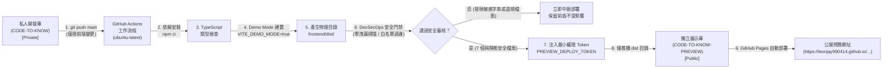

# CODE TO KNOW｜GitHub Pages 個人預覽網站完整設定指引手冊

**文件編號**：`docs/GITHUB_PAGES_PREVIEW_SETUP_GUIDE.md`  
**適用專案**：碼上學｜CODE TO KNOW  
**原始專案**：`Leonjay990414/CODE-TO-KNOW`（永久維持 **Private**）  
**公開預覽**：`Leonjay990414/CODE-TO-KNOW-PREVIEW`（預計公開，僅發布純前端靜態產物）  
**預覽網址**：`https://leonjay990414.github.io/CODE-TO-KNOW-PREVIEW/`  
**安全等級**：最高機密隔離（DevSecOps 最小權限架構）

---

## 一、架構說明與安全防護邊界

### 關鍵安全隔離原則
1. **原始庫絕對保密**：`Leonjay990414/CODE-TO-KNOW` 永不轉為公開，且 GitHub Actions 僅具有 `contents: read` 權限。
2. **非前端更新不觸發**：修改 `backend/`、`prisma/`、`docs/`、`scripts/` 或內部資料庫文件時，自動略過發布流程，避免不必要的建置。
3. **實體內容徹底隔絕**：後端程式碼、資料庫模型、Prisma Migration、個人文件、照片與 `.env` 設定檔永遠不出現在展示庫中。
4. **Token 最小權限化**：部署專用 Token 僅限定存取 `CODE-TO-KNOW-PREVIEW` 單一庫的 `Contents: Read and write`，無權存取原始庫或其他專案。

---

## 二、步驟一：建立獨立展示 Repository

> [!IMPORTANT]
> 此步驟必須由您在 GitHub 官方網頁操作，AI 不得代為建立。

1. 開啟瀏覽器登入 GitHub，前往建立新 Repository 頁面：  
   `https://github.com/new`
2. 設定專案資訊：
   - **Repository name**：`CODE-TO-KNOW-PREVIEW`
   - **Description**：`CODE TO KNOW (碼上學) 前端展示預覽版`
   - **Public / Private**：選擇 **Public**（供 GitHub Pages 免費公開展示）。
   - **Initialize this repository with**：勾選 **Add a README file**（建議勾選，以自動初始化預設分支）。
3. 點擊綠色按鈕 **Create repository** 完成建立。

---

## 三、步驟二：啟用展示庫 GitHub Pages 服務

1. 進入新建的展示 Repository 設定頁面：  
   `https://github.com/Leonjay990414/CODE-TO-KNOW-PREVIEW/settings/pages`
2. 在 **Build and deployment** 區塊：
   - **Source**：選擇 **Deploy from a branch**。
   - **Branch**：若首次建立尚未有 `gh-pages` 分支，可暫時選擇 `main` / `/ (root)`，後續首次自動化發布完成後，GitHub Actions 會自動建立並推送 `gh-pages` 分支，屆時再切換為 `gh-pages` / `/ (root)`。
3. 點擊 **Save**。

---

## 四、步驟三：產生最小權限部署 Token (Fine-grained PAT)

> [!CAUTION]
> **絕對安全守則**：
> 1. 請勿將 Token 貼在聊天視窗、Antigravity 對話框、Issue 或程式碼中。
> 2. 請務必選擇「Only select repositories」，絕對不要選擇「All repositories」！

1. 開啟 GitHub 個人設定中的 Fine-grained tokens 頁面：  
   `https://github.com/settings/personal-access-tokens/new`
2. 填寫 Token 設定：
   - **Token name**：`CODE_TO_KNOW_PREVIEW_DEPLOY_TOKEN`
   - **Expiration**：建議選擇 `90 days`（或依需要設定，到期前 GitHub 會發信提醒重新整理）。
   - **Description**：`用於 CODE-TO-KNOW 私人庫自動部署至 CODE-TO-KNOW-PREVIEW 展示庫`
   - **Resource owner**：確認為 `Leonjay990414`
3. **Repository access（關鍵步驟）**：
   - 勾選 **Only select repositories**。
   - 在下拉清單中搜尋並選擇：`Leonjay990414/CODE-TO-KNOW-PREVIEW`
   - （請再三確認清單中**只有**展示庫，沒有私人開發庫！）
4. **Permissions（權限設定）**：
   - 展開 **Repository permissions**。
   - 找到 **Contents**，將權限設為 **Access: Read and write**。
   - 其餘所有權限（Actions、Issues、Pull requests、Secrets 等）維持 **No access**。
5. 點擊最下方綠色按鈕 **Generate token**。
6. 頁面將顯示產生的 Token（格式通常為 `github_pat_...`），請立即點擊複製並暫存於本機安全位置（離開頁面後將無法再次查看）。

---

## 五、步驟四：在原始私人庫設定 Actions Secret

1. 前往原始私人 Repository 的 Secrets 設定頁面：  
   `https://github.com/Leonjay990414/CODE-TO-KNOW/settings/secrets/actions`
2. 點擊右上角 **New repository secret**。
3. 填入以下資訊：
   - **Name**：`PREVIEW_DEPLOY_TOKEN`（必須完全一致，大小寫相符）
   - **Secret**：貼上在步驟三複製的 Fine-grained PAT。
4. 點擊 **Add secret** 完成儲存。

---

## 六、步驟五：觸發首次自動化發布與驗收

完成上述一至四步後，即可測試自動化流程：

### 方式 A：手動觸發測試（推薦初次驗收）
1. 前往私人庫 Actions 頁面：  
   `https://github.com/Leonjay990414/CODE-TO-KNOW/actions/workflows/deploy-preview.yml`
2. 點擊右側 **Run workflow** 下拉按鈕，確認分支為 `main`，點擊綠色 **Run workflow**。
3. 觀察 8 個執行階段（Checkout → Setup Node → npm ci → tsc → Build Demo → Verify → DevSecOps Audit → Deploy）。
4. 全綠通過後，檢查展示庫 `CODE-TO-KNOW-PREVIEW` 是否產生 `gh-pages` 分支。

### 方式 B：程式碼推送觸發
只要對 `frontend/**` 進行修改並推送至 `main` 分支，GitHub Actions 將於 10 秒內自動啟動建置與同步。

---

## 七、步驟六：驗證公開展示網站

部署完成後，開啟預覽網站：  
`https://leonjay990414.github.io/CODE-TO-KNOW-PREVIEW/`

### 驗收檢查清單
- [ ] 頁面標題正確顯示「碼上學｜CODE TO KNOW」。
- [ ] Logo 正常載入，右側顯示精緻金色「DEMO」徽章。
- [ ] 10 大公開頁面（證照中心、學科刷題、全真模考、術科工作區、沙盒編輯器、AI教練等）無障礙切換。
- [ ] 重新整理子頁面（例如 `/#mock-exam`）無 404 錯誤。
- [ ] 存取受保護專區（例如 `/#progress` 或 `/#teacher`）時，清楚顯示展示模式說明，並可一鍵以示範學員／教師身分進入體驗。
- [ ] 開啟認證對話框時，提示「公開展示模式，請勿輸入真實密碼」，並支援一鍵模擬登入。
- [ ] 行動裝置與桌面端版面皆自適應流暢，無橫向滾動溢出。

---

## 八、維護、暫停與撤銷指引

### 1. 暫停自動同步
- 前往 `https://github.com/Leonjay990414/CODE-TO-KNOW/actions/workflows/deploy-preview.yml`
- 點擊右上角 `...` 選單，選擇 **Disable workflow** 即可隨時暫停。

### 2. 撤銷部署權限
- 前往 `https://github.com/settings/personal-access-tokens`
- 找到 `CODE_TO_KNOW_PREVIEW_DEPLOY_TOKEN`，點擊 **Delete** 即可永久作廢該 Token。

### 3. 完全移除展示網站
- 前往 `https://github.com/Leonjay990414/CODE-TO-KNOW-PREVIEW/settings`
- 最下方 Danger Zone 選擇 **Delete this repository**，即可完全下線公開展示網站，對原始私人專案無任何影響。
