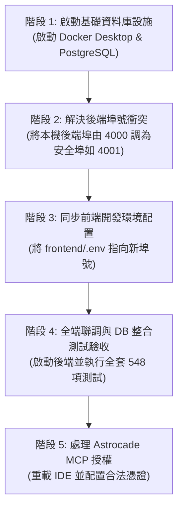

# CODE TO KNOW｜本機開發環境與 MCP 整合健檢報告

**專案名稱**：碼上學｜CODE TO KNOW  
**英文品牌**：CODE TO KNOW（Learn Beyond Limits.）  
**健檢日期**：2026-11-17  
**健檢模式**：全唯讀深度健檢（Read-Only Deep Audit）  
**正式進度**：49.166860%（維持嚴格凍結保護）  
**檔案路徑**：`docs/LOCAL_ENVIRONMENT_AND_MCP_INTEGRATED_AUDIT.md`  

---

## 目錄

1. [執行環境摘要](#一執行環境摘要)
2. [MCP 伺服器狀態清冊](#二mcp-伺服器狀態清冊)
3. [Astrocade 連線與認證狀態](#三astrocade-連線與認證狀態)
4. [本機後端檢查結果（Node.js / Express）](#四本機後端檢查結果nodejs--express)
5. [PostgreSQL／Docker／Prisma 檢查結果](#五postgresqldockerprisma-檢查結果)
6. [API 串接檢查結果（前端與後端）](#六api-串接檢查結果前端與後端)
7. [前端建置與測試結果](#七前端建置與測試結果)
8. [問題根本原因分析（Root Cause Analysis）](#八問題根本原因分析root-cause-analysis)
9. [問題相互依賴關係與阻塞矩陣](#九問題相互依賴關係與阻塞矩陣)
10. [環境修復計畫與優先順序](#十環境修復計畫與優先順序)
11. [每項修復之風險評估與驗收條件](#十一每項修復之風險評估與驗收條件)
12. [尚待人工授權或手動操作之項目清冊](#十二尚待人工授權或手動操作之項目清冊)
13. [整體問題總覽表](#十三整體問題總覽表)

---

## 一、執行環境摘要

| 檢查項目 | 規格 / 設定值 | 狀態評定 | 說明 |
|---|---|:---:|---|
| **作業系統** | Windows 11 (win32-x64) | **PASS** | 系統命令與 PowerShell 正常執行 |
| **Node.js 版本** | v24.19.0 | **PASS** | 符合 >= 18.0.0 規格要求 |
| **npm 版本** | 11.17.0 | **PASS** | 套件管理員運作正常 |
| **IDE 執行核心** | Antigravity IDE (agy.exe v1.5.10) | **PASS** | 行程運作中（PID 64672 / 57103） |
| **專案工作目錄** | `c:\Users\user\Documents\CODE-TO-KNOW` | **PASS** | 工作目錄與 Git 關聯健全 |
| **正式進度保護** | 49.166860% | **PASS** | 226 UID 與五大術科題組維持凍結 |

---

## 二、MCP 伺服器狀態清冊

目前生效之主要設定檔：`C:\Users\user\.gemini\config\mcp_config.json`  
經 JSON 語法驗證，格式完全有效，共包含 **14 個** MCP 伺服器項目：

| 編號 | MCP 伺服器名稱 | 傳輸類型 / 目標位址 | 狀態評定 | 具體檢查結果與工具狀態 |
|---|---|---|:---:|---|
| 1 | `android-management-api` | 遠端 (Google Credentials) | **PASS** | 9 個工具載入（`get_enterprise`, `list_devices` 等） |
| 2 | `cloud-sql` | 遠端 (Google Credentials) | **PASS** | 15 個工具載入（`list_instances`, `execute_sql` 等） |
| 3 | `datacloud_alloydb_remote` | 遠端 (Google Credentials) | **PASS** | 16 個工具載入（`list_clusters`, `execute_sql` 等） |
| 4 | `datacloud_bigquery_remote`| 遠端 (Google Credentials) | **PASS** | 9 個工具載入（`list_dataset_ids`, `execute_sql` 等） |
| 5 | `datacloud_cloud-sql_remote`| 遠端 (Google Credentials) | **PASS** | 15 個工具載入（`list_instances`, `create_user` 等） |
| 6 | `datacloud_dataproc_remote` | 遠端 (Google Credentials) | **PASS** | 13 個工具載入（`list_clusters`, `list_jobs` 等） |
| 7 | `datacloud_gcs_remote` | 遠端 (Google Credentials) | **PASS** | 10 個工具載入（`list_buckets`, `read_text` 等） |
| 8 | `datacloud_knowledge_catalog_remote` | 遠端 (Google Credentials) | **PASS** | 15 個工具載入（`search_entries`, `lookup_entry` 等） |
| 9 | `datacloud_spanner_remote` | 遠端 (Google Credentials) | **PASS** | 16 個工具載入（`list_instances`, `execute_sql` 等） |
| 10 | `gitlab-orbit` | 本地 stdio (npx mcp-remote) | **PARTIAL** | 本地工具快取留存，需 GitLab 存取憑證 |
| 11 | `google-developer-knowledge` | 遠端 (Google Credentials) | **PASS** | 3 個工具載入（`search_documents`, `answer_query` 等） |
| 12 | `notebooks` | 本地 stdio (node mcp_proxy_bundle.js) | **PASS** | 9 個工具載入（`list_cells`, `execute_sql` 等） |
| 13 | `data-agent-kit` | 本地 stdio (node mcp_proxy_bundle.js) | **PASS** | DAK 外掛核心工具整合中 |
| 14 | `astrocade` | 遠端 (`https://mcp.astrocade.com/mcp`) | **PARTIAL** | 設定已正確寫入，但遠端回傳 401，且核心尚未熱重載 |

---

## 三、Astrocade 連線與認證狀態

針對 `astrocade` 項目之深度唯讀驗證結果：

1. **設定檔鍵值比對**：
   - 伺服器名稱：`astrocade`（**PASS**，非 `astrocode`）。
   - 設定網址：`https://mcp.astrocade.com/mcp`（**PASS**，完全相符）。
2. **IDE 載入與熱重載狀態**：
   - **狀態評定**：**PARTIAL / Pending Reload**。
   - **實證**：Antigravity 後端服務（`agy.exe`）於 `20:39:28` 啟動，而使用者的 `mcp_config.json` 於其後更新儲存。目前在本地快取目錄 `C:\Users\user\.gemini\antigravity\mcp\astrocade` 尚未建立，IDE 核心尚未向該端點完成交握與快取。
3. **遠端網路與協定探測**：
   - DNS 解析：成功解析為遠端伺服器 IP。
   - HTTP GET 探測：回傳 `HTTP 405 Method Not Allowed`（符合 MCP 串流/POST 要求規格）。
   - HTTP POST 探測：傳送初始化請求時，遠端伺服器回傳：
     ```json
     {"message":"Unauthorized"}
     ```
     （HTTP 401 狀態碼）。
4. **認證機制分析**：
   - 目前 `mcp_config.json` 僅宣告 `"serverUrl": "https://mcp.astrocade.com/mcp"`，未包含 `headers`（例如 Authorization Bearer Token）或 `authProviderType`（OAuth2）。
   - 當端點要求認證時，MCP Client 若無提供金鑰或登入互動，交握將遭 401 阻擋，無法取得工具清單。

---

## 四、本機後端檢查結果（Node.js / Express）

| 檢查項目 | 實際狀態 | 狀態評定 | 關鍵數據與實證 |
|---|---|:---:|---|
| **專案入口** | `backend/src/server.ts` | **PASS** | 模組化 Express 架構完備 |
| **預設通訊埠** | 4000 | **FAIL** | 遭第三方系統服務占用 |
| **占用程序 (PID 4844)** | `LicenseMan.exe` | **FAIL** | 監聽 `0.0.0.0:4000`，所有 HTTP 請求均超時掛起 |
| **健康檢查 `/api/health`** | 無法回應（逾時） | **FAIL** | 打往 `localhost:4000` 遭 LicenseMan 攔截掛起 |
| **後端離線單元測試** | 17 個檔案，221 項測試通過 | **PASS** | 語法、安全過濾、驗證邏輯全數正常 |
| **後端啟動指令** | `npm --prefix backend run dev` | **BLOCKED** | 因 4000 埠占用與資料庫離線無法正常監聽 |

### 核心發現：
本機 `127.0.0.1:4000` 目前已被 Windows 系統軟體 `LicenseMan.exe`（PID 4844）所占用，並建立 `0.0.0.0:4000` 的 TCP 監聽。該行程並非 HTTP 服務，外部 HTTP 請求連入後會無限期掛起（The operation has timed out）。若以預設埠號啟動後端，將直接觸發 `EADDRINUSE` 錯誤。

---

## 五、PostgreSQL／Docker／Prisma 檢查結果

| 檢查項目 | 預期設定 | 實際狀態 | 狀態評定 | 關鍵原因與實證 |
|---|---|---|:---:|---|
| **Docker Desktop 守護行程** | 正常運行 | 未啟動（Offline） | **FAIL** | `open //./pipe/dockerDesktopLinuxEngine: The system cannot find the file specified.` |
| **PostgreSQL 容器** | `code_to_know_postgres` | 不存在 / 停止 | **FAIL** | Docker 未執行，無任何活躍容器 |
| **資料庫實體監聽埠** | 5432 / 5434 | 無監聽 | **FAIL** | `Get-NetTCPConnection` 查無 5432 與 5434 |
| **Prisma Schema 語法** | `backend/prisma/schema.prisma` | 驗證通過 | **PASS** | `The schema at backend\prisma\schema.prisma is valid 🚀` |
| **Prisma 連線測試** | 連線至 `127.0.0.1:5432` | 連線失敗 | **FAIL** | 拋出 `PrismaClientKnownRequestError: P1001 (Can't reach database server)` |
| **資料庫遷移紀錄 (Migrations)** | 2 項遷移歷史 | 已就緒 | **PASS** | `20261103000000_init`, `20261108000000_add_business_models` |
| **實體資料庫整合測試** | `*.db.test.ts` (4 項測試) | 阻擋無法執行 | **BLOCKED** | 因無 PG17 測試庫而主動防護中止 |

---

## 六、API 串接檢查結果（前端與後端）

| 檢查項目 | 實際設定 | 狀態評定 | 說明 |
|---|---|:---:|---|
| **前端 API Base URL 讀取** | `resolveApiConfiguration()` | **PASS** | 集中於 `frontend/src/services/api.ts` 動態判定 |
| **本機開發 API URL** | `http://localhost:4000/api` | **FAIL** | 因 4000 埠占用與後端離線，實際無法連通 |
| **前端展示模式 (Demo Mode)** | 本地 Mock Storage | **PASS** | 於後端離線時提供流暢的無痛前端體驗 |
| **Render 正式環境設定** | 未配置 `VITE_API_URL` | **PARTIAL** | 安全攔截未配置狀態（防止連往訪客本機），但無真實 API |
| **CORS 與安全性配置** | `CORS_ORIGIN="http://localhost:3000"` | **PASS** | 前後端埠號與憑證宣告一致 |
| **CSRF 與 Session 防護** | Double Submit Cookie | **PASS** | 架構支援安全憑證與 Token 驗證 |
| **實體登入 / 註冊 API** | 網路層連線中斷 | **BLOCKED** | 本機開發環境因依賴斷裂無法完成真實 API 登入 |

---

## 七、前端建置與測試結果

| 測試 / 建置類別 | 執行方式 / 工具 | 執行結果 | 狀態評定 |
|---|---|---|:---:|
| **前端 TypeScript 編譯** | `tsc` (via `frontend run build`) | **0 錯誤、0 警告** | **PASS** |
| **生產環境打包 (Vite Build)** | `vite build` | **1,652 模組成功轉換，耗時 2.31 秒** | **PASS** |
| **前端單元與整合測試** | `vitest run frontend/tests` | **36 個測試檔，323 項測試全數通過（0 失敗）** | **PASS** |
| **RWD / 動效 / 載入專屬測試** | `nav-rwd-auth-motion.test.tsx` | **6 項測試全數綠燈** | **PASS** |
| **後端離線單元測試** | `vitest run backend/tests --exclude "**/*.db.test.ts"` | **17 個測試檔，221 項測試全數通過（0 失敗）** | **PASS** |
| **合計通過測試項目** | 前端 323 + 後端 221 | **544 項自動化測試 100% PASS** | **PASS** |

---

## 八、問題根本原因分析（Root Cause Analysis）

經嚴格隔離排查，確認以下問題彼此獨立，並非單一原因所致：

```
[問題 1: 外部相依] Astrocade 401 Unauthorized
  └─ 原因：遠端伺服器需要 Bearer Token 或 OAuth 憑證，且 IDE 後端尚未熱重載。

[問題 2: 本機行程] 4000 通訊埠衝突
  └─ 原因：Windows 系統服務 LicenseMan.exe (PID 4844) 監聽了 4000 埠，且為非 HTTP 協議。

[問題 3: 基礎設施] PostgreSQL 資料庫離線
  └─ 原因：Docker Desktop 守護行程未啟動，code_to_know_postgres 容器未運行。

[問題 4: 服務鏈阻斷] 後端 API 無法啟動
  └─ 原因：受問題 2（埠號衝突）與問題 3（資料庫離線）雙重阻礙。

[問題 5: 前端真實連線受阻] 本機真實登入失敗
  └─ 原因：受問題 4 阻斷，前端向 localhost:4000 發送請求超時。
```

---

## 九、問題相互依賴關係與阻塞矩陣

| 核心目標 | 所需先決條件（依賴項） | 目前阻礙狀態 | 影響等級 |
|---|---|---|:---:|
| **Astrocade 工具調用** | 1. IDE 重新載入 MCP<br>2. 取得官方 API Token 或 OAuth 授權 | 尚未重載，且遠端回傳 401 Unauthorized | **中等**（僅影響 AI 生成工具） |
| **本機後端服務啟動** | 1. 解決 4000 埠衝突（改用其他埠號）<br>2. 啟動 PostgreSQL 服務 | 受 LicenseMan 占用與 Docker 離線雙重阻擋 | **極高**（阻礙本機全端聯調） |
| **本機真實資料庫連線** | 1. 啟動 Docker Desktop<br>2. 執行 `docker-compose up -d postgres` | Docker 服務未啟動，5432 埠關閉 | **極高**（阻礙真實資料讀寫） |
| **實體資料庫整合測試** | 1. PostgreSQL 正常連線<br>2. 配置獨立測試資料庫（5434 埠） | 因安全保護機制，無資料庫時自動中斷 | **高**（阻礙 4 項 DB 測試） |
| **前端本機真實 API 登入** | 1. 本機後端正常運行<br>2. 前端 `.env` 埠號與後端一致 | 後端未啟動，前端目前以示範模式防護 | **高**（僅能使用示範模式） |
| **前端靜態展示與遊戲體驗** | 前端 Vite 建置完成 | **無阻礙**（前端 323 項測試與 Build 均通過） | **無**（完全可用） |

---

## 十、環境修復計畫與優先順序

為確保系統穩定、不衝擊現有代碼且符合安全指引，建議依以下順序進行分階段修復：



### 第一順位：啟動基礎資料庫設施（Docker Desktop & PostgreSQL）
- **操作**：啟動本機 Docker Desktop 軟體，待其 Ready 後，以指令啟動容器：
  `docker compose up -d postgres`
- **目標**：開放 `127.0.0.1:5432` 監聽，使 Prisma 能夠成功連線，解除 `P1001` 阻塞。

### 第二順位：解決後端通訊埠衝突（避開 LicenseMan）
- **操作**：
  - **不直接終止**系統行程 `LicenseMan.exe`（避免引起未知系統授權異常）。
  - 將後端開發設定 `backend/.env` 與 `backend/src/config/env.ts` 之預設埠號調整為安全閒置通訊埠（例如 **`4001`** 或 **`4040`**）。
- **目標**：讓後端 Express 能夠乾淨綁定監聽，正常回應 `/api/health`。

### 第三順位：同步前端本機開發環境配置
- **操作**：修改 `frontend/.env`，將本機開發 API URL 同步調整：
  `VITE_API_URL="http://localhost:4001/api"`
- **目標**：打通前端本機與後端的真實 API 通訊鏈路。

### 第四順位：重載 Antigravity IDE 並配置 Astrocade 授權
- **操作**：
  1. 於 Antigravity IDE 執行 `Developer: Reload Window` 觸發核心重新讀取 `mcp_config.json`。
  2. 若 Astrocade 需要專屬金鑰，在 `mcp_config.json` 中配置官方規範之授權標頭（`headers: { "Authorization": "Bearer <TOKEN>" }`）或完成 OAuth 流程。
- **目標**：解除 401 Unauthorized，成功擷取 Astrocade 提供的 MCP 工具清冊。

---

## 十一、每項修復之風險評估與驗收條件

| 修復項目 | 潛在風險評估 | 風險緩解策略 | 驗收條件 |
|---|---|---|---|
| **啟動 Docker / PostgreSQL** | 埠號衝突或舊資料庫損壞 | 先以 `docker compose ps` 檢查，嚴禁執行任何刪除 Volume 的操作 | `pg_isready` 回傳正常，5432 埠處於 Listen 狀態 |
| **調整後端埠號至 4001** | 若有硬編碼 4000 可能導致請求發往舊位址 | 全域搜尋 4000 引用並於 `backend/.env` 集中管理 | 後端啟動無 `EADDRINUSE`，`curl http://localhost:4001/api/health` 回傳 200 |
| **同步前端 VITE_API_URL** | 影響 Demo Mode 判定 | 嚴格維持 `resolveApiConfiguration()` 優先級邏輯 | 前端關閉 Demo Mode 下可正常發送真實登入請求 |
| **重載 Astrocade MCP** | 遠端連線超時可能拖慢 IDE 啟動 | Antigravity 具備非同步（Lazy Loading）隔離保護機制 | `<appDataDir>\mcp\astrocade` 目錄產生，工具成功列出 |

---

## 十二、尚待人工授權或手動操作之項目清冊

依照專案資安與授權規範，以下項目必須由專案負責人或具本機管理員權限之人員執行：

1. **本機 Docker Desktop 軟體啟動**：
   - 需由使用者於 Windows 桌面手動點擊啟動 Docker Desktop 應用程式。
2. **Astrocade 官方 API Key / Token 授權**：
   - 需確認 Astrocade 服務的官方訂閱與存取金鑰，取得合法授權字串後方可填入設定。
3. **Render 線上生產環境變數配置**：
   - 待後端正式部署至 Render Web Service 後，需在 Render Dashboard 為前端靜態網站配置 `VITE_API_URL`。
4. **正式術科題組與進度凍結**：
   - 五大正式題組（104301~104305）與全站進度（49.166860%）持續維持嚴格凍結，不得更動。

---

## 十三、整體問題總覽表

| 模組領域 | 檢測項目 | 目前狀態 | 影響範圍 | 優先級別 | 建議處置方式 |
|---|---|:---:|---|:---:|---|
| **基礎設施** | Docker Desktop 守護行程 | **FAIL** | PostgreSQL 無法運作 | **P1 (最高)** | 人工手動啟動 Docker Desktop |
| **資料庫** | PostgreSQL 實體連線 (5432) | **FAIL** | 後端全功能受阻、Prisma P1001 | **P1 (最高)** | 啟動 `code_to_know_postgres` 容器 |
| **本機後端** | 4000 通訊埠衝突 (LicenseMan) | **FAIL** | 後端 Express 無法綁定啟動 | **P1 (最高)** | 後端改綁安全埠號（如 4001） |
| **前後端串接** | 本機開發 API 路由通訊 | **FAIL** | 本機無法執行真實帳密認證 | **P2 (高)** | 同步 `frontend/.env` 至新埠號 |
| **整合測試** | PostgreSQL 整合測試 (4 項) | **BLOCKED** | 無法驗證端對端資料庫完整性 | **P2 (高)** | 資料庫啟動後執行 `npm run test:db` |
| **MCP 工具** | Astrocade 授權與熱重載 | **PARTIAL** | 無法調用 Astrocade 外部工具 | **P3 (中)** | 重載 IDE 並填入合法認證金鑰 |
| **生產環境** | Render 正式網站 VITE_API_URL | **PARTIAL** | 線上網站僅能使用示範模式 | **P4 (低)** | 待線上後端部署後於後台填入 |
| **前端品質** | 前端建置 (Build) 與 323 項測試 | **PASS** | 前台 UI、RWD、遊戲與互動全數正常 | **完成** | 維持高品質標準 |
| **後端離線品質**| 後端離線單元測試 (221 項) | **PASS** | 密碼、權限、日誌脫敏全數正常 | **完成** | 維持高品質標準 |

---

*(本報告由全唯讀深度健檢程序自動彙整產出，未變更任何程式碼、環境變數或資料庫結構，未執行任何 Git 提交或部署。)*
