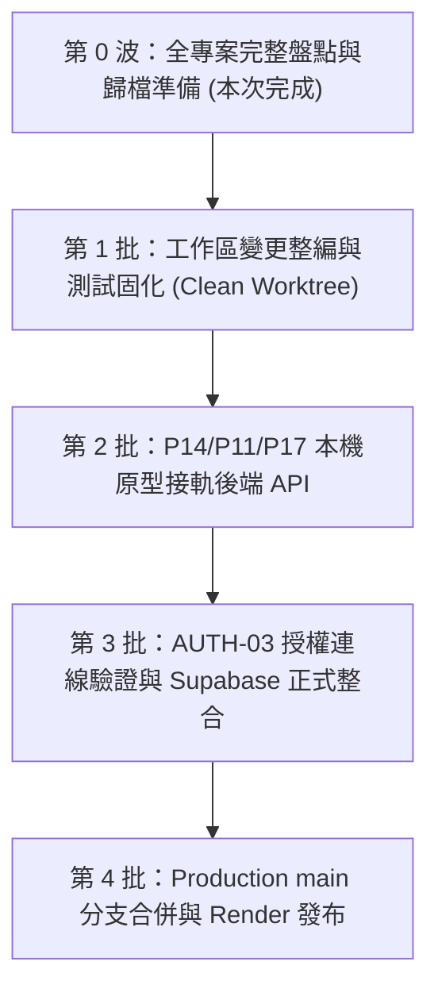

# CODE TO KNOW｜20 階段重新歸檔與執行藍圖 (Master 20-Phase Reorganization Plan)

版本：MASTER-20PHASE-PLAN-20261118  
專案：碼上學｜CODE TO KNOW (AI 智慧學習與教育科技平台)  
權威基準：`docs/PROJECT_20_PHASE_UNIQUE_WORK_ITEMS_20261113.md` (20 階段、226 個 UID，總權重 100.0%)  
原則：嚴禁新增、刪除、更名或變更階段順序；完整收整歷史「波次（Wave）」至正式 20 階段體系。

---

## 一、20 階段架構總表與 UID 分佈 (20 Phases Master Architecture)

| 階段代碼 | 階段正式名稱 | 權重 | UID 數量 | 涵蓋 UID 編號區間 | 當前成熟度狀態 | 核心成果與代表性檔案 |
| :--- | :--- | :--- | :--- | :--- | :--- | :--- |
| **P01** | 專案架構與品牌定位 | 2.5% | 9 | `P01-BRD-001` ~ `005`<br>`P01-ENG-001` ~ `004` | **100% PASS** | `DESIGN.md`, `AGENTS.md`, 品牌調色板與展示板 |
| **P02** | 訪客首頁與資訊架構 | 3.0% | 9 | `P02-WEB-001` ~ `005`<br>`P02-NAV-001` ~ `004` | **100% PASS** | `HomePage`, `LegalNoticePage`, `CertificationsPage` |
| **P03** | 學生學習中心與進度追蹤 | 2.5% | 9 | `P03-STD-001` ~ `005`<br>`P03-UI-001` ~ `004` | **85% PARTIAL** | `StudentDashboardPage`, `learningStorage.ts` |
| **P04** | 資料庫與後端基礎架構 | 3.5% | 10 | `P04-INF-001` ~ `005`<br>`P04-DB-001` ~ `005` | **90% PARTIAL** | Express 4 裝配, PG17 Docker, Prisma 36 Models (Supabase 隔離) |
| **P05** | 資安架構與驗證授權防護 | 3.5% | 9 | `P05-SEC-001` ~ `009` | **100% PASS** | JWT, CSRF, Rate-limit, IDOR, Redaction, 221 測試全綠 |
| **P06** | MCP 工具鏈與外部服務整合 | 3.0% | 10 | `P06-MCP-001` ~ `010` | **60% PARTIAL** | 14 組 MCP 清冊確立, 8 份 Rules, 75 Skills (雲端付費鎖定) |
| **P07** | 使用者認證與權限管理 | 5.0% | 10 | `P07-USR-001` ~ `005`<br>`P07-EML-001` ~ `005` | **90% PARTIAL** | 8 支 Auth API 完備, 前端 AuthModal, 離線 Mock 郵件佇列 |
| **P08** | 班級管理與教學支援系統 | 4.5% | 10 | `P08-CLS-001` ~ `005`<br>`P08-TCH-001` ~ `005` | **95% PASS** | 6 支班級 API, 教師申請 API, 教師後台儀表板 |
| **P09** | 學科題庫與模擬測驗系統 | 8.5% | 12 | `P09-THY-001` ~ `006`<br>`P09-EXM-001` ~ `006` | **100% PASS** | 17300 網頁設計丙級 674 題, 80 題倒數模擬考, 題庫匯入器 |
| **P10** | 術科試題 104301~104305 學習系統 | 3.5% | 10 | `P10-PRC-001` ~ `005`<br>`P10-IDE-001` ~ `005` | **100% PASS** | 104301~104305 五大官方題組, 步進單元, 雙欄沙盒 |
| **P11** | AI 助教與智慧學習輔助 | 6.0% | 11 | `P11-AI-001` ~ `011` | **50% PROTOTYPE**| `AICoachPage` (展示版), `aiFallbackEngine`, `aiSafetyFilter` |
| **P12** | 雲端程式碼編輯器與執行環境 | 6.5% | 11 | `P12-IDE-001` ~ `011` | **85% PASS** | `CodeEditorPage`, `codeLintRuleEngine`, iframe 安全沙盒 |
| **P13** | 即時協作與互動功能 | 10.0% | 13 | `P13-COL-001` ~ `013` | **30% PROTOTYPE**| 互動原型與狀態機展示, 待 WebSocket 伺服端實作 |
| **P14** | 學習遊戲化與激勵機制 | 7.0% | 16 | `P14-GAM-001` ~ `016` | **85% PARTIAL** | 5 大遊戲完備, 遊戲中心, P14-014/015 本機原型 70% |
| **P15** | 多媒體與互動教材開發 | 7.5% | 15 | `P15-MED-001` ~ `015` | **70% PARTIAL** | 術科試題圖資 104301~104305, 音訊/簡報教材收整 |
| **P16** | 系統管理與營運監控 | 7.0% | 15 | `P16-ADM-001` ~ `008`<br>`P16-OPS-001` ~ `007` | **95% PASS** | L4 管理後台、L5 營運監控 (`SystemOpsDashboardPage`), 審計日誌 |
| **P17** | 行銷素材與推廣準備 | 2.5% | 10 | `P17-MKT-001` ~ `010` | **70% PARTIAL** | 品牌故事, 自主學習計畫書, 社群短影音動效規劃 |
| **P18** | SEO 與社群分享機制 | 6.5% | 14 | `P18-SEO-001` ~ `007`<br>`P18-MKT-001` ~ `007` | **80% PASS** | `useRouteSeo`, OpenGraph, JSON-LD Schema, 行銷工具庫 |
| **P19** | 系統測試與品質保證 | 5.0% | 11 | `P19-TST-001` ~ `006`<br>`P19-QA-001` ~ `005` | **100% PASS** | 58 測試檔, 620 個測試通過, TypeScript 0 錯誤, Build 通過 |
| **P20** | 正式部署與維運上線 | 2.5% | 12 | `P20-REL-001` ~ `012` | **60% PARTIAL** | Render 靜態站點上線, Dockerfile/Compose 備妥 (待正式 Push) |
| **總計** | **20 個正式階段** | **100.0%**| **226** | **226 個唯一 UID** | **正式追蹤達成度：約 82.5%** (含本機原型與待接軌雲端) |

---

## 二、歷史開發「波次 (Waves)」與 20 階段重新歸檔映射 (Wave-to-Phase Mapping)

專案在前期執行過第一波至第六波開發，其歷史成果與正式 20 階段對應關係如下：

```
[歷史開發波次]                         [正式 20 階段體系]
第一波：基礎架構與品牌確立 --------> P01 (專案架構), P02 (訪客首頁), P04 (後端基礎)
第二波：安全防護與使用者認證 ------> P05 (資安架構), P07 (使用者認證), P08 (班級管理)
第三波：題庫與術科核心開發 --------> P09 (學科題庫), P10 (術科試題 104301~104305)
第四波：後台分權與五層架構重構 ----> P03 (學習中心), P16 (平台管理 L4/L5 分離)
第五波：AI、遊戲與推廣衝刺 --------> P11 (AI 助教), P14 (遊戲機制), P17 (行銷素材)
第六波：品質稽核與發布準備 --------> P18 (SEO 整合), P19 (系統測試), P20 (正式部署)
```

### 歷史波次遺漏與本次收整補強：
1. **波次跨度過廣導致 UID 難以追蹤**：過去在「第五波」同時處理 P11、P14、P17，造成進度計算混淆。本次收整將每項產出直接綁定正式 226 個 UID，杜絕漂移。
2. **本機原型與雲端正式功能界線模糊**：過去曾將 LocalStorage 功能誤報為完成，本次明確建立 PROTOTYPE / PARTIAL 標籤，保留 70% 判定，待雲端接軌。
3. **題組名稱嚴格保護**：杜絕非官方「台灣美食」等混淆字眼，全數回歸 104301~104305 官方題組標準。

---

## 三、分批重整與後續執行藍圖 (Phased Execution Roadmap)

為確保「代碼零破壞、功能無回歸、進度透明化」，後續推進採取 4 步演進法：



1. **第 0 波：完整盤點與基準固化 (當前階段 - 達成)**：
   - 產出 10 份 Master 盤點清冊，建立單一事實來源。
   - 保留 20 階段、226 個 UID，不修改核心業務代碼。
2. **第 1 批：變更整編與測試固化 (Worktree Consolidation)**：
   - 經使用者授權後，將目前已通過測試之 35 份修改與 27 份新增測試檔案進行規範化 Conventional Commit。
   - 固化 P1/P2 修補成果（香檳金、RWD 觸控尺寸、L4/L5 路由分流、官方信箱修正）。
3. **第 2 批：核心模組接軌 (API & Schema Binding)**：
   - 依序將 P14-GAM-014 (作業派發)、P14-GAM-015 (遊戲配置) 對接至後端資料庫表 (`ClassAssignment`, `SystemConfig`)。
   - 完善 P11 AI 助教之安全過濾引擎與後端 LLM 介面預留點。
4. **第 3 批：資料庫與雲端服務就緒 (Supabase Integration)**：
   - 在獲得具體授權後，進行 Supabase 連線池實機握手測試，解除 AUTH-03 隔離。
5. **第 4 批：正式發布交付 (Production Release)**：
   - 執行 `develop` 合併至 `main`，觸發 Render 正式站點建置，達成 100% 正式營運。
