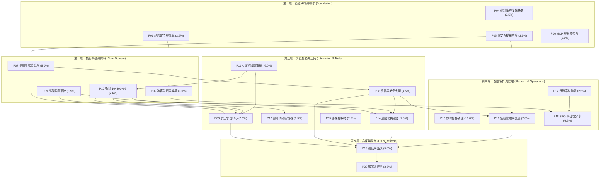

# CODE TO KNOW｜跨階段相依性拓撲與資料流向圖 (Master Cross-Phase Dependency Map)

版本：MASTER-DEPENDENCY-MAP-20261118  
專案：碼上學｜CODE TO KNOW (AI 智慧學習與教育科技平台)  
目的：分析 20 階段之間的相依關係、核心業務資料流向與潛在阻斷鏈條。

---

## 一、20 階段相依性拓撲圖 (Phase Dependency Topology)

系統架構由基礎設施層層向上疊加，其核心拓撲關係如下：



---

## 二、全專案核心資料流向分析 (Data Flow Lifecycle)

以平台標準使用者生命週期為例，資料在各階段之間的流轉路徑如下：

```
[使用者註冊/登入 (P05/P07)]
   │
   ├─► 簽發 JWT Session Cookie 與 CSRF Token
   ├─► 建立 User, UserRole, UserProfile
   │
   ▼
[學生學習中心 (P03)]
   │
   ├─► 選擇 17300 網頁設計丙級 674 題刷題 (P09) ──────► 記錄錯題與收藏 (WrongQuestionRecord)
   ├─► 參加 80 題模擬測驗 (P09) ───────────────────────► 產生成績單與作答快照 (ExamAttempt)
   ├─► 學習 104301~104305 術科題組 (P10) ──────────────► 即時沙盒預覽與步進代碼檢查 (P12)
   ├─► 進入五大遊戲闖關挑戰 (P14) ──────────────────────► 結算星級、成就與積分 (gameStorage)
   │
   ▼
[教師班級教學支援 (P08)]
   │
   ├─► 教師建立班級取得 6 碼 high-entropy joinCode
   ├─► 學生輸入代碼加入班級 (ClassEnrollment)
   ├─► 教師指派遊戲作業關卡 (P14-GAM-014 / ClassAssignment)
   ├─► 讀取班級學生通關進度與測驗成績
   │
   ▼
[平台管理與系統營運 (P16)]
   │
   ├─► L4 平台管理員審核教師資格申請 (P16-ADM-008~010)
   ├─► 系統寫入高權限操作審計追蹤 (AuditLog - 去識別化脫敏)
   └─► L5 系統營運監控即時連線健康度與資料庫延遲 (/api/health)
```

---

## 三、關鍵阻斷與下游衝擊矩陣 (Blocker & Impact Analysis)

| 關鍵阻斷項目 (Core Blocker) | 當前狀態 | 直接受衝擊之階段 (Direct Impact) | 下游連鎖衝擊 (Cascading Ripple Effect) | 緩解方案 (Mitigation Strategy) |
| :--- | :--- | :--- | :--- | :--- |
| **AUTH-03 雲端 Supabase 資料庫隔離** | **嚴格隔離** (未經授權禁止連線) | **P04, P07, P08, P16** | 學生學習歷程 (P03)、錯題本 (P09)、遊戲成就 (P14) 無法跨裝置同步，目前停留於 LocalStorage | 前端全面採用「雙模客戶端 (`api.ts`)」，本機自動優雅降級為 LocalStorage/Demo 模式 |
| **L3/L4 遊戲管理 API 待對接** | **70% 本機原型** (`P14-GAM-014/015`) | **P14, P08, P16** | 教師無法跨瀏覽器派發作業給真實學生，管理員關卡配置僅存於本機 | 以獨立 Utility (`teacherGameTaskManager`, `adminGameConfigManager`) 封裝介面，後端 API 上線時一鍵替換 |
| **雲端 LLM API 未對接** | **展示版** (`P11-AI-001`) | **P11, P03, P10** | AI 家教無法進行多輪動態智慧推理，僅能呈現離線模擬解題與提示 | 內建 `aiFallbackEngine` 與 `aiSafetyFilter`，介面標記【展示版】，確保無網路時依然具備教育示範價值 |
| **正式發信通道未設定** | **離線 Mock** (`P07-EML-001`) | **P07** | 註冊信與重設密碼信僅能於伺服器主控台查看 Token，無法實際寄送至使用者信箱 | 後端使用 `emailQueueService` 記憶體重試佇列，上線時僅需注入 SendGrid/Resend API Key |
