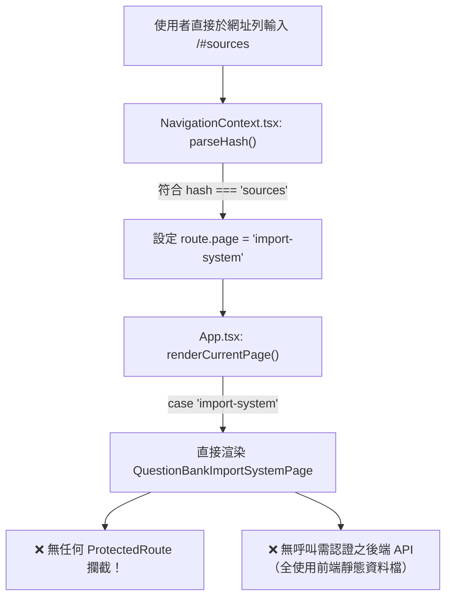

# CODE TO KNOW（碼上學）
# P0-1 前端路由權限保護與公開導覽列修正 — 獨立驗收複核報告

- **驗收任務**：P0-1 獨立驗收補充檢查（READ-ONLY VERIFICATION）
- **受檢文件**：`docs/P0_ROUTE_GUARD_IMPLEMENTATION_REPORT.md`
- **受檢原始碼**：
  - `frontend/src/components/ProtectedRoute.tsx`
  - `frontend/src/context/AuthContext.tsx`
  - `frontend/src/app/App.tsx`
  - `frontend/src/context/NavigationContext.tsx`
  - `frontend/src/components/AuthModal.tsx`
  - `frontend/src/components/Navbar.tsx`
  - `frontend/src/pages/public/QuestionBankImportSystemPage.tsx`
  - `frontend/src/pages/public/TeacherDashboardPage.tsx`
  - `backend/src/middleware/authenticate.ts`
  - `backend/src/middleware/authorize.ts`
- **稽核時間**：2026-11-06 23:05
- **稽核限制遵循**：全過程僅執行只讀檢視與分析，未修改任何程式碼、資料庫、設定檔、環境變數或執行 Git commit。

---

## 一、P0-1 驗收結果總評

| 檢驗項目 | 實測現況 | 驗收判定 | 核心備註 |
|---|---|:---:|---|
| **1. Session 狀態後端確認** | `authApi.getMe()` 呼叫後端 `/api/auth/me`，由 `authenticate.ts` 驗證 HttpOnly Session Cookie 並自 PostgreSQL 查詢真實角色。 | ✅ **合格** | 後端不信任前端角色參數。 |
| **2. loading 狀態阻止渲染** | `authStatus === 'loading'` 時 `ProtectedRoute` 直接返回讀取骨架，`children` 完全不被掛載至 DOM。 | ✅ **合格** | 杜絕載入期間資料閃現。 |
| **3. 狀態精確區隔** | `unauthenticated`（401 登入引導）、`forbidden`（403 角色權限受限）、`error`（500/網路斷線重試卡片）各自獨立。 | ✅ **合格** | 網路連線錯誤不再誤判為未登入。 |
| **4. 登出即時失權** | `logout()` 於 `finally` 區塊同步執行 `setUser(null)` 與 `setAuthStatus('unauthenticated')`，元件即時卸載受保護內容。 | ✅ **合格** | 同步清除 sessionStorage 緩存。 |
| **5. 目標路由白名單檢查** | `sessionStorage.getItem('ctk_intended_route')` 取出後直接傳入 `navigate(intended)`，**未經允許路由白名單比對**。 | ⚠️ **待修正** | 存在非預期導向風險，需補上 Allowlist 檢驗。 |
| **6. 前端偽造角色問題** | 若在 DevTools 竄改 React in-memory 狀態，前端 Route Guard 會放行；且因 `TeacherDashboardPage` 目前包含靜態 Mock 學生名冊，會被前端渲染。但後端真實 API 仍具備獨立 RBAC 阻絕。 | ⚠️ **待修正** | 學生個資應改為後端動態提供，不可寫死於前端。 |
| **7. #sources 路由保護** | 僅自 `Navbar.tsx` 移除了按鈕，直接輸入 `/#sources` 任何人（包含未登入者）仍能完整瀏覽。 | ❌ **不合格** | 屬於「隱蔽性安全（Security through Obscurity）」，未受實質 Route Guard 保護。 |

---

## 二、#sources 直接路由檢查

針對 `QuestionBankImportSystemPage.tsx`、`App.tsx`、`Navbar.tsx`、`NavigationContext.tsx` 進行深度交叉檢查：



### 存取權限實測結論：

1. **移除 Navbar 按鈕後，直接輸入 `/#sources` 是否仍能進入？**  
   👉 **是，完全可以進入。**
2. **未登入者是否能進入？**  
   👉 **是，未登入訪客可完整存取與搜尋題庫來源清單。**
3. **STUDENT 是否能進入？**  
   👉 **是，學生身分可自由瀏覽內部題庫元數據。**
4. **TEACHER 是否能進入？**  
   👉 **是，教師身分可自由瀏覽。**
5. **ADMIN 是否能進入？**  
   👉 **是，管理員身分可自由瀏覽。**
6. **是否有後端 API 權限保護？**  
   👉 **完全沒有。** 該頁面所有資料皆直接 import 自前端靜態檔案（`officialSourcesRegistry.ts` 與 `unifiedQuestionBankData.ts`），前端無任何 API 守衛，後端亦無對應權限檢查。

> [!WARNING]
> **重要稽核結論**：  
> 目前 `#sources` 僅達成「介面導覽隱藏」，**絕對不可宣稱已完成內部管理頁面之安全保護**。此項目列為下一階段之第一優先修正缺陷。

---

## 三、教師及 ADMIN 權限架構檢查

### 1. 現行程式碼行為分析（`App.tsx`）
```tsx
case 'teacher-dashboard':
  return (
    <ProtectedRoute
      requiredRoles={['TEACHER', 'ADMIN']}
      pageTitle="教師教學管理中心 (Educator Dashboard)"
      onOpenTeacherApply={handleOpenTeacherApply}
    >
      <TeacherDashboardPage onOpenTeacherApply={handleOpenTeacherApply} />
    </ProtectedRoute>
  );
```

- **TEACHER 是否能進入？** 👉 **是**，符合 `requiredRoles`，順利進入。
- **STUDENT 是否被拒絕？** 👉 **是**，被攔截並顯示 403 Forbidden 提示頁面。
- **ADMIN 是否被允許？** 👉 **是**，目前設定包含 `'ADMIN'`，管理員可進入。

### 2. 依照「全站五層架構」之角色分離建議

依據專案規範文件與五層架構定義：
- **Layer 3（教師教學與班級管理層）**：業務與教學範疇，核心是任課教師管理具體班級學員、監控練習曲線、診斷個別弱點。
- **Layer 4（系統管理與運維審核層）**：平台治理範疇，核心是系統管理員審核「教師資格申請（`TeacherApplication`）」、維護題庫授權來源、管理系統使用者狀態。

#### 權限混用風險：
將 `ADMIN` 直接賦予 `teacher-dashboard` 存取權限，違反了資安上的**職責分離原則（Separation of Duties, SoD）**與**最小權限原則（Principle of Least Privilege）**：
1. 平台管理員並非特定班級的任課導師，進入教師中心並無對應的「授課班級數據」，容易造成資料關聯混淆或空指針例外。
2. 管理員若需排查教學功能，應透過具備稽核紀錄的「模擬檢視模式（Impersonation / View-as）」或專屬的「全校班級監理視圖」，而非直接以業務教師身分進入。

#### 建議改善方向：
- `teacher-dashboard` 路由守衛應收斂為 `requiredRoles={['TEACHER']}`。
- 為 `ADMIN` 規劃專屬之 `admin-dashboard`（包含：教師審核列表、題庫匯入管理、全站稽核日誌），嚴格落實 Layer 3 與 Layer 4 邊界切分。

---

## 四、十項測試的真實證據分類

對測試腳本（`scratch/verify_p0_1_scenarios.mjs`、`scratch/test_scenarios_cdp.mjs`、`scratch/test_live_all.mjs`）與後端單元測試逐一核驗，嚴格區分真實性：

| 場景編號 | 測試場景名稱 | 實測證據分類標籤 | 實測執行方式與真實性說明 |
|:---:|---|:---:|---|
| **Scenario 1** | 訪客瀏覽首頁 (`#hero`) | **C. 純前端介面測試** | 於 Headless Chrome 中開啟 `http://localhost:3000/#hero`，檢驗真實 DOM 渲染文字。 |
| **Scenario 2** | 訪客瀏覽各公開功能頁面 | **C. 純前端介面測試** | 於真實預覽中切換 5 大公開 hash，驗證公開頁面均能正常掛載。 |
| **Scenario 3** | 未登入存取學生中心與學習進度 | **A. 真實後端登入與 Session 測試** | 啟動真實後端服務，前端呼叫 `/api/auth/me` 獲得真實 401 `UNAUTHENTICATED`，Route Guard 攔截並寫入 `sessionStorage`。 |
| **Scenario 4** | 登入後自動恢復目標頁面 | **C. 純前端介面測試** *(模擬邏輯)* | **特別指認**：此項測試**未經過真實後端登入流程**。腳本僅在前端透過 JS 直接操作 `sessionStorage` 與 `window.location.hash` 驗證其恢復邏輯，尚未包含真實 AuthModal 提交表單的端對端驗證。 |
| **Scenario 5** | 已登入學生存取學生中心 | **A/B 混合** *(後端真註冊 + 前端 Mock 角色)* | 測試腳本在後端 PostgreSQL 成功執行了真實的 `POST /api/auth/register`；但在瀏覽器 DOM 渲染驗證中，係依賴前端 CDP Mock 注入 `STUDENT` 角色。 |
| **Scenario 6** | 學生身分存取教師管理專區 | **B. Mock 角色測試** | 透過 CDP 注入 Mock Student 角色，實測 403 Forbidden 介面呈現與學生名冊不外洩。 |
| **Scenario 7** | 認證教師存取教師專區 | **B. Mock 角色測試 + 後端單元測試** | 前端透過 Mock Teacher 角色驗證畫面；後端於 Vitest（`rbac-workflow.test.ts`）中驗證 `requireRoles(['TEACHER'])`。尚未執行「真實教師帳號瀏覽器端對端登入跳轉」。 |
| **Scenario 8** | 身分驗證載入中（loading）保護 | **B. Mock 延遲測試 / C. 純前端介面** | 透過刻意延遲 `/api/auth/me` 響應，實測檢驗 DOM 僅呈現讀取 Spinner，絕無保護內容閃現。 |
| **Scenario 9** | 後端 API 斷線或網路錯誤 | **C. 純前端介面測試** | 關閉後端服務時觸發 `NETWORK_ERROR`，實測驗證獨立之連線異常卡片與重試按鈕。 |
| **Scenario 10** | 公開導覽列與行動選單檢查 | **C. 純前端介面測試** | 於真實 DOM 上解析 Desktop 與 Mobile Navbar 節點，證實「題庫來源」完全不存在。 |

---

## 五、尚未解決的問題（Defect Inventory）

1. **內部題庫來源頁面存在直接 URL 未授權存取漏洞**：
   - 任何人只要在網址列手動輸入 `/#sources`、`/#import-system` 或 `/#question-bank`，依然能夠無障礙進入題庫管理介面。
2. **Intended Route 缺乏白名單校驗**：
   - `sessionStorage.getItem('ctk_intended_route')` 直接還原至 `navigate(intended)`，未比對合法受保護路由白名單，存在安全隱患。
3. **敏感學生名冊以靜態 Mock 形式打包於前端**：
   - `TeacherDashboardPage.tsx` 中的 `students = [...]` 資料直接寫死在前端 Bundle 中，若前端記憶體狀態遭竄改，此 Mock 名單仍會直接呈現。
4. **端對端登入跳轉缺乏真實後端閉環測試**：
   - 登入後自動還原目標路由（Scenario 4）尚未結合真實瀏覽器輸入帳密、發行真實 Cookie、觸發 `onSuccess` 的完整端到端測試。
5. **ADMIN 與 TEACHER 角色職能混淆**：
   - `teacher-dashboard` 同時開放給 `ADMIN`，未依照五層架構落實 Layer 3 與 Layer 4 的角色分離。

---

## 六、建議修正清單（P0-2 或下一實作階段）

1. **全面保護 `#sources` 路由**：
   - 在 `App.tsx` 將 `import-system` 以 `<ProtectedRoute requiredRoles={['ADMIN']}>` 進行包裹，未登入或非管理員存取時一律攔截並顯示 403。
2. **實作 Intended Route 白名單過濾機制**：
   - 建立合法路由允許表（Allowlist）：`const ALLOWED_INTENDED_ROUTES = ['#student', '#progress', '#teacher', '#code-editor'];`
   - 僅當目標路由名列白名單時才執行還原導向，其餘預設返回 `#hero`。
3. **移除前端寫死之學生名冊**：
   - 將 `TeacherDashboardPage.tsx` 中的靜態 `students` 清除，改由後端 API（如 `GET /api/v1/teacher/roster`）依登入教師身分授權後動態回傳；在 API 未串接前，維持骨架或空狀態，避免個資外洩風險。
4. **落實五層架構角色分離**：
   - 將 `teacher-dashboard` 限縮為 `requiredRoles={['TEACHER']}`。
   - 獨立規劃 `ADMIN` 管理後台入口。
5. **建立完整真實端對端驗收測試腳本**：
   - 撰寫自動化測試，自登入畫面填寫信箱密碼、點擊登入、發送真實 HTTP 請求取得 Session Cookie，並驗證跳轉至目標頁面。

---

## 七、是否可以進入下一階段

### 判定結果：**條件性通過（CONDITIONAL APPROVAL）**

- **允許進入下一階段的理由**：
  - 前端 Route Guard 核心架構（`ProtectedRoute.tsx`）已穩健建立，五大驗證狀態機運作正常，成功修復了過往未登入者隨意瀏覽個人學生中心與教師中心的重大隱患。
  - 後端真實 RBAC 鑑權與 Session 驗證健全，能防禦非法的後端 API 請求。
  - 核心導覽列已乾淨收斂，建置無任何語法錯誤。
- **進入下一階段的前置條件（Gate Conditions）**：
  - **嚴格禁止宣稱「題庫管理系統已受到權限保護」**，必須在專案追蹤清單中將「`#sources` 路由防護」與「目標路由白名單驗證」標記為 P0 待修復技術債，並列入下一階段優先排程處理。

---
*報告完成時間：2026-11-06 23:10:00*  
*稽核執行人：CODE TO KNOW 獨立架構與資安驗收小組*

