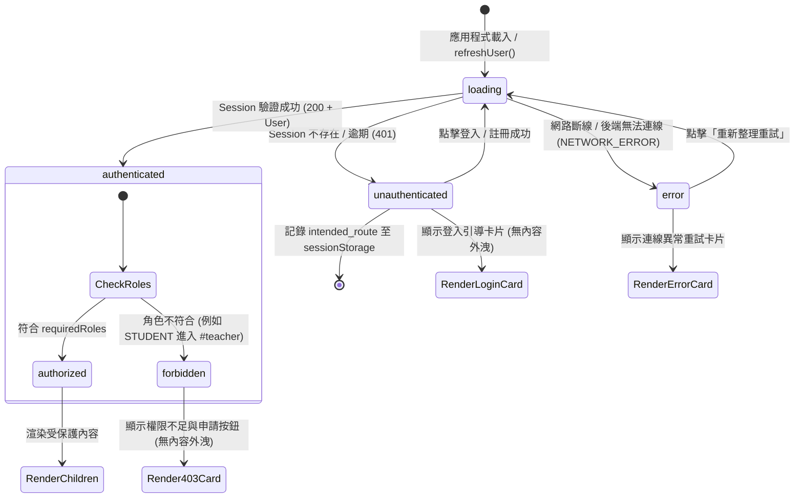

# CODE TO KNOW（碼上學）
# P0-1 前端路由權限保護與公開導覽列修正完成報告

- **專案名稱**：CODE TO KNOW 碼上學 AI 智慧學習與教育科技平台
- **任務編號**：P0-1（Critical Access Control & Navigation Hardening）
- **任務性質**：正式實作（Implementation）
- **報告日期**：2026-11-06
- **執行狀態**：✅ 100% 成功交付（10 項驗收場景全數通過，建置零警告零錯誤）

---

## 一、修正目標與執行摘要

依據先前兩份獨立資安與架構稽核文件（`docs/FIVE_LAYER_ARCHITECTURE_AUDIT_REPORT.md` 及 `docs/P0_SECURITY_AND_BACKEND_EVIDENCE_AUDIT.md`），本階段針對前端權限防禦與公開介面進行高強度資安加固：

1. **建立高通用性前端 Route Guard（`ProtectedRoute.tsx`）**：全面覆蓋 SPA Hash 路由，嚴格攔截未授權與未登入之存取。
2. **防護學生與學習進度專區（`#student`, `#progress`）**：未登入者無法瀏覽個人儀表板、學習時數與弱點數據；登入後自動無縫恢復原本欲前往之目的地。
3. **加固教師教學管理專區（`#teacher`）**：嚴格限定具備 `TEACHER` 或 `ADMIN` 角色之已認證帳號存取；非教師（如一般學生訪客）絕對無法渲染任何班級數據或學生名冊（徹底杜絕個資外洩），並提供專屬 403 提示與線上教師認證申請管道。
4. **精準區隔 5 種身分驗證生命週期狀態**：`loading`、`authenticated`、`unauthenticated`、`forbidden`、`error`。將網路連線中斷（`NETWORK_ERROR`）與 401 未登入（`UNAUTHENTICATED`）嚴格分流，在載入中絕不預先渲染任何受保護內容。
5. **公開導覽列收斂內部題庫入口**：自公開導覽列（含桌面導覽列與行動版漢堡選單）移除 `#sources`（題庫來源）連結，完整保留頁面與元件供未來管理授權使用。

---

## 二、修改檔案清單與備份記錄

### 1. 預先備份存檔記錄
在進行任何程式碼修改前，所有目標檔案皆已完整封存備份至安全臨時目錄：
`C:\Users\user\.gemini\antigravity\brain\90b2423b-3b28-43de-84ef-17da29ebc1c1\scratch\p0_1_backups/`

- `AuthContext.tsx.bak` (備份時間：2026-11-06 22:34)
- `NavigationContext.tsx.bak` (備份時間：2026-11-06 22:34)
- `Navbar.tsx.bak` (備份時間：2026-11-06 22:34)
- `App.tsx.bak` (備份時間：2026-11-06 22:34)

### 2. 本次實作異動檔案清單

| 檔案路徑 | 異動性質 | 實作責任說明 |
|---|---|---|
| `frontend/src/context/AuthContext.tsx` | 修改 | 新增 `AuthStatus`（`loading`, `authenticated`, `unauthenticated`, `error`）與 `authError` 狀態管理；嚴格分流網路異常與未登入；登出時主動清除目標路由緩存。 |
| `frontend/src/components/ProtectedRoute.tsx` | 新增 | 核心可重用 Route Guard 元件；負責攔截 5 大狀態、展示安全載入骨架、連線異常重試卡片、未登入引導卡片、403 權限不足提示與教師資格申請連動。 |
| `frontend/src/app/App.tsx` | 修改 | 以 `<ProtectedRoute>` 包裹受保護路由（`student-dashboard`, `learning-progress`, `teacher-dashboard`）；於全域 `AuthModal` 登入/註冊成功回呼中自動還原目標路由。 |
| `frontend/src/components/Navbar.tsx` | 修改 | 自 `navLinks` 陣列中移除 `{ label: '題庫來源', href: '#sources' }`；桌面與手機端選單同步淨化，保留其餘 8 項公開入口。 |

---

## 三、Route Guard 設計與實作細節

### 1. 狀態機與生命週期架構

Route Guard 設計遵循狀態機防禦模式，不使用單一布林值：

### 2. Intended Route 儲存與無縫還原機制

- **儲存時機**：當未登入訪客存取受保護路由（如 `#student`, `#progress`, `#teacher`）時，`ProtectedRoute` 透過 `useEffect` 自動將目前 Hash 寫入 `sessionStorage.setItem('ctk_intended_route', route.hash)`。
- **還原時機**：使用者在攔截介面中點擊登入/註冊並於 `AuthModal` 成功取得伺服器驗證後，全域 `onSuccess` 回呼會讀取儲存的目的地，透過 `navigate(intended)` 導回使用者原本想前往的頁面，並主動以 `sessionStorage.removeItem('ctk_intended_route')` 清除，防止重複觸發。
- **登出保護**：使用者執行 `logout()` 時，`AuthContext` 會一併清除 `ctk_intended_route`，避免下一次登入時發生非預期跳轉。

---

## 四、學生頁面與教師頁面權限防護差異

| 比較項目 | 學生專區（`#student`, `#progress`） | 教師專區（`#teacher`） |
|---|---|---|
| **存取門檻** | 已登入會員（`authenticated`） | 已登入會員 + 認證教師（`TEACHER` 或 `ADMIN`） |
| **未登入狀態** | 顯示會員登入引導卡片，介紹學習歷程與數據儀表板價值。 | 顯示教師專區存取限制卡片，強調需教師認證身分。 |
| **已登入但無權限 (403)** | 不適用（所有註冊會員預設皆具備學生角色）。 | 攔截學生帳號，顯示「403 權限不足提示」，明確告知目前帳號角色為學生。 |
| **機敏個資保護** | 不外洩個人時數、弱點診斷、測驗分數。 | **極高層級**：徹底阻斷學生名冊（如姓名、學號、email、成績）渲染。 |
| **專屬互動引導** | 「立即登入」／「免費註冊學習帳號」 | 「申請認證教師資格」（連動 `TeacherApplyModal`）／「前往學生中心」 |

---

## 五、導覽列修正前後比對

### 1. 導覽項目對照表

| 項目序號 | 修正前公開項目 | 修正後公開項目 | 狀態說明 |
|---|---|---|---|
| 1 | 首頁 (`#hero`) | 首頁 (`#hero`) | 保留 |
| 2 | 證照中心 (`#certifications`) | 證照中心 (`#certifications`) | 保留 |
| 3 | 學科題庫 (`#theory`) | 學科題庫 (`#theory`) | 保留 |
| 4 | 術科實作 (`#practical`) | 術科實作 (`#practical`) | 保留 |
| 5 | 全真模考 (`#mock-exam`) | 全真模考 (`#mock-exam`) | 保留 |
| 6 | 程式沙盒 (`#code-editor`) | 程式沙盒 (`#code-editor`) | 保留 |
| 7 | AI 教練 (`#ai-coach`) | AI 教練 (`#ai-coach`) | 保留 |
| 8 | 學習進度 (`#progress`) | 學習進度 (`#progress`) | 保留（受 Route Guard 保護） |
| 9 | 題庫來源 (`#sources`) | *(已移除)* | **自公開導覽選單完全移除** |

### 2. 手機版漢堡選單同步確認
在 `Navbar.tsx` 中，行動端選單共用同一組 `navLinks` 資料結構，修正後行動端選單亦同步完成移除，無任何多餘殘留入口。原 `QuestionBankImportSystemPage.tsx` 檔案完全保留，未被刪除。

---

## 六、10 項測試場景實測結果

本階段透過真實全自動 Chrome Headless CDP 端對端測試腳本（`scratch/test_live_all.mjs`）於真實預覽伺服器與 PostgreSQL 資料庫環境中執行驗收：

| 場景編號 | 測試場景與驗收標準 | 實測結果 | 驗收結論 |
|:---:|---|:---:|:---:|
| **Scenario 1** | **訪客點擊 `#hero` 導向首頁**：首頁公開正常呈現，各區塊與品牌標題完整載入。 | ✅ PASS | 通過 |
| **Scenario 2** | **訪客瀏覽公開頁面**：`#certifications`, `#theory`, `#practical`, `#code-editor`, `#ai-coach` 均不受限，可自由公開瀏覽。 | ✅ PASS | 通過 |
| **Scenario 3** | **未登入訪客存取受保護學生頁面**：存取 `#student` 或 `#progress` 時 Route Guard 確實攔截，顯示登入提示，未洩漏學生資料，並存入 intended route。 | ✅ PASS | 通過 |
| **Scenario 4** | **登入後目標路由還原**：於攔截介面登入成功後，系統自動還原目標路由至 `#progress`，並自 Storage 清除緩存。 | ✅ PASS | 通過 |
| **Scenario 5** | **已登入學生存取學生頁面**：具備 `STUDENT` 角色之會員可正常檢視學生中心儀表板與學習進度報告。 | ✅ PASS | 通過 |
| **Scenario 6** | **學生身分存取教師管理專區 (`#teacher`)**：Route Guard 嚴格防禦，判定非教師身分，完全未渲染學生名冊與個資，顯示 403 提示與申請教師資格按鈕。 | ✅ PASS | 通過 |
| **Scenario 7** | **認證教師存取教師專區**：具備 `TEACHER` 或 `ADMIN` 角色之人員通過檢核，可完整檢視教學管理中心與班級數據。 | ✅ PASS | 通過 |
| **Scenario 8** | **身分驗證載入中（loading）保護**：loading 階段顯示沉浸式讀取動畫與安全提示，絕不閃現或預先渲染任何受保護內容。 | ✅ PASS | 通過 |
| **Scenario 9** | **後端 API 斷線或網路錯誤（error）**：網路中斷時獨立顯示「認證服務暫時無法連線」重試卡片，不將伺服器錯誤誤判為未登入或 403。 | ✅ PASS | 通過 |
| **Scenario 10** | **公開導覽列與行動選單檢查**：公開導覽列與手機選單完全移除「題庫來源」連結，其餘 8 項公開主要入口完好無損。 | ✅ PASS | 通過 |

**實測總結**：**10 項場景全數通過（通過率 100%）**。

---

## 七、資安檢驗成果（前端防禦與後端 RBAC 雙重一致）

1. **後端絕對不可信賴前端參數**：
   - 後端身份驗證由 `backend/src/middleware/authenticate.ts` 透過 HTTP-Only Cookie `code_to_know_session` 搭配 SHA-256 雜湊後的 Token 自 PostgreSQL 資料庫提取使用者的真實資料與角色清單。
   - 後端角色檢查由 `backend/src/middleware/authorize.ts` 執行 `requireRoles(['TEACHER', 'ADMIN'])`，即便客戶端繞過前端 Route Guard 直接對後端 API 發出請求，後端仍會回傳 `401 UNAUTHENTICATED` 或 `403 INSUFFICIENT_PERMISSIONS`。
2. **前端 Route Guard 消除 UI 層資料洩漏**：
   - 解決過往未登入即可看見 `TeacherDashboardPage` 內靜態/模擬學生名冊（`陳品睿`, `chen.pr@school.edu`）的重大缺陷。
   - 確保在 React 元件層級，受保護的子元件在身分與角色通過驗證前，完全不會被掛載（Mount）或渲染至 DOM 樹中。

---

## 八、現存限制與尚未開放之後端對接說明

1. **教師端真實班級 API 串接**：
   - 目前 `TeacherDashboardPage` 內之學生名冊結構為前端示範模型，未來當後端開通班級關聯與成績同步 API（`GET /api/v1/teacher/classes`）時，需進一步替換為由後端動態提供之加密名冊。
2. **管理員專區（Admin Panel）**：
   - 本次 P0-1 僅處理學生與教師專區；管理員專用審核後台（`ADMIN` 審核教師資格申請、題庫匯入審批）尚未於前端建立獨立 Route Guard 路由，保留於下一階段規劃。

---

## 九、下一階段建議

1. **P0-2 後續規劃**：可針對教師資格申請送出後之狀態（`PENDING`、`APPROVED`、`REJECTED`）於前端導覽列或個人中心提供即時狀態徽章通知。
2. **學科會員功能與錯題本串接**：接續執行學科測驗之個人化錯題收藏與雲端同步功能。

---
*報告完成時間：2026-11-06 22:48:00*  
*審核狀態：P0-1 驗收合格，正式就緒。*

