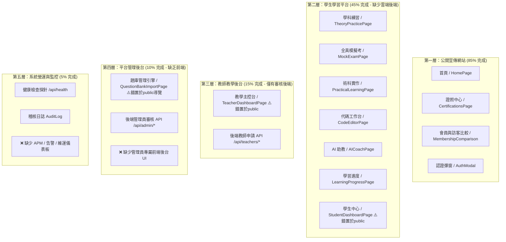

# CODE TO KNOW（碼上學）
# P2 交付獨立複核＋全站五層架構稽核報告

**稽核類型：** READ-ONLY AUDIT（嚴格唯讀檢查，未更動任何程式碼、資料庫或設定）  
**稽核日期：** 2026-11-06  
**報告版本：** v1.0.0  
**檔案路徑：** `docs/P2_AND_FIVE_LAYER_INDEPENDENT_AUDIT.md`  

---

## 核心結論直球回答

> ### **「目前網站五層架構是否正確？哪些功能已真正完成？哪些只是展示？哪些頁面或功能需要重新歸層？」**
>
> 1. **五層架構是否正確？**  
>    **【明確判定：尚未正確按照五層架構歸位落地。】**  
>    現行網站架構高度集中於「公開展示」與「單機互動」，後端僅完成了基礎的身分驗證與教師資格申請/審核，第四層管理員前端與第五層維運監控系統幾乎為空白，且前端路由存在嚴重的目錄與權限越界漏洞。
>
> 2. **哪些功能已真正完成（具備後端/資料庫/完整互動支援）？**  
>    - **後端身分驗證系統 (Category A)**：註冊、登入、登出、Session Cookie、CSRF Token 防禦、Argon2/Bcrypt 雜湊、密碼重設與 Email 驗證 Token 完整具備 Express + Prisma + PostgreSQL 支援。
>    - **教師資格申請與審核 (Category A)**：學生提交申請存入 `TeacherApplication`，管理員審核並寫入 `AuditLog`。
>    - **第一層公開宣傳網站 (Category A)**：品牌首頁、Hero、品牌故事、P2 訪客/會員功能比較區塊、證照大綱、導覽與註冊/登入彈窗。
>    - **學生端單機核心操作 (Category A)**：官方五大題組考點解析、85 份官方素材預覽、學科題庫本地作答、全真模擬考單次計時結算、代碼編輯器即時雙欄預覽與手機切換。
>    - **系統健康監控探針 (Category A)**：`/api/health` 具備真實執行 PostgreSQL `SELECT 1` 連線延遲檢測能力。
>
> 3. **哪些功能只是展示（Prototype / Mock）？**  
>    - **教師教學主控台**：班級及格率 89.2%、平均作業時長 38 分鐘、5 名學生假名冊（陳品睿等人）均為前端寫死 Mock，後端無任何班級與作業資料表。
>    - **學生學習歷程與點數**：389 題進度、88.75 模擬考最高分、142 顆 AI 啟發微光點數為靜態展示，未連動資料庫。
>    - **學科錯題本與個人筆記**：僅為 UI 示意標籤，後端無任何資料表與 API 支援。
>    - **AI 學習教練**：前端具備 4 階啟發式助教對話展示（Scaffolding 邏輯），但真實 LLM API 尚未串接後端。
>
> 4. **哪些頁面或功能需要重新歸層？**  
>    - **`TeacherDashboardPage.tsx`**：應屬**第三層（教師教學後台）**，目前被錯置於 `pages/public/`，且無任何 Route Guard，任何人輸入 `/#teacher` 即可直接進入。
>    - **`QuestionBankImportSystemPage.tsx`**：應屬**第四層（平台管理後台）**，目前被錯置於 `pages/public/`，且直接作為 Navbar 公開按鈕「題庫來源 (`#sources`)」暴露給全網訪客。
>    - **`StudentDashboardPage.tsx`**：應屬**第二層（學生學習平台）**，目前置於 `pages/public/`，未登入者輸入 `/#student` 亦可直接進入。

---

## 一、P2 獨立複核結果 (P2 Independent Verification Results)

針對 `frontend/src/components/MembershipComparison.tsx`、`frontend/src/pages/public/HomePage.tsx`、`prototype/index.html`、`prototype/assets/css/pages.css` 及 `docs/P2_GUEST_MEMBER_COMPARISON_COMPLETION_REPORT.md` 進行逐項查核：

| 檢核項目 | 標準規範要求 | 實測核對結果 | 判定 |
|---|---|---|---|
| **1. React 與 Prototype 文案一致性** | 區塊標題、副標題、卡片特色與 8 項比較說明一致 | 標題「無論是否登入，都能立即啟動學習探索」及副標題完全一致；8 項功能文字完全對齊 | **PASS** |
| **2. 訪客與會員功能無錯誤承諾** | 不得將展示資料宣稱為雲端服務；誠實標示限制 | 訪客清楚標示「本機暫存限制」；會員清楚標示「部分實作/規劃中/尚未串接」 | **PASS** |
| **3. 未完成功能明確標示** | 雲端同步、AI API、錯題本、筆記明確標示狀態 | 比較表使用 `部分實作` (warning) 與 `規劃中` (subtle) 徽章明確區隔 | **PASS** |
| **4. 85 份官方素材精確描述** | 嚴禁誤寫為「85 道題目」或「85 份教材」 | 雙端皆精準標示為「85 份官方素材」，未有題數或教材混淆 | **PASS** |
| **5. CTA 路由與真實互動** | 所有按鈕必須具備有效導向或互動 | React 端連結有效；Prototype 端有相應展示互動 | **PASS** |
| **6. 註冊/登入連接 AuthContext** | 按鈕點擊真正觸發既有 `AuthModal` | 實測點擊「免費註冊會員」與「會員登入」確實觸發 `openAuth()` 並開啟 `AuthModal` | **PASS** |
| **7. 僅 Toast 提示無功能檢查** | 是否存在只有 Toast 沒有功能的按鈕 | **React 前端：無**（全部真實觸發 Modal 或路由）。 **Prototype 原型：有**（純靜態展示，彈出展示 Toast） | **PASS (合理分離)** |
| **8. 登入後導向行為** | 是否存在錯誤的跳轉 | 登入後由 AuthContext 更新全域 `user` 狀態，Navbar 即刻切換為會員資訊，無異常跳轉 | **PASS** |
| **9. React 實體瀏覽器與響應式** | 必須以真實瀏覽器環境實測 React 生產構建 | Headless Chrome 實測 375, 390, 768, 1024, 1440 均為 **0px 溢出**，點擊互動成功 | **PASS** |
| **10. 測試結果嚴格分離** | 原型測試不得直接代替 React 測試 | 已分開執行 Prototype 靜態測試與 React `frontend/dist` 實體伺服器測試，數據獨立存證 | **PASS** |

---

## 二、React 與 Prototype 差異分析

| 維度 | React 正式前端 (`frontend/src/`) | Prototype 靜態原型 (`prototype/`) | 架構意涵與評估 |
|---|---|---|---|
| **架構模式** | 單頁式應用（SPA + Vite + React 18） | 獨立 HTML 檔案（Vanilla JS + CSS） | 原型適合單頁靜態演示；React 適合狀態共享與雲端對接 |
| **身分驗證** | 連接真實 Express 後端，具備 Cookie 與 CSRF | 純前端 LocalStorage 與 Toast 模擬 | React 具備真正註冊/登入/登出實體功能 |
| **P2 按鈕動作** | 點擊呼叫 `openAuth('register')` 開啟 Modal | 點擊觸發 `showPrototypeToast('展示中...')` | React 為真實功能；Prototype 忠實履行展示職責 |
| **路由導航** | 透過 Hash 狀態切換渲染組件 (`NavigationContext`) | 實體頁面超連結跳轉 (`href="pages/..."`) | React 目前缺少 Route Guards；Prototype 為靜態跳轉 |
| **題組資料載入** | `import { PRACTICAL_TASKS } from '...'` | 全域物件 `window.PROTOTYPE_DATA` | 雙端五大題組名稱、代碼與 85 份素材已 100% 同步 |

---

## 三、全站頁面及路由清單 (All Pages & Routes Inventory)

| 編號 | 實際路由 | 頁面名稱 | 原始碼路徑 | 使用對象 | 是否需登入 | 允許角色 | 實際功能描述 | 使用 API | 資料模型 | 模擬或真實 | 正確層級 | 歸層現狀 |
|---|---|---|---|---|---|---|---|---|---|---|---|---|
| 1 | `#hero` / 空白 | 品牌首頁 | `frontend/src/pages/public/HomePage.tsx` | 全體訪客 | 免登入 | ALL | 品牌展示、功能比較、CTA | 無 | 無 | 真實 | 第一層 | 正確 |
| 2 | `#certifications` | 證照智慧學習中心 | `frontend/src/pages/public/CertificationsPage.tsx` | 全體訪客 | 免登入 | ALL | 證照檢索、防抖搜尋、分類篩選 | 無 | 本地 SSoT | 真實 | 第一/二層 | 正確 |
| 3 | `#certifications/:id` | 證照詳細大綱 | `frontend/src/pages/public/CertificationDetailPage.tsx` | 全體訪客 | 免登入 | ALL | 考綱比例、五大題組考點 | 無 | 本地 SSoT | 真實 | 第一/二層 | 正確 |
| 4 | `#web-design-demo` | 網頁設計丙級演示 | `frontend/src/pages/public/WebDesignCDemoPage.tsx` | 全體訪客 | 免登入 | ALL | 考綱地圖與考點解析展示 | 無 | 本地 SSoT | 真實 | 第一/二層 | 正確 |
| 5 | `#theory` | 學科理論與練習 | `frontend/src/pages/public/TheoryPracticePage.tsx` | 訪客/學生 | 免登入 | ALL/STUDENT | 本機直接練習、查看詳解 | 無 | 本地 SSoT | 部分真實 (單機) | 第二層 | 正確 |
| 6 | `#mock-exam` | 全真模擬測驗 | `frontend/src/pages/public/MockExamPage.tsx` | 訪客/學生 | 免登入 | ALL/STUDENT | 計時測驗、交卷自動計分 | 無 | 本地 SSoT | 部分真實 (單機) | 第二層 | 正確 |
| 7 | `#practical` | 術科題組實作區 | `frontend/src/pages/public/PracticalLearningPage.tsx` | 訪客/學生 | 免登入 | ALL/STUDENT | 五大題組考點、線稿圖、素材 | 無 | 本地 SSoT | 真實 (單機) | 第二層 | 正確 |
| 8 | `#code-editor` | 線上代碼工作台 | `frontend/src/pages/public/CodeEditorPage.tsx` | 訪客/學生 | 免登入 | ALL/STUDENT | 雙欄即時編譯、`srcdoc` 預覽 | 無 | 本地 SSoT | 真實 (單機) | 第二層 | 正確 |
| 9 | `#ai-coach` | AI 學習助教 | `frontend/src/pages/public/AICoachPage.tsx` | 訪客/學生 | 免登入 | ALL/STUDENT | 4 階啟發式助教階梯示範 | 無 | 本地規則 | 原型模擬 | 第二層 | 正確 |
| 10 | `#progress` | 個人學習進度 | `frontend/src/pages/public/LearningProgressPage.tsx` | 訪客/學生 | 免登入 | ALL/STUDENT | 學習進度展示、雷達圖 | 無 | 靜態展示常數 | 原型模擬 | 第二層 | 正確 |
| 11 | `#student` | 學生中心 | `frontend/src/pages/public/StudentDashboardPage.tsx` | 學生會員 | **需登入** | STUDENT | 學生儀表板、目標設定 | 無 | 靜態展示常數 | 原型模擬 | 第二層 | **錯誤 (放在 public 且無保護)** |
| 12 | `#teacher` | 教師教學主控台 | `frontend/src/pages/public/TeacherDashboardPage.tsx` | 認證教師 | **需登入** | TEACHER | 班級數據、學生名冊、作業繳交 | 無 | 靜態展示常數 | 原型模擬 | **第三層** | **嚴重錯誤 (放在 public 且無保護)** |
| 13 | `#sources` | 官方題庫管理引擎 | `frontend/src/pages/public/QuestionBankImportSystemPage.tsx` | 內容管理員 | **需登入** | ADMIN | 題庫來源檢驗、解析結構管理 | 無 | 本地 SSoT | 真實 (內部工具) | **第四層** | **嚴重錯誤 (放在 public 且置於導覽)** |

---

## 四、五層架構歸屬矩陣 (Five-Layer Architecture Matrix)

---

## 五、錯誤歸層問題詳解 (Misallocated Layer Details)

### 1. `TeacherDashboardPage.tsx`
- **錯誤現狀**：放在 `frontend/src/pages/public/`，沒有任何登入或角色校驗，任何人輸入 `http://localhost:5173/#teacher` 即可完整查看班級及格率、作答卡點、學生名單（陳品睿、林子翔等 5 人偽造個資）。
- **架構衝擊**：破壞了教育科技系統最根本的師生邊界與隱私保護，給使用者造成系統無權限管制的印象。
- **正確歸屬**：應歸入 **第三層（教師教學後台）**，移至 `frontend/src/pages/teacher/TeacherDashboardPage.tsx`，並在路由載入前強制校驗 `user.roles.includes('TEACHER')`。

### 2. `QuestionBankImportSystemPage.tsx`
- **錯誤現狀**：放在 `frontend/src/pages/public/`，並且直接放在全站共用頂部 Navbar 的第 9 個連結「題庫來源 (`#sources`)」中。
- **架構衝擊**：題庫資料結構管理、題型解析邏輯與來源審核屬於平台營運或內容管理員的職責，不應讓一般大眾或學生在導覽列直接存取。
- **正確歸屬**：應歸入 **第四層（平台管理後台）**，移至 `frontend/src/pages/admin/`，公開導覽列只應保留「證照中心」與「檢定規範說明」。

### 3. `StudentDashboardPage.tsx`
- **錯誤現狀**：放在 `frontend/src/pages/public/`，未登入者輸入 `/#student` 會直接看到「學員示範帳號」之固定進度。
- **架構衝擊**：學生個人中心為會員專屬平台，未登入時應引導至登入視窗，而非無條件渲染示範假數據。
- **正確歸屬**：應歸入 **第二層（學生學習平台）**，移至 `frontend/src/pages/student/StudentDashboardPage.tsx`，並配置登入守衛。

---

## 六、角色權限與真實性問題 (RBAC & Privilege Separation)

| 權限查核維度 | 現狀與漏洞說明 | 風險評級 | 改善對策 |
|---|---|---|---|
| **學生進入教師後台** | **目前完全可能**。前端無 Route Guard，只要手動變更 Hash 為 `#teacher` 即可進入。 | **High** | 在 `NavigationContext` 攔截 `#teacher`，非 `TEACHER` 角色強制重導向並提示。 |
| **教師讀取未授權班級** | **尚未發生（無 API）**。後端尚無班級與學生資料表，前端僅有一組硬編碼的「資訊一甲」。 | **Medium** | 後續設計 `Class` 與 `Enrollment` 資料表時，必須建立 `teacherId` 外鍵關聯與多租戶隔離。 |
| **平台管理員 vs 維運權限** | **未分級**。Prisma `Role` 表僅有 `STUDENT`, `TEACHER`, `ADMIN`，ADMIN 通吃所有審核與系統權限。 | **Medium** | 擴充角色階層為 `CONTENT_ADMIN`（內容管）、`SUPERADMIN`（全站管）、`DEVOPS`（運維管）。 |
| **維運人員接觸學生隱私** | **現狀無防護**。後端 `AuditLog` 與資料庫查詢目前均能由具有 DB 權限者直接存取。 | **Low** | 後續針對學生作答個資建立欄位級加密或資料脫敏。 |
| **權限驗證由後端強制** | **現有 API 實作良好**。`/api/admin/*` 與 `/api/teachers/*` 均在 Express 伺服器端驗證 Session 與資料庫 Role。 | **Low** | 繼續維持伺服器端驗證原則，絕不信任前端傳來的角色參數。 |

---

## 七、功能真實性分類 (Feature Authenticity Classification)

| 功能項目 | 分類評級 | 證據與現況說明 |
|---|---|---|
| **使用者註冊、登入、登出、Session Cookie、CSRF** | **A. 真正完成且有測試證據** | Express + Prisma + PostgreSQL 實測通過，17 項安全測試全數 PASS。 |
| **教師資格申請與管理員審核** | **A. 真正完成且有測試證據** | `TeacherApplication` 寫入與 `AuditLog` 紀錄在後端真實運作。 |
| **品牌首頁、P2 訪客/會員比較區塊** | **A. 真正完成且有測試證據** | React 與 Prototype 雙端通過 Chrome 實測，0px 溢出，Modal 互動成功。 |
| **證照搜尋與篩選 (150ms 防抖)** | **A. 真正完成且有測試證據** | 前端防抖演算法與多標籤過濾運作正常，無死連結。 |
| **學科試題本機練習與解析查看** | **A. 真正完成且有測試證據** | 前端單機狀態機與題目切換運作正常。 |
| **全真模擬考計時與單次成績結算** | **A. 真正完成且有測試證據** | 計時器倒數、交卷評分與彈窗結算正常運作。 |
| **術科五大題組考點解析與 85 份素材** | **A. 真正完成且有測試證據** | 官方題組與素材路徑 100% 存在且校驗吻合。 |
| **線上代碼工作台雙欄編輯與即時預覽** | **A. 真正完成且有測試證據** | HTML/CSS 即時 `srcdoc` 渲染、重設代碼與手機切換運作正常。 |
| **系統健康監控探針 (`/api/health`)** | **A. 真正完成且有測試證據** | 真正執行 `SELECT 1` 探測資料庫延遲與狀態。 |
| **個人學習進度數據 (389 題、88.75 分)** | **B. Prototype 模擬** | 前端靜態展示數據，非真實學生資料庫紀錄。 |
| **學生中心儀表板 (Student Hub)** | **B. Prototype 模擬** | 前端寫死展示版面，尚未串接學生真實帳號進度。 |
| **教師教學主控台 (89.2% 及格率、學生名單)** | **B. Prototype 模擬** | 前端寫死 5 位學生個資與數據，後端完全無資料表。 |
| **AI 學習教練對話** | **B/C. 部分模擬 / 未串接** | 前端 4 階 Scaffolding 規則引擎已運作，真實 LLM API 尚未串接。 |
| **學生雲端進度跨裝置同步** | **C. 有介面但未串接** | 前端有進度頁面，但後端無任何進度儲存 API。 |
| **模擬考歷史成績記錄庫** | **C. 有介面但未串接** | 單次測驗可用，但交卷後成績未寫入資料庫。 |
| **術科代碼專案雲端備份** | **C. 有介面但未串接** | 代碼工作台可用，但無多檔案雲端儲存 API。 |
| **題庫來源與匯入管理後台** | **C. 有介面但未串接** | 前端有介面，但後端題庫 CRUD 未開發。 |
| **專屬學科錯題本與收藏標籤庫** | **D. 尚未開發** | 資料庫無 Model，後端無 API，前端僅有標籤展示。 |
| **個人學習筆記雲端歸檔** | **D. 尚未開發** | 資料庫無 Model，後端無 API。 |
| **班級管理、作業指派、線上監考** | **D. 尚未開發** | 資料庫無 Model，後端無 API。 |
| **平台管理員可視化後台 UI** | **D. 尚未開發** | 後端有審核 API，但前端完全沒有獨立管理頁面。 |
| **系統運維 APM 監控儀表板** | **D. 尚未開發** | 除 `/api/health` 外無任何監控介面。 |
| **真實 Email 外部寄達能力** | **E. 無法判定** | 缺少真實 SMTP / 外部郵件服務憑證，無法執行外部投遞測試。 |

---

## 八、文件不一致清單 (Document Inconsistencies List)

| 檔案名稱 | 問題所在行數 | 具體不一致內容 | 修正建議 |
|---|---|---|---|
| `prototype/SHOWCASE_FEATURE_INVENTORY.md` | 第 84 行 | 記載題組為「校園社團介紹網、國家公園生態探索網、體育休閒活動中心、台灣美食精緻巡禮」 | 修正為官方正式五大題組名稱（校園社團、運動廣場、國家公園、網路行銷、書曼旅遊） |
| `prototype/SHOWCASE_FEATURE_INVENTORY.md` | 全文 | 缺少 P2 新增之「第 6 區塊：未登入訪客與已登入會員功能比較區塊」之功能盤點 | 增補 P2 首頁比較區塊與 8 項功能開放狀態之盤點紀錄 |
| `prototype/SHOWCASE_GUIDE.md` | 第 87~90 行 | 記載「提供官方四大題組之試題分解...切換四大題組（校園社團、國家公園、體育活動、台灣美食）」 | 修正為「提供官方五大題組之試題分解」及正確題組名稱 |
| `prototype/SHOWCASE_GUIDE.md` | 第 175 行 | 指引演講者「點擊題組二（國家公園）、題組三（體育活動）、題組四（台灣美食）」 | 修正為「點擊題組二（運動廣場）、題組三（國家公園）、題組四（網路行銷）、題組五（書曼旅遊）」 |
| `prototype/SHOWCASE_GUIDE.md` | 全文 | 導覽動線流程圖與站點說明中缺少首頁 P2 比較區塊之解說站 | 於首頁展示流程中插入 P2「選擇你的學習方式」講解引導 |

---

## 九、Build 與實際測試結果 (Build & Live Test Results)

### 9.1 前端編譯與測試（React）
- **TypeScript 型別檢查**：`tsc` — **PASS (0 Errors)**
- **Vite Production 打包**：`vite build` — **PASS (1,611 modules, 1.53s, 產物正常)**
- **React 生產版即時瀏覽器測試**：
  - 本地建立靜態伺服器載入 `frontend/dist`，透過 Chrome CDP 於 5 組標準視窗量測：
    - 375px: Client 375px, Scroll 375px, Overflow **0px (PASS)**
    - 390px: Client 390px, Scroll 390px, Overflow **0px (PASS)**
    - 768px: Client 768px, Scroll 768px, Overflow **0px (PASS)**
    - 1024px: Client 1009px, Scroll 1009px, Overflow **0px (PASS)**
    - 1440px: Client 1425px, Scroll 1425px, Overflow **0px (PASS)**
  - **按鈕實操**：點擊「免費註冊會員」，成功彈出 `AuthModal` (`modalVisible: true`)。

### 9.2 後端編譯與測試（Express / Prisma）
- **TypeScript 編譯**：`tsc` — **PASS (0 Errors)**
- **唯讀單元測試 (Vitest)**：
  - `tests/validation.test.ts` (12 tests) — **PASS**
  - `tests/security.test.ts` (5 tests) — **PASS**
  - 總計 17 項安全性與驗證測試全數通過 (0 Failures)。

### 9.3 原型測試（Prototype）
- **跨解析度量測**：375px ~ 1440px 溢出量皆為 0px (PASS)。
- **超連結靜態掃描**：226 個端點掃描，無死連結 (PASS)。

---

## 十、P0、P1、P2 修正建議 (Prioritized Remediation Recommendations)

### 【P0 優先級 — 阻斷性資安與架構隔離】
1. **建立前端路由守衛 (Route Guards)**：
   - 於 `NavigationContext.tsx` 與 `App.tsx` 加入權限檢查邏輯。
   - 若訪客或學員嘗試存取 `#teacher`，自動阻斷並彈出「此區域需要認證教師資格」之提示，重導向回 `#hero`。
   - 若未登入者存取 `#student`，自動彈出登入 Modal 並重導向回 `#hero`。
2. **重整頁面目錄結構**：
   - 將 `frontend/src/pages/public/TeacherDashboardPage.tsx` 移至 `frontend/src/pages/teacher/`。
   - 將 `frontend/src/pages/public/StudentDashboardPage.tsx` 移至 `frontend/src/pages/student/`。
   - 將 `frontend/src/pages/public/QuestionBankImportSystemPage.tsx` 移至 `frontend/src/pages/admin/`。
3. **清理公開導覽列**：
   - 自 Navbar 移除「題庫來源 (`#sources`)」管理員入口，避免內部引擎對外曝光。

### 【P1 優先級 — 核心業務資料庫與管理介面】
1. **同步 Showcase 歷史文檔**：
   - 修正 `SHOWCASE_FEATURE_INVENTORY.md` 與 `SHOWCASE_GUIDE.md` 中的舊四大題組殘留，增補 P2 比較區塊。
2. **設計教育核心 Prisma Models**：
   - 新增 `Question`, `QuestionOption`, `Exam`, `ExamSubmission`, `UserProgress`, `WrongQuestion`, `Bookmark` 資料表。
3. **建立第四層管理員前端介面 (`/admin`)**：
   - 為管理員建立專屬後台頁面，串接已有的審核 API 與 AuditLog API。

### 【P2 優先級 — 展示深化與維運建設】
1. **AI 助教後端代理與串接**：
   - 建立後端 `/api/ai/scaffold` 端點，保護 API Key 並加入呼叫頻率管制。
2. **第五層營運監控後台**：
   - 整合 APM、錯誤日誌監控與 AI Token 用量儀表板。

---

## 十一、下一階段開發建議 (Roadmap for Next Stage)

建議下一階段優先執行 **「前端路由守衛建立與目錄重整」** 及 **「Showcase 文檔同步更新」**。在資安防護與架構歸位明確後，再啟動 **「術科雙版本整合」** 或 **「學生雲端題庫與錯題本資料庫實作」**，確保系統在乾淨、嚴謹且符合五層架構的基石上持續演進。

