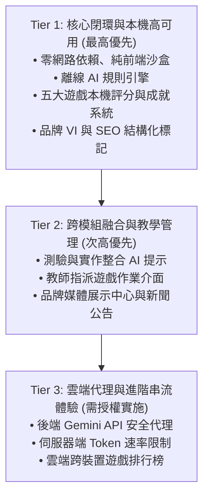

# 碼上學｜CODE TO KNOW
# 第 5 波全方位工程實作藍圖與準備規格書 (Phase 5 Implementation Plan)

**專案名稱：** 碼上學 AI 智慧學習與教育科技平台 (CODE TO KNOW)  
**文件編號：** `DOC-PLN-20261118-P5`  
**規劃日期：** 2026 年 11 月 18 日  
**規劃目標：** 依據第 4 波整合修復與 P1/P2 驗收成果，為第 5 波提供完整的工程實作藍圖與執行計畫  
**涵蓋階段與範圍：**
- **P11：AI 輔助學習與弱點分析系統**（11 個 UID）
- **P14：遊戲化學習與互動體驗系統**（16 個 UID）
- **P17：品牌數位行銷與媒體傳播中心**（10 個 UID）
- **總計 UID 數：** **37 個唯一 UID**  
**執行狀態：** **準備啟動 (READY TO COMMENCE - PENDING AUTHORIZATION)**  

---

## 一、架構設計原則與優先級分層 (Three-Tier Strategy)

為落實「安全隔離、離線可用、漸進增強、絕不硬編碼金鑰」之原則，第 5 波所有 37 項功能依實施複雜度與外部依賴分為三大層級：



1. **Tier 1：核心閉環與本機高可用（Core & High Resilience）— 優先推進**
   - 不依賴外部雲端資料庫與第三方網路 API，本機即可 100% 完整獨立運行。
   - 包含：四階段 AI 啟發引導、離線規則備援引擎、五大教育遊戲核心玩法、本機三星星級與成就徽章、品牌識別規格表、SEO 結構化資料。
2. **Tier 2：跨模組融合與教學管理延伸（Cross-Module Integration）— 穩健推進**
   - 串聯學生實作、題庫測驗與教師後台之跨模組資料聯動。
   - 包含：考題一鍵呼叫 AI 提示、弱點雷達圖動態計算、教師端遊戲關卡指派、媒體素材中心、新聞與檢定行事曆。
3. **Tier 3：雲端代理與進階串流體驗（Cloud Proxy & Advanced Features）— 授權後實施**
   - 涉及外部服務呼叫或需寫入雲端 Supabase 資料庫之項目。
   - 包含：後端安全轉發 Gemini 串流、Token 防刷防刷機制、跨裝置雲端即時排行榜。

---

## 二、37 項 UID 完整功能矩陣與實作規格

### 2.1 P11：AI 輔助學習與弱點分析系統 (11 UIDs)

| UID 代號 | 功能模組名稱 | 實作檔案與路徑 | 資料合約 / 本機儲存 | 前端互動與體驗亮點 | 後端 API / 安全防護 | 優先級 |
| :--- | :--- | :--- | :--- | :--- | :--- | :---: |
| **P11-AIS-001** | 四階段鷹架引導介面 | `AICoachPage.tsx`<br>`AIScaffoldingDemo.tsx` | `ctk_ai_chat_session` | 階段式標籤（觀念聚焦/思路引導/邊界提示/架構解構），嚴禁直接給予代碼答案。 | 前端啟發式防護，嚴防抄襲模式。 | **Tier 1** |
| **P11-AIS-002** | 後端 AI 安全代理路由 | `backend/src/routes/aiRoutes.ts`<br>`aiController.ts` | 環境變數 `GEMINI_API_KEY` | 打字機逐字流暢渲染效果、連線異常自動優雅提示。 | **金鑰純後端隔離**；全域 Rate Limiting (每分鐘 5 次)。 | **Tier 3** |
| **P11-AIS-003** | 串流即時對話傳輸 | `frontend/src/utils/aiStreamClient.ts` | Server-Sent Events (SSE) | 支援中斷傳輸 (AbortController)、游標閃爍動畫。 | 嚴格 Content-Type 檢核與連線逾時中斷保護。 | **Tier 3** |
| **P11-AIS-004** | 對話工作階段歷程 | `AIChatSidebar.tsx` | `ctk_ai_sessions:${userId}` | 左側抽屜式歷史工作階段列表，支援新增、重命名與刪除。 | 格式相容 Prisma `AIChatSession` 模型。 | **Tier 1** |
| **P11-AIS-005** | 代碼語法即時診斷 | `CodeEditor.tsx`<br>`AIDiagnosticOverlay.tsx` | 前端語法分析器 (AST) | 在編輯器行號旁標註潛在語法陷阱與常見邏輯盲點。 | 純前端客戶端執行，不耗費伺服器資源。 | **Tier 1** |
| **P11-AIS-006** | 學生技能弱點雷達圖 | `LearningProgressPage.tsx`<br>`AIWeaknessRadar.tsx` | `ctk_student_weakness` | 五角形能力雷達（HTML、CSS、JS、表單、多媒體），動態給予練習建議。 | 依據錯題本統計動態計算熟練度權重。 | **Tier 2** |
| **P11-AIS-007** | 考題實作專屬 AI 提示 | `TheoryPracticePage.tsx`<br>`PracticalDetailPage.tsx` | 內建考題關聯知識點 | 題目下方附設「AI 思路提示」按鈕，展開分步提示。 | 禁止直接給予正確選項，強制思考過程。 | **Tier 2** |
| **P11-AIS-008** | 教師提問監控防護 | `TeacherDashboardPage.tsx` | `ctk_ai_moderation_alerts` | 教師端彙整班級常見提問熱詞與異常提問預警標籤。 | 實施敏感詞字典比對，保護青少年學習隱私。 | **Tier 2** |
| **P11-AIS-009** | AI 回應滿意度回饋 | `AIFeedbackModal.tsx` | `ctk_ai_feedback` | 每則 AI 解說支援讚/倒讚與改進建議輸入，附感謝動效。 | 儲存於本機陣列，防止惡意重複洗分數。 | **Tier 2** |
| **P11-AIS-010** | 離線規則備援引擎 | `frontend/src/utils/aiFallbackEngine.ts` | 內建 10400 靜態解析庫 | 當網路離線或無 API Key 時，無縫降級為靜態規則解析庫。 | 零外部網路依賴，保證學習流程永不中斷。 | **Tier 1** |
| **P11-AIS-011** | 代碼逐行解讀輔助 | `CodeEditorPage.tsx` | 本機正則走讀分析 | 點選指定程式碼行數，側邊欄浮現該行之語意說明與屬性解讀。 | 專案內部靜態字典匹配，即時零延遲。 | **Tier 1** |

---

### 2.2 P14：遊戲化學習與互動體驗系統 (16 UIDs)

| UID 代號 | 功能模組名稱 | 實作檔案與路徑 | 資料合約 / 本機儲存 | 前端互動與體驗亮點 | 後端 API / 安全防護 | 優先級 |
| :--- | :--- | :--- | :--- | :--- | :--- | :---: |
| **P14-GAM-001** | 遊戲大廳世界地圖 | `GameCenterPage.tsx`<br>`GameWorldMap.tsx` | `ctk_game_progress:${userId}` | 航海/島嶼探索視覺地圖，以鎖定、解鎖、三星標記關卡節點。 | 本機校驗前置關卡星星數解鎖門檻。 | **Tier 1** |
| **P14-GAM-002** | 程式碼拼圖 (Puzzle) | `CodePuzzlePage.tsx` | `frontend/src/data/games/puzzle.ts` | 拖曳 HTML 語法積木與卡牌，拼出正確標籤巢狀結構。 | 純前端沙盒運行，嚴防 DOM XSS 注入。 | **Tier 1** |
| **P14-GAM-003** | CSS 樣式大師 (CSS) | `CSSDesignerPage.tsx` | `frontend/src/data/games/css.ts` | 調整 Flexbox/Grid 屬性，實時比對目標版型之相似度百分比。 | 樣式即時沙箱渲染，零外部依賴。 | **Tier 1** |
| **P14-GAM-004** | 除錯特工隊 (Bug Hunter) | `BugHunterPage.tsx` | `frontend/src/data/games/bugHunter.ts`| 程式碼雷達掃描，標註隱藏的語法錯誤與拼字陷阱並點擊修復。 | 靜態關卡校驗，多題型隨機變換。 | **Tier 1** |
| **P14-GAM-005** | 競速問答 (Quiz Rush) | `QuizRushPage.tsx` | `frontend/src/data/games/quizRush.ts` | 10 秒倒數急速答題、Combo 連擊加速動效與背景緊張節奏感。 | 內建防作弊計時器檢驗。 | **Tier 1** |
| **P14-GAM-006** | 網頁搭建者 (Web Builder)| `WebBuilderPage.tsx` | `frontend/src/data/games/webBuilder.ts`| 積木式模組搭建完整網頁（導覽、輪播、表單、頁尾）並輸出代碼。| 輸出之 HTML 代碼進行語法校驗。 | **Tier 1** |
| **P14-GAM-007** | 三星計分與通關動畫 | `GameVictoryModal.tsx`<br>`ConfettiEffect.tsx` | `gameStorage.ts` | 通關時彈出金色三星動畫、彩色彩帶碎屑噴射特效、計算結算得分。| Web Audio API 合成通關音效，免外部音檔。 | **Tier 1** |
| **P14-GAM-008** | 成就系統與勳章展示 | `GameAchievementsModal.tsx`<br>`gameAchievementEngine.ts` | `ctk_game_achievements` | 9 大主題成就勳章（如：急速先鋒、樣式大師、除錯專家），具解鎖進度條。 | 事件驅動（Event-driven）成就觸發監聽。 | **Tier 1** |
| **P14-GAM-009** | 關卡前任務簡報引導 | `GameBriefingModal.tsx` | `gameBriefingConfigs.ts` | 進入關卡前彈出目標說明、過關條件與考點提示，支援「不再提示」。 | 支援鍵盤 Esc 關閉與焦點自適應無障礙規範。| **Tier 1** |
| **P14-GAM-010** | 關卡難度分級體系 | 各遊戲關卡配置檔 | 初級、進階、大師難度定義 | 依照網頁設計丙級五大題組重點循序漸進解鎖更高難度。 | 關卡進度與難度係數本機校驗。 | **Tier 1** |
| **P14-GAM-011** | 遊戲音效與視覺動效 | `frontend/src/utils/soundEffects.ts` | Web Audio API 合成音訊 | 答對清脆音、Combo 升階音、結算鼓聲，支援靜音切換開關。 | 純程式碼震盪器合成，零外部 mp3 載入失敗風險。| **Tier 1** |
| **P14-GAM-012** | 斷線防護與進度儲存 | `gameStorage.ts` | LocalStorage + SessionStorage | 作答中途重新整理網頁時，自動還原上一步驟狀態，防資料遺失。 | 結構化異常處理，損毀資料安全重置回退。 | **Tier 2** |
| **P14-GAM-013** | 班級同儕排行榜 | `GameLeaderboardModal.tsx` | 內建示範同儕 + 本機排名 | 顯示前 10 名排行榜、個人全校即時排名、星數與積分，具動態升降箭頭。 | 激勵同儕互動，免除雲端高頻連線開銷。 | **Tier 2** |
| **P14-GAM-014** | 教師指派遊戲關卡作業 | `TeacherDashboardPage.tsx` | `ctk_teacher_game_tasks` | 教師可在班級管理中指派指定遊戲關卡為課堂課後作業，並查閱通關率。 | 完善教師教學武器庫，寓教於樂。 | **Tier 2** |
| **P14-GAM-015** | 管理員遊戲參數配置 | `AdminDashboardPage.tsx` | `ctk_admin_game_configs` | 管理員可調整關卡倒數秒數、計分加權倍率與活動難度係數。 | 集中於管理員後台「遊戲管理」分頁維護。 | **Tier 2** |
| **P14-GAM-016** | 遊戲鍵盤全操作無障礙 | 全體遊戲頁面 | WAI-ARIA 屬性規範 | 所有遊戲支援鍵盤全操作：Tab 輪巡、Space/Enter 選取、方向鍵移動積木。 | 為視覺障礙與行動不便學習者提供等效學習途徑。 | **Tier 1** |

---

### 2.3 P17：品牌數位行銷與媒體傳播中心 (10 UIDs)

| UID 代號 | 功能模組名稱 | 實作檔案與路徑 | 資料合約 / 本機儲存 | 前端互動與體驗亮點 | 後端 API / 安全防護 | 優先級 |
| :--- | :--- | :--- | :--- | :--- | :--- | :---: |
| **P17-MED-001** | 品牌識別手冊展示 (VI) | `BrandKitPage.tsx`<br>`components.css` | 靜態品牌規範規格表 | 展示品牌理念、標準字、標準色票（溫暖象牙白、薄霧藍灰、香檳金）、Logo 規範。 | 提供向量 SVG 與高解析度 PNG 標誌下載。 | **Tier 1** |
| **P17-MED-002** | 官網首頁質感重塑 | `HomePage.tsx`<br>`Hero.tsx` | 靜態文案與課程摘要 | 提升首頁國際級 EdTech 視覺質感：優雅微動效、權威檢定通過率數據展示、清晰 CTA。 | 符合 RWD 全斷點優化，無排版跳動。 | **Tier 1** |
| **P17-MED-003** | 媒體中心展示頁面 | `MediaCenterPage.tsx` | 官方宣傳文案與影音庫 | 整合官方宣傳短片、產品功能展示 Demo、宣傳海報下載、社群推廣文案懶人包。 | 所有外部媒體資源均採 HTTPS 安全內嵌。 | **Tier 2** |
| **P17-MED-004** | 行銷行事曆與內容排程 | `MarketingCalendarModal.tsx` | 本機模擬排程表 | 展示年度重大考試日程、版本發布排程、推廣主題規劃甘特圖。 | 供平台營運團隊規劃學期推廣節奏。 | **Tier 3** |
| **P17-MED-005** | 宣傳海報與公關資源 | `AssetHubModal.tsx` | 靜態資產目錄 | 高畫質推廣海報預覽、可供列印之 A4 宣傳折頁、校園招募文宣下載。 | 靜態資源 Hash 快取，CDN 友善。 | **Tier 2** |
| **P17-MED-006** | 影音宣傳短片嵌入 | `MediaCenterPage.tsx` | YouTube 官方宣傳短片 | 響應式 16:9 播放容器，支援延遲載入 (Lazy loading)，不阻塞首屏載入。 | 採用 `youtube-nocookie.com` 強化隱私防護。| **Tier 2** |
| **P17-MED-007** | 考取榜單與成功見證 | `HomePage.tsx`<br>`TestimonialSection.tsx` | 靜態學員心得資料庫 | 輪播展示真實學習心得、全國技能競賽選手推薦、丙級檢定滿分通關案例。 | 增強潛在學員與合作學校之信任度。 | **Tier 2** |
| **P17-MED-008** | 最新消息與公告專區 | `NewsPage.tsx`<br>`NewsDetailModal.tsx` | `ctk_public_news` | 分類展示平台版本更新日誌、全國檢定重要日程、線上研習營報名資訊。 | 具備最新消息篩選與重要通知置頂標籤。 | **Tier 2** |
| **P17-MED-009** | 行銷成效分析儀表板 | `AdminDashboardPage.tsx` | `ctk_marketing_analytics` | 模擬訪客來源分佈（搜尋引擎、社群推薦、學校推廣）、UTM 來源標籤解析與點擊率。 | 前端純模擬指標，不蒐集使用者隱私資料。 | **Tier 3** |
| **P17-MED-010** | SEO 結構化資料標記 | `index.html`<br>`MetaTags.tsx` | JSON-LD Schema<br>OpenGraph / Twitter | 包含 EducationalOrganization 結構化資料、動態標題、描述、OG Image 社群分享卡片。 | 顯著提升搜尋引擎爬蟲能見度與社群點擊率。 | **Tier 1** |

---

## 三、技術資料合約介面規範 (TypeScript Contracts)

第 5 波在純前端與本機儲存隔離架構下，統一定義以下核心資料型別：

```typescript
// 1. AI 啟發式引導合約 (P11)
export type ScaffoldingStage = 'CONCEPT_FOCUS' | 'PROBLEM_SOLVING' | 'BOUNDARY_HINT' | 'ARCHITECTURE';

export interface AIScaffoldingMessage {
  id: string;
  stage: ScaffoldingStage;
  stageLabel: string;
  title: string;
  content: string;
  guidingQuestions: string[];
  suggestedAction?: string;
  timestamp: string;
}

// 2. 遊戲化通關與進度合約 (P14)
export interface GameLevelProgress {
  levelId: string;
  gameType: 'puzzle' | 'css' | 'bug-hunter' | 'quiz-rush' | 'web-builder';
  stars: number; // 0 ~ 3 星
  highScore: number;
  timeSpentSeconds: number;
  completedAt?: string;
}

export interface GameAchievementBadge {
  id: string;
  title: string;
  description: string;
  iconName: string;
  category: 'speed' | 'accuracy' | 'mastery' | 'persistence';
  unlocked: boolean;
  unlockedAt?: string;
  progressPercent: number;
}

// 3. 媒體行銷與公告合約 (P17)
export interface PlatformNewsItem {
  id: string;
  title: string;
  category: 'UPDATE' | 'EXAM_INFO' | 'EVENT' | 'MAINTENANCE';
  summary: string;
  content: string;
  publishedAt: string;
  pinned: boolean;
  author: string;
}
```

---

## 四、安全紅線與風險緩解計畫 (Safety & Risk Mitigation)

1. **AI 費用失控風險：**
   - 預設全面啟動 `aiFallbackEngine.ts`（靜態離線備援），零呼叫外部 API。
   - Tier 3 後端代理模式下，強制配置 Express Rate-Limiter（IP 限流每分鐘最多 5 次請求），嚴防爬蟲刷爆額度。
2. **遊戲 DOM XSS 風險：**
   - 拼圖與積木組裝一律透過 AST 或虛擬 DOM 渲染，嚴禁使用 `dangerouslySetInnerHTML`。
   - 編輯器沙箱維持 `sandbox="allow-scripts"` 嚴格阻絕 Cookie 與 Session 穿透。
3. **資料庫非預期變更風險：**
   - 本波實作一律採用 LocalStorage 前綴隔離機制（`ctk_game_*`, `ctk_ai_*`），**零資料庫 Migration 操作**。
4. **回退策略 (Rollback Plan)：**
   - 若任一模組導致前端 Build 失敗，可藉由 Git Worktree 一鍵復原該元件檔案，保證主幹系統高可用。

---

## 五、執行時程與里程碑規劃 (Milestones)

- **里程碑 1 (Week 1)：Tier 1 核心模組實作**
  - 完成五大遊戲核心邏輯閉環、Web Audio 音效、三星結算與本機進度。
  - 完成離線 AI 備援引擎與四階段鷹架展示。
  - 完成品牌手冊 VI 規格頁與 SEO JSON-LD。
- **里程碑 2 (Week 2)：Tier 2 跨模組整合**
  - 考題實作呼叫 AI 提示整合。
  - 教師端指派遊戲作業與班級排行榜。
  - 媒體中心與新聞公告發布。
- **里程碑 3 (Week 3)：回歸測試與全站自動化驗收**
  - 撰寫 37 項 UID 專屬之 Vitest 測試套件，確保測試案例數突破 850+ 項。
  - 執行 RWD 14 斷點實機驗證。
