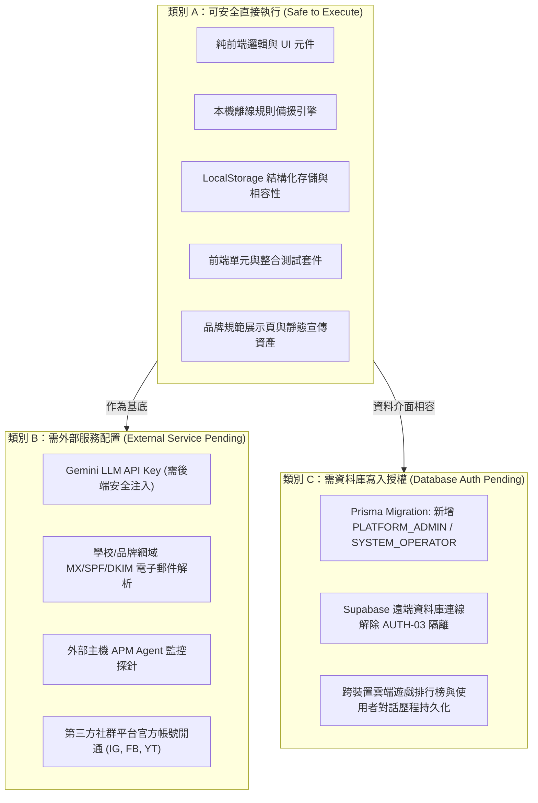

# 碼上學｜CODE TO KNOW
# 第五波主執行計畫書 (Phase 5 Master Execution Plan)

**專案名稱：** 碼上學 AI 智慧學習與教育科技平台 (CODE TO KNOW)  
**文件編號：** `DOC-PLN-20261118-P5-MASTER`  
**建立日期：** 2026 年 11 月 18 日  
**目前 Git 分支：** `develop` (HEAD: `502ccbc`)  
**覆核依據：**  
- `docs/FULL_PROJECT_INTEGRATED_AUDIT_REPORT.md`
- `docs/FULL_PROJECT_REPAIR_CHANGELOG.md`
- `docs/PHASE_5_IMPLEMENTATION_PLAN.md`
- `docs/RELEASE_READINESS_CHECKLIST.md`
- `docs/PROJECT_20_PHASE_PROGRESS_FINAL_20261115.md`
- `docs/P1_RELEASE_READINESS_REPAIR_REPORT.md`
- `docs/P2_VISUAL_ACCESSIBILITY_AND_P1_RECHECK_REPORT.md`

---

## 一、計畫宗旨與邊界約束

本計畫為「碼上學｜CODE TO KNOW」第五波工程之最高指導計畫書。
核心宗旨：**在堅守現有成果與安全紅線的前提下，針對第五波 P11（AI 輔助學習）、P14（遊戲化互動）、P17（品牌數位行銷）共 37 個法定 UID，建立可依序分批執行、零重複返工、零虛報進度的完整工程路徑。**

### 1.1 最高安全執行紅線
1. **嚴禁未授權 Git 寫入：** 不執行 `git commit`、`git push`、`git merge`、`git rebase`、`git tag`。
2. **嚴禁線上未授權部署：** 不執行 Render Production (`code-to-know-web`) 或 Preview 部署。
3. **嚴禁破壞性資料庫操作：** 不執行 Supabase 線上資料庫寫入或刪除、不執行 Prisma Migration、不修改正式 Schema。
4. **嚴禁環境設定與金鑰外洩：** 不變更正式環境 Secrets、不將任何 API Token 或 Bearer 憑證寫入追蹤檔案或終端日誌。
5. **嚴守教育內容真實性：** 不破壞或刪除勞動部官方五大術科題組（104301~104305）及其素材，不虛偽標記未串接之外部服務為 PASS。

---

## 二、工作分類準則 (Classification Criteria)

第五波 37 個 UID 的工程任務，嚴格切分為三大類別：



1. **類別 A（可安全直接執行）：**
   - 僅涉及前端 TypeScript/React 程式碼、本地資料模組、離線規則計算、前端單元測試。
   - 包含：五大遊戲本機完整閉環、遊戲成就引擎、關卡前簡報 Modal、四階段 AI 鷹架引導介面、離線規則備援解析、教師指派遊戲作業之本機介面原型、品牌手冊 VI 展示頁面、SEO 結構化 JSON-LD。
2. **類別 B（需外部服務配置）：**
   - 涉及第三方雲端 API 金鑰、網路服務合約或外部 DNS 設定。
   - 包含：後端 Gemini API 安全代理中繼、即時串流 SSE 連線、企業信箱 SMTP/MX 綁定、GA4 實體流量埋點。
3. **類別 C（需資料庫寫入授權）：**
   - 涉及 PostgreSQL 資料庫連線、Schema 變更或 Prisma 遷移。
   - 包含：正式資料庫 `Role` 表擴充、學生雲端做題歷程同步、雲端遊戲全球排行榜。

---

## 三、分批執行架構與循序路徑 (Batch Execution Sequencing)

為了達成高內聚、低耦合，第五波實作循序分為 6 個執行批次（Batches）：

```
┌─────────────────────────────────────────────────────────────┐
│ Batch 1: AI 鷹架引導深化與離線規則備援引擎 (P11 核心)         │
├─────────────────────────────────────────────────────────────┤
│ Batch 2: 五大互動遊戲核心玩法與成就系統閉環 (P14 核心)         │
├─────────────────────────────────────────────────────────────┤
│ Batch 3: 教師/管理員遊戲化教學管理延伸 (P14 整合)            │
├─────────────────────────────────────────────────────────────┤
│ Batch 4: 品牌手冊展示、媒體中心與 SEO 結構化 (P17 核心)      │
├─────────────────────────────────────────────────────────────┤
│ Batch 5: 跨模組整合 (考題/實作呼叫 AI 提示 + 錯題回流)       │
├─────────────────────────────────────────────────────────────┤
│ Batch 6: 第五波專屬迴歸測試、無障礙驗收與防禦性校驗           │
└─────────────────────────────────────────────────────────────┘
```

### 3.1 Batch 1：AI 鷹架引導深化與離線備援 (P11-AIS)
- **目標：** 完善四階段引導介面與本機離線題組解析字典。
- **工作項目：**
  - 在 `aiFallbackEngine.ts` 擴充涵蓋 10400 網頁設計丙級 5 大題組之常規錯誤知識圖譜。
  - 確保前端 `AICoachPage.tsx` 明確標註 `[展示版示範模型]` 與 `[本機規則引導]` 標籤。
  - 實作防抄襲機制：若學生輸入包含「直接給我代碼」、「解答是什麼」，自動觸發蘇格拉底反詰引導，嚴禁直接輸出完整程式碼解答。
- **測試驗證：** `frontend/tests/ai-scaffolding.test.ts`。

### 3.2 Batch 2：五大互動遊戲與成就系統閉環 (P14-GAM)
- **目標：** 確保五款遊戲 4 大關卡具備完整通關判定、三星計分與成就觸發。
- **工作項目：**
  - 驗證並補強 `CodePuzzlePage`（語法積木重組）、`CSSDesignerPage`（樣式調校容差）、`BugHunterPage`（行級除錯挑戰）、`QuizRushPage`（急速問答 Combo）、`WebBuilderPage`（語意元件搭建）。
  - 透過 Web Audio API 合成音效（答對清脆音、通關號角、Combo 升階），絕不依賴外部 mp3。
  - 完善 `GameAchievementsModal` 與 `gameAchievementEngine` 9 項成就解鎖判定。
- **測試驗證：** 各遊戲專屬測試套件及 `game-session-resilience.test.ts`。

### 3.3 Batch 3：教學管理延伸原型 (P14-GAM-014, 015)
- **目標：** 解決目前 `P14-GAM-014`（教師指派遊戲）與 `P14-GAM-015`（管理員遊戲設定）為 0% 之缺口。
- **工作項目：**
  - **教師端：** 在 `TeacherDashboardPage.tsx` 增設「班級遊戲任務指派」介面，教師可勾選 5 大遊戲指定關卡產生作業代碼，儲存於 `ctk_teacher_game_tasks`。
  - **管理員端：** 在 `AdminDashboardPage.tsx` 增設「遊戲參數調整」面板，支援調整秒數、容差門檻與加權分數，儲存於 `ctk_admin_game_configs`。
  - **安全原則：** 採用純前端與 LocalStorage 隔離實作，不觸發後端 DB 寫入。
- **測試驗證：** `frontend/tests/teacher-dashboard-classroom.test.tsx`。

### 3.4 Batch 4：品牌手冊、媒體中心與 SEO 標記 (P17-MED)
- **目標：** 具體落盤品牌識別規範與媒體中心展示頁面。
- **工作項目：**
  - 建立 `BrandKitPage.tsx`（路由 `#brand-kit`），動態呈現品牌核心色票（溫暖象牙白 `#F5F2EA`、深香檳金 `#7C663D`、薄霧藍灰 `#D9E2EA`）、Logo 安全間距與字體層級。
  - 建立 `MediaCenterPage.tsx`（路由 `#media`），展示官方宣傳短片嵌入容器、A4 宣傳折頁預覽與新聞公告清單。
  - 在 `index.html` 與相關元件增設標準 `schema.org/EducationalOrganization` JSON-LD 結構化標記。
- **測試驗證：** SEO 標記與品牌頁面渲染測試。

### 3.5 Batch 5：跨模組融合與錯題回流 (Cross-Module)
- **目標：** 打通「題庫測驗 → 錯題本 → AI 思路提示 → 遊戲化練習」之學習閉環。
- **工作項目：**
  - 在 `TheoryPracticePage.tsx` 題目解析區，增加「呼叫 AI 思路提示」按鈕，展開該題對應之概念鷹架。
  - 在 `QuizRushPage.tsx` 答錯題目時，自動回流至 `ctk_wrong_questions` 錯題本。
- **測試驗證：** 跨模組整合單元測試。

### 3.6 Batch 6：全站自動化迴歸驗收與建置
- **目標：** 確保全站測試覆蓋率持續提升，Production Build 零錯誤。
- **驗收標準：**
  - 前端測試 ≥ 546 項 PASS。
  - 後端測試 ≥ 221 項 PASS。
  - 總測試數 ≥ 767 項 100% PASS。
  - `npm run build --prefix frontend` 編譯耗時 ≤ 3.5 秒，0 錯誤。

---

## 四、回退機制與緊急中斷預案 (Rollback & Abort Procedures)

1. **程式碼級別回退：**
   - 由於所有操作均未 Commit，若任一實作引起型別毀損或測試失敗，使用 `git checkout -- <file>` 或 `git restore <file>` 即可秒級恢復至初始乾淨基準。
2. **存儲資料隔離回退：**
   - 所有測試與本地原型資料均配置獨立前綴（如 `ctk_test_*`），重置僅需呼叫 `clearStorage()`，絕不干擾既有學生進度。
3. **中斷條件：**
   - 若遇到必須執行資料庫連線、或必須取得正式雲端 API Key 才能推進之項目，一律標註 **BLOCKED / PENDING_AUTH** 並立即停步，向使用者回報。
