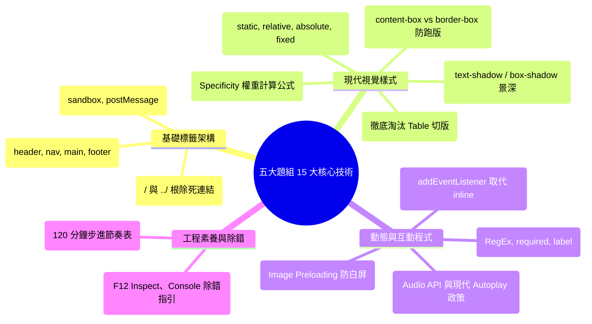

# CODE TO KNOW｜五大術科題組講義與影音知識差距分析報告

**專案名稱**：碼上學｜CODE TO KNOW  
**英文品牌**：CODE TO KNOW（Learn Beyond Limits.）  
**分析日期**：2026-11-17  
**研究依據**：11 冊 PDF 講義、19 支教學影片大綱、勞動部 173003B12 試題規範、MDN Web Docs 現代標準  
**檔案路徑**：`docs/PRACTICAL_KNOWLEDGE_GAP_ANALYSIS.md`  

---

## 目錄

1. [分析目的與技術標準演進背景](#一分析目的與技術標準演進背景)
2. [題組一（104301 校園社團介紹網）差異與缺漏分析](#二題組一104301-校園社團介紹網差異與缺漏分析)
3. [題組二（104302 運動廣場連結網）差異與缺漏分析](#三題組二104302-運動廣場連結網差異與缺漏分析)
4. [題組三（104303 國家公園介紹網）差異與缺漏分析](#四題組三104303-國家公園介紹網差異與缺漏分析)
5. [題組四（104304 網路行銷購物網）差異與缺漏分析](#五題組四104304-網路行銷購物網差異與缺漏分析)
6. [題組五（104305 書曼的旅遊相簿）差異與缺漏分析](#六題組五104305-書曼的旅遊相簿差異與缺漏分析)
7. [全域性 15 項核心網頁技術盲區深度盤查](#七全域性-15-項核心網頁技術盲區深度盤查)
8. [知識補充與原創教材轉化策略](#八知識補充與原創教材轉化策略)

---

## 一、分析目的與技術標準演進背景

### 1. 知識斷層的核心成因
勞動部「網頁設計丙級（職類代號 17300）」術科試題自民國 90 年代起草、經 104 年微調後延續至今。其官方評審表主要著眼於**「結果論」**（包含尺寸是否為 1024×768、檔案命名是否相符、連結行為是否正確、圖片是否超出邊框）。

然而，民間既有教材與坊間講義（如本次盤點之 11 冊 PDF）大多停留在 **2000 年代初期之「DreamWeaver + Table 切版 + 切圖工具」應試速成模式**。這導致學生雖然能機械式背誦按鈕點擊順序，卻面臨嚴重的三大知識斷層：
1. **語法盲區**：知其「點擊哪裡」，不知「底層產生了什麼 HTML/CSS 碼」。
2. **現代淘汰**：依賴已廢棄的標籤（如 `<marquee>`、`<embed>`、``）與專有套件（如 Spry Widget）。
3. **除錯無能**：在考場一旦遇到少點一個逗號或路徑錯誤，因缺乏「CSS 權重」與「相對路徑」概念，完全無法自主排查。

本報告旨在逐項對照講義、影音與官方試題，找出所有技術缺漏，為 CODE TO KNOW 打造自主、符合現代 Web 標準的教學內容奠定基石。

---

## 二、題組一（104301 校園社團介紹網）差異與缺漏分析

### 1. 知識點對照矩陣

| 知識點分類 | PDF 講義涵蓋程度 | 影片教學提及程度 | 現代標準與實質差距 | 是否需要獨立補充 |
|---|:---:|:---:|---|:---:|
| **操作流程** | 詳細（逐步圖文） | 詳細（示範演練） | 講義側重 DreamWeaver 工具列點擊，未提 VS Code 操作 | **是（補充現代代碼工作流）** |
| **技術原理** | 極低（無原理說明） | 中等（說明視覺效果） | 僅交代輸入數值，未解釋 Table 盒模型與 Frame 運作原理 | **是（補充盒模型與佈局原理）** |
| **特殊程式碼** | 僅呈現自動生成碼 | 中等（標註重點標籤） | 使用已淘汰之 `<marquee>` 與非標準屬性 | **是（補充 CSS 動畫對照）** |
| **常見錯誤** | 極少（僅提示存檔路徑） | 高（強調 Target 錯誤） | 未系統化列出 10 大常見失分陷阱與排查流程 | **是（補充錯誤排查表）** |
| **延伸技巧** | 無 | 低（偶有提及快捷鍵） | 缺乏 Flexbox / CSS 居中與現代 RWD 觀念 | **是（補充現代延伸練習）** |

### 2. 核心技術缺漏剖析
- **Target 導覽行為本質**：講義僅標註「設定目標：_top」，未解釋瀏覽器 Browsing Context（`_self`, `_blank`, `_parent`, `_top`）的層級關係，導致學生換個場景便無法理解。
- **跑馬燈現代化解法**：試題要求文字由右向左滾動。講義使用 `<marquee>`，但現代瀏覽器已標記為 Deprecated。教材應教授如何以 CSS `@keyframes` 實現平滑無抖動的現代跑馬燈，並兼容官方評分。

---

## 三、題組二（104302 運動廣場連結網）差異與缺漏分析

### 1. 知識點對照矩陣

| 知識點分類 | PDF 講義涵蓋程度 | 影片教學提及程度 | 現代標準與實質差距 | 是否需要獨立補充 |
|---|:---:|:---:|---|:---:|
| **操作流程** | 詳細（分 3 冊步驟） | 詳細（連續操作） | 依賴 Spry Menu 與 Spry Tab（軟體已停產） | **是（提供現代純 CSS 解法）** |
| **技術原理** | 低（僅填寫數值） | 中（解釋陰影外觀） | 未解釋 CSS `text-shadow` 四大參數（X, Y, Blur, Color） | **是（補充陰影物理視覺原理）** |
| **特殊程式碼** | Spry JavaScript 封裝 | 中（提示引入 JS） | Spry 代碼冗長且在現代瀏覽器易拋出警告 | **是（以輕量原生 JS 重寫）** |
| **常見錯誤** | 低（僅提示檔名） | 高（強調 Radio 互斥） | 未說明表單 `<label>` 對齊與重置失效原因 | **是（補充表單除錯手冊）** |
| **延伸技巧** | 無 | 低 | 缺乏 CSS 變數與 Tab 鍵鍵盤無障礙操作指引 | **是（補充無障礙與微互動）** |

### 2. 核心技術缺漏剖析
- **Spry 元件致命依賴**：講義耗費大量篇幅指導如何插入 Spry 選單列與 TabbedPanels。現代開發者根本不應接觸此類私有庫。教材必須補足「HTML5 `<input type="radio">` + CSS `:checked`」或「原生 5 行 JavaScript」實現 Tab 切換的乾淨架構。
- **表單語意化缺漏**：講義製作表單時完全未加入 `<label>`，在現代無障礙標準與手機點擊體驗中屬於嚴重不良設計。

---

## 四、題組三（104303 國家公園介紹網）差異與缺漏分析

### 1. 知識點對照矩陣

| 知識點分類 | PDF 講義涵蓋程度 | 影片教學提及程度 | 現代標準與實質差距 | 是否需要獨立補充 |
|---|:---:|:---:|---|:---:|
| **操作流程** | 中等（圖解步驟） | 詳細（動態拉熱區） | 依賴 GIF 軟體合成輪播，忽視 CSS 輪播潛力 | **是（補充兩種實作對比）** |
| **技術原理** | 極低 | 中（說明座標原理） | 未解釋 `<map>` 像素座標系統與網頁縮放關係 | **是（補充座標幾何原理）** |
| **特殊程式碼** | 提供下載標籤片段 | 中（提醒副檔名） | `<a download>` 在跨域與本機協定下的安全性行為未提 | **是（補充檔案下載機制）** |
| **常見錯誤** | 低 | 高（強調多邊形漏勾） | 未說明熱區破界、點擊無反應之除錯方法 | **是（補充影像地圖排錯指引）** |
| **延伸技巧** | 無 | 低 | 缺乏 SVG `<polygon>` 現代熱區替代方案 | **是（補充 SVG 延伸知識）** |

### 2. 核心技術缺漏剖析
- **影像地圖（Image Map）侷限**：講義直接指導在靜態圖上拉座標。但現代網頁通常需要響應式縮放，傳統 `<map coords="...">` 一旦圖片寬度縮放即刻位移失效。教材應說明其歷史背景，並示範現代替代方案。
- **色彩調整與濾鏡**：講義使用 PhotoImpact 做 Ctrl+E 上色，教材應補充現代 CSS `filter: hue-rotate()` 與 `filter: saturate()` 的即時無損濾鏡技術。

---

## 五、題組四（104304 網路行銷購物網）差異與缺漏分析

### 1. 知識點對照矩陣

| 知識點分類 | PDF 講義涵蓋程度 | 影片教學提及程度 | 現代標準與實質差距 | 是否需要獨立補充 |
|---|:---:|:---:|---|:---:|
| **操作流程** | 詳細（伺服器架設） | 詳細（虛擬目錄） | 早期講義教 AppServ/XAMPP，現代考場多改用本機伺服器 | **是（補充現代本機伺服器）** |
| **技術原理** | 低（照抄文字） | 中（說明單選預設） | 未解釋 `<audio autoplay loop>` 的現代瀏覽器限制 | **是（補充音訊策略與 API）** |
| **特殊程式碼** | 內聯 `onClick="alert()"` | 中（提示字串引號） | 內聯 JavaScript 與現代 CSP 安全防護衝突 | **是（補充現代事件監聽器）** |
| **常見錯誤** | 低 | 高（強調新視窗開啟） | 未提 `target="_blank"` 安全性漏洞 | **是（補充 rel 屬性防護）** |
| **延伸技巧** | 無 | 低 | 缺乏 LocalStorage 購物車暫存概念 | **是（補充前端資料持久化）** |

### 2. 核心技術缺漏剖析
- **Autoplay 政策盲點**：現代主流瀏覽器（Chrome、Edge、Safari）為維護使用者體驗，預設阻擋帶有聲音的媒體自動播放。講義未解釋此原理，常導致學生在現代瀏覽器除錯時懷疑音訊檔案損壞。
- **Tabnabbing 安全隱患**：講義直接寫 `target="_blank"`，未加入 `rel="noopener noreferrer"`。教材應藉此向學生灌輸現代網路安全基礎。

---

## 六、題組五（104305 書曼的旅遊相簿）差異與缺漏分析

### 1. 知識點對照矩陣

| 知識點分類 | PDF 講義涵蓋程度 | 影片教學提及程度 | 現代標準與實質差距 | 是否需要獨立補充 |
|---|:---:|:---:|---|:---:|
| **操作流程** | 詳細（相簿排版） | 詳細（影像切換） | 大量使用 GIF 動態字體與多層巢狀 Table | **是（補充現代相簿 CSS 排版）** |
| **技術原理** | 極低（無 DOM 原理） | 中（說明換圖指令） | 僅交代複製 `document.images[...]`，未解構物件模型 | **是（詳解 DOM 與事件傳遞）** |
| **特殊程式碼** | 舊式 `MM_swapImage()` | 中（提示快取機制） | 依賴 DreamWeaver 自動生成的複雜相容包裝碼 | **是（以現代 2 行 JS 取代）** |
| **常見錯誤** | 低 | 高（強調框線跳動） | 未提 CSS `box-sizing: border-box` 對外框防抖的奇效 | **是（補充版面抖動解決方案）** |
| **延伸技巧** | 無 | 低 | 缺乏 Flexbox 彈性相簿與 Lightbox 燈箱特效 | **是（補充現代相簿組件設計）** |

### 2. 核心技術缺漏剖析
- **DreamWeaver 毒瘤代碼（`MM_swapImage`）**：舊式講義直接插入數十行 `MM_findObj`、`MM_preloadImages` 等 90 年代相容性遺留代碼，學生宛如看天書。教材必須證明：在現代瀏覽器中，只需 `document.getElementById('largePic').src = newSrc;` 一行即可優雅達成。
- **盒模型破壞版面**：學生在為縮圖加 2px/5px 邊框時，常因未設定 `box-sizing: border-box` 導致卡片被邊框撐大而擠落至下一行。講義未提根本原因，僅叫學生縮減表格寬度，這是最典型的「知其然不知其所以然」。

---

## 七、全域性 15 項核心網頁技術盲區深度盤查

本專案針對五大題組涉及之 15 大底層技術進行嚴格審查與查證，明確補充標準：

### 15 項盲區具體分析摘要：
1. **語意標籤**：講義全站由 `<table>`、`<tr>`、`<td>` 堆疊，無任何語意。教材將建立對應映射表（`table#header` $\rightarrow$ `<header>`, `td#menu` $\rightarrow$ `<nav>`）。
2. **路徑認知**：學生常混淆 `images/`、`./images/` 與 `../images/`。教材將提供樹狀目錄視覺圖解。
3. **CSS 權重**：講義隨處濫用 `style=""` 內聯樣式。教材傳授 `id (100) > class (10) > element (1)` 權重階梯。
4. **盒模型**：徹底剖析 `box-sizing: border-box` 為何是現代切版第一行必備語法。
5. **Flexbox / Grid**：示範如何以 3 行 Flexbox 完美取代 30 行複雜 Table 儲存格合併。
6. **定位機制**：詳解 `relative` 作為錨點、`absolute` 精確定位的圖解原理。
7. **陰影物理學**：解構 `text-shadow: 10px 10px 15px #333` 在題組二中的立體感表現。
8. **原生事件監聽**：教導以標準 `element.addEventListener('click', fn)` 替代過時的 HTML 標籤內 `onClick="..."`。
9. **表單可存取性**：補齊 `<label for="id">` 點擊文字即可選取單選框的使用者體驗細節。
10. **圖片格式策略**：分析 JPG（相片）、PNG（透明標誌）、GIF（簡單動畫）、SVG（向量無損）之適用時機。
11. **音訊 API**：解析現代 Web Audio 與 Autoplay 政策演進。
12. **防白屏預載**：在題組二與題組五展示 JavaScript `new Image()` 預載優勢。
13. **F12 除錯術**：教導學生看 Console 紅字、檢查 Network 404，擺脫「找不到圖片瞎猜」的盲目操作。
14. **瀏覽器相容性**：剖析 Chrome、Firefox、Edge 與 Safari 算繪差異。
15. **檢定時間管理**：歸納「前 15 分鐘目錄與素材合成、中間 60 分鐘主框架與內容、後 30 分鐘表單與互動、最後 15 分鐘全站逐頁檢查」的黃金 120 分鐘時間管理法。

---

## 八、知識補充與原創教材轉化策略

1. **去蕪存菁**：保留官方 173003B12 的「考綱要求」作為骨架，將 PDF 講義中陳舊的軟體工具步驟轉化為「底層技術邏輯」。
2. **雙軌對照**：教材同時呈現「考場最速應試解法」與「現代業界標準解法」，讓學生既能順利通過檢定，又能真正掌握就業實戰技能。
3. **鷹架學習**：在互動教材中導入 4 階 AI 思考引導，讓學生在遇到 Target 錯誤或路徑失效時，學會看開發者工具自我診斷，而非死背答案。
