# CODE TO KNOW｜五大術科題組 PDF 講義內容完整盤點報告

**專案名稱**：碼上學｜CODE TO KNOW  
**英文品牌**：CODE TO KNOW（Learn Beyond Limits.）  
**盤點日期**：2026-11-17  
**研究模式**：逐冊逐頁文字結構與知識點實質稽核（Non-Plagiarism Deep Audit）  
**正式職類**：勞動部技能檢定 17300 網頁設計丙級技術士（104301 ～ 104305）  
**檔案路徑**：`docs/PRACTICAL_PDF_CONTENT_AUDIT.md`  

---

## 目錄

1. [盤點背景與版權遵循聲明](#一盤點背景與版權遵循聲明)
2. [官方規範與 11 冊 PDF 講義總覽清冊](#二官方規範與-11-冊-pdf-講義總覽清冊)
3. [題組一：104301 校園社團介紹網 PDF 深度盤點](#三題組一104301-校園社團介紹網-pdf-深度盤點)
4. [題組二：104302 運動廣場連結網 PDF 深度盤點](#四題組二104302-運動廣場連結網-pdf-深度盤點)
5. [題組三：104303 國家公園介紹網 PDF 深度盤點](#五題組三104303-國家公園介紹網-pdf-深度盤點)
6. [題組四：104304 網路行銷購物網 PDF 深度盤點](#六題組四104304-網路行銷購物網-pdf-深度盤點)
7. [題組五：104305 書曼的旅遊相簿 PDF 深度盤點](#七題組五104305-書曼的旅遊相簿-pdf-深度盤點)
8. [講義共通核心技術模式與歷史軟體侷限分析](#八講義共通核心技術模式與歷史軟體侷限分析)
9. [盤點結論與獨立教材轉換建議](#九盤點結論與獨立教材轉換建議)

---

## 一、盤點背景與版權遵循聲明

### 1. 盤點目的
本文件旨在針對專案內既有之五大正式術科題組資料夾（`題組一答案` 至 `題組五答案`）所附之 11 冊 PDF 講義，以及勞動部官方術科規範手冊（`173003B12.pdf`），進行系統性盤點與技術提煉，找出各題組的操作核心、技術限制與未被充分解釋的知識盲區，作為建構本專案「獨立原創、符合現代標準」之互動教學教材依據。

### 2. 版權保護與原創教學規範（Non-Plagiarism Policy）
- **非逐字轉錄**：本盤點僅分析講義中的操作邏輯、步驟架構與所涉技術，**嚴禁將講義之原文段落、版權截圖或他人著作逐字抄襲發布於公開網站**。
- **概念重構與現代化**：五大題組的評分依據為勞動部官方公開之檢定規範（包含檔名、排版尺寸、連結行為與圖形規格）。本專案教材將以自研之現代化語法（HTML5、CSS3、ES6+ JavaScript）重新詮釋技術原理，輔以自製流程圖、沙盒互動及練習檢核表，確保擁有 100% 獨立教學價值與智慧財產權。

---

## 二、官方規範與 11 冊 PDF 講義總覽清冊

經系統級全面掃描，五大題組實體答案資料夾內共計收錄 **11 冊分冊講義**（合計 54 頁），並以根目錄 `173003B12.pdf`（官方術科應檢參考資料，118 頁）作為單一評分規準：

| 題組代號 | 題組正式名稱 | 講義檔案名稱 | 頁數 | 檔案大小 | 涉及核心技術與工具 |
|:---:|---|---|:---:|:---:|---|
| **規範** | 術科測試應檢參考資料 | `173003B12.pdf` | 118 頁 | 4.13 MB | 官方評審規準、五大題組試題說明、評分扣分項目表 |
| **104301** | 校園社團介紹網 (分冊 1) | `網頁設計 術科講義 題組一 校園社團介紹網-1.pdf` | 6 頁 | 862 KB | 目錄建置、Logo 影像合成、表格切版、跑馬燈、選單按鈕 |
| **104301** | 校園社團介紹網 (分冊 2) | `網頁設計 術科講義 題組一 校園社團介紹網-2.pdf` | 6 頁 | 570 KB | 日期更新、main 內容區、社史/活動頁、錨點 TOP、頁尾版權 |
| **104302** | 運動廣場連結網 (分冊 1) | `網頁設計 術科講義 題組二 運動廣場連結網-1.pdf` | 5 頁 | 665 KB | 框架尺寸 1024×768、橫幅文字陰影、Spry 水平選單列 |
| **104302** | 運動廣場連結網 (分冊 2) | `網頁設計 術科講義 題組二 運動廣場連結網-2.pdf` | 6 頁 | 827 KB | 最新消息帶狀排版、縮圖切換原圖展示區、Tab 標籤頁切換 |
| **104302** | 運動廣場連結網 (分冊 3) | `網頁設計 術科講義 題組二 運動廣場連結網-3.pdf` | 4 頁 | 562 KB | 棒球/游泳介紹、訪客留言板 (6×2 表單與重置)、資料來源頁 |
| **104303** | 國家公園介紹網 (分冊 1) | `網頁設計 術科講義 題組三 國家公園介紹網-1.pdf` | 4 頁 | 824 KB | 4 張標題圖輪播 GIF、圖片色相/彩度上色、表格排版、跑馬燈 |
| **104303** | 國家公園介紹網 (分冊 2) | `網頁設計 術科講義 題組三 國家公園介紹網-2.pdf` | 4 頁 | 592 KB | 7×1 垂直選單 Hover 變色、檔案下載超連結、多邊形影像地圖 |
| **104304** | 網路行銷購物網 (分冊 1) | `網頁設計 術科講義 題組四 網路行銷購物網-1.pdf` | 5 頁 | 847 KB | 本機伺服器目錄規範、橫幅文字陰影、跑馬燈與內容共用背景 |
| **104304** | 網路行銷購物網 (分冊 2) | `網頁設計 術科講義 題組四 網路行銷購物網-2.pdf` | 6 頁 | 663 KB | 3×3 商品展示表格、TOP 平滑返回、JS 對話框購物確認表單 |
| **104305** | 書曼的旅遊相簿 (分冊 1) | `網頁設計 術科講義 題組五 書曼的旅遊相簿-1.pdf` | 4 頁 | 582 KB | 動態文字 GIF、木紋相框影像合成、album5 電子相簿縮圖排版 |
| **104305** | 書曼的旅遊相簿 (分冊 2) | `網頁設計 術科講義 題組五 書曼的旅遊相簿-2.pdf` | 4 頁 | 749 KB | 三分割版面、12×1 選單按鈕變色交換、蘭嶼影像地圖、背景音樂 |
| **合計** | **五大題組全收錄** | **11 冊分冊講義 + 1 冊官方規準** | **172 頁** | — | 完整覆蓋五大題組之實作流程 |

---

## 三、題組一：104301 校園社團介紹網 PDF 深度盤點

### 1. 涵蓋分冊
- `網頁設計 術科講義 題組一 校園社團介紹網-1.pdf`（6 頁）
- `網頁設計 術科講義 題組一 校園社團介紹網-2.pdf`（6 頁）

### 2. 章節與操作步驟
- **分冊 1 步驟**：
  - （一）建置資料夾：於本機 `C:\` 建立 `web01` 與 `images` 目錄。
  - （二）製作標題圖片：透過影像工具開啟 `logo1.png` 與 `logo2.png`，合成輸出為指定之 `logo.png` (994×60px)。
  - （三）製作校長玉照圖片：將素材 `0102.jpg` 與 `0103.jpg` 裁切合成為 `0104.jpg` (250×250px)。
  - （四）建立網站架構：定義根目錄檔案。
  - （五）設定首頁 `index.html`：以 Table 劃分標題區 (1000×65)、跑馬燈廣告區 (770×29)、選單區 (215×...)、內容區 (770×...) 與頁尾區 (1000×20)。
  - （七）設定跑馬燈：插入「歡迎光臨校園社團介紹網...」，設定標楷體、24px、顏色 `#0000FF`。
  - （八）製作選單區：製作按鈕並設定平常狀態 `menu1.png` 與 Hover 狀態 `menu2.png`。
- **分冊 2 步驟**：
  - （一）建置資料夾：下載解壓基礎檔。
  - （二）製作日期更新區：文字格式設定與最近更新日期動態填寫。
  - （三）設定網頁內容區 `main.html`：置入校長玉照與歡迎詞。
  - （四）設定吉他社社史網頁 `guitar_history.html`：圖文排版與「回社團介紹首頁」連結。
  - （五）設定近期活動公告網頁 `guitar_event.html`：表格排版、錨點超連結 `#top`。
  - （七）設定頁尾版權區：版權文字置中排版。

### 3. 涉及技術
- HTML `<table>` 排版、`<marquee>` 標籤、`<a>` 標籤與 `target` 屬性。
- CSS 偽類別 `:hover`、類別選擇器（`.f4`, `.b1`）、命名錨點（Named Anchor `#top`）。
- 影像軟體（PhotoImpact/PhotoCap）圖層複製、裁切與尺寸重設。

### 4. 重要操作及注意事項
- **超連結 Target 陷阱**：子頁面之「回社團介紹首頁」必須明確指定 `target="_top"`，否則會在內容區內形成巢狀首頁割裂（嚴重失分項）。
- **左側選單 Target**：選單超連結必須指定 `target="content"`，使內容加載至右側內容區。
- **版面居中**：主容器必須在瀏覽器視窗中水平居中。

### 5. 講義尚未充分說明的知識盲區
- 為什麼現代網頁應棄用 `<marquee>` 改用 CSS `@keyframes` 動畫（無障礙與標準相容性）。
- 為什麼 `table` 佈局不符合現代 RWD 響應式網頁，以及如何改以 CSS `Flexbox` 或 `Grid` 實現同等 1000×768 區域劃分。
- 命名錨點平滑捲動（`scroll-behavior: smooth`）的現代原理。

---

## 四、題組二：104302 運動廣場連結網 PDF 深度盤點

### 1. 涵蓋分冊
- `網頁設計 術科講義 題組二 運動廣場連結網-1.pdf`（5 頁）
- `網頁設計 術科講義 題組二 運動廣場連結網-2.pdf`（6 頁）
- `網頁設計 術科講義 題組二 運動廣場連結網-3.pdf`（4 頁）

### 2. 章節與操作步驟
- **分冊 1 步驟**：
  - （一）建置資料夾：建立 `web02` 與 `images`，放置 12 個圖形檔。
  - （二）建立網站架構：定義 `index.html`。
  - （三）設定首頁：外圍背景 `#42413C`，內圍背景 `#FFFFFF`，版面 1024×768px 置中。
  - （四）設定網站標題區：插入 `logo.png` (180×90px)，文字「運動廣場連結網」（標楷體 52px 白色，CSS 陰影 10px/15px `#333333`）。
  - （五）設定選單區：採用 DreamWeaver Spry 水平選單列元件。
- **分冊 2 步驟**：
  - （二）設定最新消息區：寬 280px，交錯背景顏色 `#FFFFCC` 與 `#DDDDDD`。
  - （三）設定圖片展示區：背景 `#333333`，上方大圖切換，下方縮圖與說明文字。
  - （四）設定健康天地網頁 `health.html`：以 Spry Tab 標籤頁呈現 4 項健康訊息（來自 `0203.txt`）。
  - （五）設定籃球介紹網頁 `basketball.html`：置入路徑導覽列與圖文資料。
- **分冊 3 步驟**：
  - （二）設定棒球介紹網頁 `baseball.html` 與（三）游泳介紹 `swimming.html`。
  - （四）設定訪客留言網頁 `msgboard.html`：6×2 表格表單（姓名、Email、性別單選 Radio、職業下拉 Select、留言 Textarea、送出/重設按鈕）。
  - （五）設定資料來源網頁 `reference.html`：文字排版。

### 3. 涉及技術
- CSS `text-shadow` 陰影效果。
- 縮圖點擊切換大圖之 JavaScript DOM 操作。
- HTML `<form>`、`<input type="radio">`、`<select>`、`<textarea>` 控制項與事件。
- DreamWeaver Spry Widget（歷史專利元件）。

### 4. 重要操作及注意事項
- **單選按鈕群組化**：性別單選按鈕的 `name` 屬性必須完全相同，否則無法達到互斥選擇效果。
- **縮圖切換不破圖**：更換原圖時必須確保路徑正確，不可發生超出區域或畫面閃動。
- **表單重置**：點擊「重置」必須完整清空所有欄位。

### 5. 講義尚未充分說明的知識盲區
- **Spry 元件已完全被現代 Web 標準淘汰**：講義僅指導在 DreamWeaver 點選 Spry 選單與 Spry Tab，學生完全不了解其底層 JS 與 CSS 原理。本專案教材必須補足「以純 CSS 或簡單 Vanilla JS 實現水平選單與 Tab 切換」的原創技術。
- 表單的前端簡易格式驗證（如 Email 格式正則檢查）與無障礙標籤 `<label for="...">` 的重要性。

---

## 五、題組三：104303 國家公園介紹網 PDF 深度盤點

### 1. 涵蓋分冊
- `網頁設計 術科講義 題組三 國家公園介紹網-1.pdf`（4 頁）
- `網頁設計 術科講義 題組三 國家公園介紹網-2.pdf`（4 頁）

### 2. 章節與操作步驟
- **分冊 1 步驟**：
  - （一）建置資料夾：建立 `web03` 與素材目錄。
  - （二）製作動態效果標題圖片：取 `park0307.jpg~park0313.jpg` 中 4 張圖片，以 GIF 動畫軟體設定 1 秒循環輪播，輸出為標題圖。
  - （三）設定變色圖片：透過影像軟體色彩調整（色相與彩度 Ctrl+E 上色），將 `park0302.jpg~park0305.jpg` 產出對應變色版本。
  - （四）設定圖片組合：合成雪霸公園圖 `0314`。
  - （五）建立網站架構與（七）設定標題區：背景色 `#0000FF`。
  - （八）設定跑馬燈：「歡迎進入國家公園介紹網...」。
- **分冊 2 步驟**：
  - （二）製作網頁內容區 `main.html`：背景圖片 `park0301.jpg`。
  - （三）設定選單區：7×1 垂直選單，滑鼠移入圖片動態交換；設置「檔案下載」超連結至 `park.mp3`（設定 `download` 屬性）。
  - （四）設定陽明山 `yangmingshan.html` 與（五）雪霸 `sheipa.html`。
  - 核心操作：於地圖上建立**矩形影像地圖（Rectangular Image Map）**與**多邊形影像地圖（Polygon Image Map）**。

### 3. 涉及技術
- `<map>` 與 `<area>` 標籤（`shape="rect"`, `shape="poly"`, `coords="..."`）。
- HTML5 `<a download>` 檔案下載屬性。
- JavaScript `onmouseover` / `onmouseout` 圖片交換（Image Swap）。
- GIF 動畫幀率設定（Frame Delay 100/100s）。

### 4. 重要操作及注意事項
- **多邊形地圖座標精確度**：雪霸公園多邊形必須細緻描繪黃色紅邊範圍，座標點不可越界或偏移過大。
- **檔案下載協定**：超連結必須正確指定相對路徑至 `others/park.mp3`，確保瀏覽器能正確觸發下載或開啟播放。

### 5. 講義尚未充分說明的知識盲區
- 影像地圖（`<map>`）在響應式網頁（RWD）中的縮放失真問題，以及現代 SVG 熱區或 CSS 絕對定位覆蓋（Overlay）的對比優勢。
- GIF 格式在 256 色限制下的色階斷層現象，與現代 Web 影片/CSS 輪播之效能比較。

---

## 六、題組四：104304 網路行銷購物網 PDF 深度盤點

### 1. 涵蓋分冊
- `網頁設計 術科講義 題組四 網路行銷購物網-1.pdf`（5 頁）
- `網頁設計 術科講義 題組四 網路行銷購物網-2.pdf`（6 頁）

### 2. 章節與操作步驟
- **分冊 1 步驟**：
  - （一）建置資料夾：建立 `web04`、`images`、`music`、`results` 目錄。
  - （二）製作標題圖片：合成橫幅圖。
  - （三）建立網站架構：定義 `index.html`。
  - （四）設定首頁：自動播放背景音樂 `0401.mp3`。
  - （五）設定標題區：標題橫幅文字陰影效果。
  - （七）製作內容區 `main.html`：跑馬燈與內容區共用背景圖片 `0402.jpg`。
- **分冊 2 步驟**：
  - （二）製作頁尾版權區。
  - （三）製作購物確認網頁 `purchase.html`：3×3 商品展示表格（真皮皮包 `0403.jpg`、真皮短夾 `0404.jpg`）。
  - （四）製作 `leather1.html` 與（五）`leather2.html`：超連結設定全新分頁開啟 (`target="_blank"`)，並配置 `0409.jpg` TOP 圖片。
  - （六）製作留言與確認表單：單選按鈕預設值；點擊送出觸發 JavaScript `alert()` 對話框確認購買狀態。

### 3. 涉及技術
- HTML `<audio>` 或 `<embed>` / `<bgsound>` 背景音樂播放。
- 3×3 商品展示網格排版。
- 超連結開新視窗 `target="_blank"`。
- JavaScript `alert()` 對話框與表單驗證事件。

### 4. 重要操作及注意事項
- **新視窗開啟**：點選皮包與短夾必須在新視窗開啟詳細頁，不可在原內容區重載。
- **共用背景無縫貼合**：跑馬燈與內容區的背景圖片必須垂直對齊，不可出現白邊或錯位。
- **單選預設值**：購物清單中，皮包需預設「購買」、短夾需預設「考慮中」。

### 5. 講義尚未充分說明的知識盲區
- 現代瀏覽器對「自動播放音訊（Autoplay Policy）」的嚴格限制（需使用者互動），以及在檢定環境與真實 Web 環境的落差。
- `target="_blank"` 帶來的安全隱患（Tabnabbing 攻擊）及現代必備之 `rel="noopener noreferrer"` 防護。
- 原生 `alert()` 阻塞 UI 線程之缺點，與現代 Modal/Dialog 對話框元件的對比。

---

## 七、題組五：104305 書曼的旅遊相簿 PDF 深度盤點

### 1. 涵蓋分冊
- `網頁設計 術科講義 題組五 書曼的旅遊相簿-1.pdf`（4 頁）
- `網頁設計 術科講義 題組五 書曼的旅遊相簿-2.pdf`（4 頁）

### 2. 章節與操作步驟
- **分冊 1 步驟**：
  - （一）建置資料夾：建立 `web05` 與 `images`。
  - （二）製作動態標題圖片：以動畫精靈將多張動態字體圖片合成為 `0508.gif`。
  - （三）相框影像合成：將風景照 `0511.jpg~0551.jpg` 分別嵌入木紋相框 `0509.jpg`，輸出為相框照，並合成為展示圖 `0510a.gif`。
  - （五）製作 `album5` 電子相簿：5 張縮圖（寬 60px、高 45px，外框 2px `#0000FF`），滑鼠移入變色 `#00FFFF`，點選切換上方 400×300px 大圖。
- **分冊 2 步驟**：
  - （二）設定首頁 `index.html`：三分割版面，外圍 `#333333`，內圍 `#FFFFCC`，自動播放 `0501.mp3`。
  - （三）設定選單區：12×1 表格，第一列動態標題，第二列書曼照片，按鈕平時藍色 `*b.gif`、移入紅色 `*r.gif`。
  - （四）設定跑馬燈。
  - （五）設定內容區 `main.html`：置入相框合成圖 `0510a.gif`，並於蘭嶼區域設置影像地圖連結至 `album5/album5.html`。

### 3. 涉及技術
- 動態 GIF 影像合成與幀率控制。
- 複合影像地圖熱區連結。
- 電子相簿互動：縮圖 Hover 邊框變色、Click 事件替換大圖 `src`。
- 背景音樂循環播放。

### 4. 重要操作及注意事項
- **縮圖與原圖比例**：切換大圖時必須維持 400×300px，且外框線必須固定為 5px 藍色，不可因圖片切換造成周圍元素位移（Layout Shift）。
- **選單按鈕精確對應**：5 個景點按鈕的藍底/紅底 GIF 檔名必須與景點精準對應。

### 5. 講義尚未充分說明的知識盲區
- 影像切換時的瀏覽器快取與預載機制（Preloading），避免首次點擊出現空白閃爍。
- 現代 CSS `:hover` 與 CSS 變數（CSS Variables）如何取代大量的雙份靜態圖片切換。
- 現代 Lightbox / 輪播元件的互動無障礙設計（ARIA Roles）。

---

## 八、講義共通核心技術模式與歷史軟體侷限分析

綜合分析 11 冊 PDF 講義，發現以下共通之歷史軟體限制：

```mermaid
flowchart LR
    subgraph LegacyMode ["舊式講義教學模式 (歷史侷限)"]
        A["DreamWeaver 選單拖拉<br>(忽視底層語法理解)"]
        B["HTML Table 萬用排版<br>(結構肥大、無響應能力)"]
        C["Proprietary Spry 元件<br>(早已自現代標準淘汰)"]
        D["過時標籤 marquee / embed<br>(現代瀏覽器相容性差)"]
        E["大量的切圖與 GIF 合成<br>(忽視現代 CSS3 向量表現)"]
    end

    subgraph ModernMode ["CODE TO KNOW 現代獨立教材模式"]
        F["語意化 HTML5 + CSS3<br>(Flexbox / Grid 現代切版)"]
        G["標準原生 JavaScript<br>(事件監聽、動態 DOM、解構)"]
        H["響應式設計理念<br>(兼顧 1024 考綱與手機/平板)"]
        I["現代化工具引導<br>(VS Code、語法高亮、除錯技巧)"]
        J["4 階思考鷹架與原理解析<br>(知其然，更知其所以然)"]
    end

    LegacyMode ==>|全面升級重構| ModernMode
```

---

## 九、盤點結論與獨立教材轉換建議

1. **結論**：11 冊 PDF 講義詳細記錄了五大題組在檢定考場上的「應試快捷步驟」，對於考場尺寸、命名規則與素材使用具有不可替代的參考價值。但其內容嚴重依賴過期軟體（DreamWeaver、Spry、PhotoImpact），缺乏底層原理說明與除錯指引。
2. **教材建置策略**：
   - **保留**：官方題庫規範之檔案結構、尺寸規格（1024×768）、連結行為（`_top`, `_blank`, `content`）、表單規則與評審要求。
   - **重構**：全面採用標準語法（語意標籤、現代 CSS、原生 JS）重寫每一步的操作目的與原理。
   - **補充**：補足講義完全略過之「CSS 盒模型」、「定位計算」、「事件監聽」、「瀏覽器相容性」與「考場常見錯誤排除」，打造真正具備獨立教育價值的優質教材。
