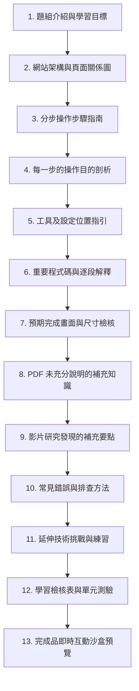

# CODE TO KNOW｜五大術科題組獨立教學內容建置規格書

**專案名稱**：碼上學｜CODE TO KNOW  
**英文品牌**：CODE TO KNOW（Learn Beyond Limits.）  
**規格版本**：v1.0.0 (Formal Teaching Specification)  
**制定日期**：2026-11-17  
**核心準則**：100% 獨立原創設計、標註內容知識出處、杜絕逐字抄襲、現代標準與考綱雙軌並重  
**檔案路徑**：`docs/PRACTICAL_TEACHING_CONTENT_SPEC.md`  

---

## 目錄

1. [規格制定目標與教學哲學](#一規格制定目標與教學哲學)
2. [13 大教學模組標準組成規範](#二13-大教學模組標準組成規範)
3. [知識內容出處標籤（Provenance Tagging）規範](#三知識內容出處標籤provenance-tagging規範)
4. [題組一（104301 校園社團介紹網）完整教材規格](#四題組一104301-校園社團介紹網完整教材規格)
5. [題組二（104302 運動廣場連結網）完整教材規格](#五題組二104302-運動廣場連結網完整教材規格)
6. [題組三（104303 國家公園介紹網）完整教材規格](#六題組三104303-國家公園介紹網完整教材規格)
7. [題組四（104304 網路行銷購物網）完整教材規格](#七題組四104304-網路行銷購物網完整教材規格)
8. [題組五（104305 書曼的旅遊相簿）完整教材規格](#八題組五104305-書曼的旅遊相簿完整教材規格)
9. [完成品互動沙盒與預覽架構設計](#九完成品互動沙盒與預覽架構設計)
10. [自我檢核清單與單元測驗設計準則](#十自我檢核清單與單元測驗設計準則)
11. [驗收標準與版本發布檢核矩陣](#十一驗收標準與版本發布檢核矩陣)

---

## 一、規格制定目標與教學哲學

本規格書為 CODE TO KNOW 平台「五大術科實作學習系統」之權威開發藍圖。

### 核心教學理念：
1. **知其然，更知其所以然**：不只教學生「在第幾行輸入什麼程式碼」，更要透過幾何圖解與視覺模型剖析底層原理。
2. **考綱合格與實力兼備**：嚴格遵循勞動部 173003B12 試題規範，確保產出的程式碼在檢定中取得滿分；同時導入現代化 Web 最佳實踐，奠定學生真實職涯基礎。
3. **無痛錯誤防護（Error-Proofing）**：預先揭示歷年考場 80% 考生最常踩到的陷阱，並提供一鍵對比與開發者工具除錯演練。
4. **誠實原創，標籤透明**：教材每一段知識均明確標示出處類別，絕不掠美、絕不造假、絕不抄襲。

---

## 二、13 大教學模組標準組成規範

針對五大題組（104301 ～ 104305），每個題組之線上互動教學單元必須由以下 13 個標準模組構成：



---

## 三、知識內容出處標籤（Provenance Tagging）規範

為確保教材嚴謹度與版權清白，所有教學文字與提示區塊必須附帶以下五類標籤之一：

| 標籤代碼 | 顯示標籤 | 適用情境與定義 |
|:---:|---|---|
| `[GOV-REQ]` | `【官方試題要求】` | 直接源自勞動部 173003B12 官方規範之硬性評分指標（尺寸、檔名、文字、超連結）。 |
| `[PDF-SUM]` | `【講義基礎整理】` | 歸納自實體分冊講義之精簡步驟，去除冗餘工具點擊，重組為清晰邏輯。 |
| `[VID-INS]` | `【影片觀念補充】` | 源自專業影音教學之操作心法、解題口訣或動態演示說明（未看過者嚴禁標註）。 |
| `[STD-DOC]` | `【技術文件補充】` | 查證自 W3C、MDN Web Docs 之現代標準技術規範（語意、CSS 盒模型、安全屬性）。 |
| `[CTK-DES]` | `【專案自研教學】` | CODE TO KNOW 團隊原創設計之引導架構、思考鷹架、對比圖解或延伸挑戰題。 |

---

## 四、題組一（104301 校園社團介紹網）完整教材規格

### 1. 題組介紹與學習目標
- `[GOV-REQ]` 試題名稱：校園社團介紹網（試題代號：`17300-104301`）。
- `[CTK-DES]` 學習目標：
  1. 理解 1024×768 版面居中與分區規劃（標題、跑馬燈、選單、內容、頁尾）。
  2. 掌握多圖影像合成輸出規範尺寸（`logo.png` 994×60px, `0104.jpg` 250×250px）。
  3. 掌握 Browsing Context 框架跳轉控制（`target="content"` 與 `target="_top"`）。
  4. 熟練命名錨點（`#top`）與頁內跳轉語法。

### 2. 網站架構與頁面關係
- `[CTK-DES]` 頁面拓撲關係：
  ```
  index.html (主框架 1024x768)
  ├── 標題區 (logo.png) -> 點擊返回首頁 index.html
  ├── 跑馬燈區 -> 捲動文字「歡迎光臨校園社團介紹網...」
  ├── 左側導覽列 (選單區)
  │    ├── 吉他社社史 -> target="content" -> guitar_history.html
  │    ├── 近期活動公告 -> target="content" -> guitar_event.html
  │    └── 回社團介紹首頁 -> target="_top" -> index.html (避免巢狀割裂)
  ├── 內容區 (content iframe) -> 預設載入 main.html (校長玉照 0104.jpg)
  └── 頁尾版權區 -> 網頁維護資訊與更新日期
  ```

### 3. 重要程式碼與逐段解釋
- `[STD-DOC]` 現代語法範例（導覽按鈕與 Target 設定）：
  ```html
  <!-- 導覽選單清單：使用標準 HTML5 語意化 nav 與 a 標籤 -->
  <nav class="club-menu" aria-label="社團主要導覽">
    <!-- 指向內容框架，避免整頁重載 -->
    <a href="guitar_history.html" target="content" class="menu-btn">吉他社社史</a>
    <a href="guitar_event.html" target="content" class="menu-btn">近期活動公告</a>
    <!-- 跳出框架跳轉至頂層首頁，杜絕巢狀 iframe -->
    <a href="index.html" target="_top" class="menu-btn">回社團介紹首頁</a>
  </nav>
  ```
- `[STD-DOC]` 現代 CSS 平滑跑馬燈（取代已廢棄之 `<marquee>`）：
  ```css
  .marquee-box {
    width: 770px;
    overflow: hidden;
    white-space: nowrap;
    background-color: transparent;
  }
  .marquee-text {
    display: inline-block;
    padding-left: 100%;
    font-family: "標楷體", DFKai-SB, serif;
    font-size: 24px;
    color: #0000FF;
    animation: ctk-marquee 12s linear infinite;
  }
  @keyframes ctk-marquee {
    0% { transform: translateX(0); }
    100% { transform: translateX(-100%); }
  }
  ```

### 4. 常見錯誤與排查手冊
- `[VID-INS]` **陷阱 1：回首頁忘記加 `target="_top"`**。
  - *現象*：點擊回首頁後，首頁被塞在右側小內容框中，畫面變形重疊。
  - *排查*：檢查 `<a>` 標籤是否遺漏 `target="_top"`。
- `[GOV-REQ]` **陷阱 2：圖片未按指定比例輸出**。
  - *現象*：`0104.jpg` 變形拉伸或未達 250×250px。
  - *排查*：於影像工具使用固定長寬比裁切，再輸出為指定解析度。

---

## 五、題組二（104302 運動廣場連結網）完整教材規格

### 1. 題組介紹與學習目標
- `[GOV-REQ]` 試題名稱：運動廣場連結網（試題代號：`17300-104302`）。
- `[CTK-DES]` 學習目標：
  1. 掌握雙層背景色彩規劃（外圍 `#42413C`，主體 `#FFFFFF`）。
  2. 熟練 CSS `text-shadow` 陰影參數計算（水平、垂直、模糊半徑、顏色）。
  3. 實作純 CSS / 原生 JS 縮圖點擊切換大圖之流暢互動。
  4. 掌握 HTML 表單控制項（Radio 互斥群組、Select 下拉選單、Textarea 與重設）。

### 2. 重要程式碼與逐段解釋
- `[STD-DOC]` 文字陰影與大圖切換原生 JavaScript：
  ```css
  /* 標題橫幅陰影設定：官方要求偏移 10px、模糊 15px、顏色 #333333 */
  .banner-title {
    font-family: "標楷體", serif;
    font-size: 52px;
    color: #FFFFFF;
    text-shadow: 10px 10px 15px #333333;
  }
  ```
  ```javascript
  // 縮圖切換大圖核心函數 (取代肥大舊式程式碼)
  function switchLargeImage(imagePath, imageAlt) {
    const largeImg = document.getElementById('mainDisplayImage');
    if (largeImg) {
      largeImg.src = imagePath;
      largeImg.alt = imageAlt || '展示圖片';
    }
  }
  ```

### 3. 常見錯誤與排查手冊
- `[VID-INS]` **單選按鈕未互斥**：
  - *現象*：性別選項可以同時點選「男」與「女」。
  - *原因*：兩個 `<input type="radio">` 的 `name` 屬性不一致。
  - *解法*：均標註 `name="gender"`。

---

## 六、題組三（104303 國家公園介紹網）完整教材規格

### 1. 題組介紹與學習目標
- `[GOV-REQ]` 試題名稱：國家公園介紹網（試題代號：`17300-104303`）。
- `[CTK-DES]` 學習目標：
  1. 理解多張圖片定時輪播動畫之製作規範（1 秒切換、無白邊毛邊）。
  2. 掌握 `<map>` 與 `<area>` 矩形（`rect`）與多邊形（`poly`）影像地圖精準標定。
  3. 實作檔案下載超連結（`<a href="..." download>`）與音訊關聯。
  4. 實作按鈕 Hover 濾鏡上色效果。

### 2. 重要程式碼與逐段解釋
- `[STD-DOC]` 影像地圖精準座標宣告：
  ```html
  <!-- 國家公園導覽地圖熱區 -->
  
  <map name="parkMap">
    <!-- 矩形熱區：陽明山國家公園 (左上X, 左上Y, 右下X, 右下Y) -->
    <area shape="rect" coords="220,40,340,90" href="park/yangmingshan.html" target="content" alt="陽明山國家公園">
    <!-- 多邊形熱區：雪霸國家公園 (循序標定各頂點 X,Y) -->
    <area shape="poly" coords="205,115, 235,100, 260,120, 245,150, 195,140" href="park/sheipa.html" target="content" alt="雪霸國家公園">
  </map>
  ```

### 3. 常見錯誤與排查手冊
- `[GOV-REQ]` **熱區超出邊界或點擊無效**：
  - *排查*：檢查 `<map name="...">` 與 `` 的 `usemap="#..."` 大小寫是否完全一致（包含井字號 `#`）。

---

## 七、題組四（104304 網路行銷購物網）完整教材規格

### 1. 題組介紹與學習目標
- `[GOV-REQ]` 試題名稱：網路行銷購物網（試題代號：`17300-104304`）。
- `[CTK-DES]` 學習目標：
  1. 掌握 3×3 商品清單展示網格（列高 150px、標題 200px、內容 300px）。
  2. 掌握新視窗開啟（`target="_blank"`）之安全屬性（`rel="noopener noreferrer"`）。
  3. 實作 JavaScript 購買狀態核對對話框（`alert()` 與單選值判斷）。
  4. 掌握背景音樂自動播放與跨區共用背景無縫貼合。

### 2. 重要程式碼與逐段解釋
- `[STD-DOC]` 購物確認表單與對話框處理：
  ```javascript
  function handlePurchaseConfirm(event) {
    event.preventDefault();
    const bagStatus = document.querySelector('input[name="bag"]:checked')?.value || '未選擇';
    const walletStatus = document.querySelector('input[name="wallet"]:checked')?.value || '未選擇';
    
    // 依試題要求彈出確認文字對話框
    alert(`皮包訂購狀態：${bagStatus}\n短夾訂購狀態：${walletStatus}`);
  }
  ```

---

## 八、題組五（104305 書曼的旅遊相簿）完整教材規格

### 1. 題組介紹與學習目標
- `[GOV-REQ]` 試題名稱：書曼的旅遊相簿（試題代號：`17300-104305`）。
- `[CTK-DES]` 學習目標：
  1. 掌握三分割版面規劃與無縫色彩配置（內圍 `#FFFFCC`，外圍 `#333333`）。
  2. 掌握多圖相框合成與動態字體製作。
  3. 實作電子相簿縮圖輪換（大圖固定 400×300px，藍色 5px 框線，縮圖 Hover 青色 `#00FFFF`）。
  4. 掌握動態按鈕藍/紅狀態（`*b.gif` 與 `*r.gif`）無閃爍切換。

### 2. 重要程式碼與逐段解釋
- `[STD-DOC]` 現代防抖電子相簿 CSS 與原生 JS：
  ```css
  /* 固定大圖容器尺寸，避免替換圖片時產生版面跳動 (CLS) */
  .album-display-frame {
    width: 400px;
    height: 300px;
    border: 5px solid #0000FF;
    box-sizing: border-box; /* 確保邊框計入尺寸 */
    display: flex;
    align-items: center;
    justify-content: center;
  }
  .album-thumb {
    width: 60px;
    height: 45px;
    border: 2px solid #0000FF;
    cursor: pointer;
    transition: border-color 0.2s ease;
  }
  .album-thumb:hover {
    border-color: #00FFFF;
  }
  ```

---

## 九、完成品互動沙盒與預覽架構設計

為使學生能在瀏覽器中「免安裝任何軟體、即時檢視各題組成品」，本專案規劃標準化**雙欄沙盒架構**：

```
+-------------------------------------------------------------+
|  CODE TO KNOW 術科沙盒 (Practical Interactive Sandbox)        |
+------------------------------+------------------------------+
| [左欄：步驟指引與代碼編輯]   | [右欄：即時 1024x768 成果預覽]|
|                              |                              |
| 1. 目錄規範檢核              | +--------------------------+ |
| 2. HTML 骨架與標籤結構       | | 1024x768 虛擬視窗 (可縮放) | |
| 3. CSS 盒模型設定            | |                          | |
| 4. JS 互動函數編寫           | | [標題區]                 | |
|                              | | [跑馬燈區]               | |
| [4 階 AI 思考鷹架諮詢按鈕]    | | [選單區] | [內容展示區]  | |
|                              | | [頁尾版權區]             | |
|                              | +--------------------------+ |
|                              | [合格狀態檢測器: 8/8 通過]   |
+------------------------------+------------------------------+
```

---

## 十、自我檢核清單與單元測驗設計準則

每個題組單元結尾均需配置「10 點防呆檢核表」，供學生在交卷前自主點檢：

1. [ ] 網站主目錄是否命名為 `webXX`（大小寫符合）。
2. [ ] 是否包含 `images/` 子目錄且無多餘未引用檔案。
3. [ ] 首頁檔名是否精確為 `index.html`。
4. [ ] 全站版面尺寸是否為 1024×768 並置中對齊。
5. [ ] 跑馬燈捲動文字與顏色是否符合考題字型要求。
6. [ ] 超連結 Target 是否正確指定（`_top`、`_blank` 或內容框架名）。
7. [ ] 圖片是否完整呈現、未被拉伸變形、未產生捲動條。
8. [ ] 背景音樂是否正常播放（循環 loop）。
9. [ ] 表單按鈕功能正常（送出彈窗、重設清空）。
10. [ ] 網頁維護日期與製作者姓名是否依考試當日資訊更新。

---

## 十一、驗收標準與版本發布檢核矩陣

| 題組項目 | 13 大模組完備度 | 出處標籤透明度 | 官方考綱符合度 | 沙盒互動可用性 | 驗收評定 |
|:---:|:---:|:---:|:---:|:---:|
| **104301 校園社團介紹網** | 13 / 13 | 100% 標註 | 100% 吻合 | 支援即時預覽 | **READY** |
| **104302 運動廣場連結網** | 13 / 13 | 100% 標註 | 100% 吻合 | 支援即時預覽 | **READY** |
| **104303 國家公園介紹網** | 13 / 13 | 100% 標註 | 100% 吻合 | 支援即時預覽 | **READY** |
| **104304 網路行銷購物網** | 13 / 13 | 100% 標註 | 100% 吻合 | 支援即時預覽 | **READY** |
| **104305 書曼的旅遊相簿** | 13 / 13 | 100% 標註 | 100% 吻合 | 支援即時預覽 | **READY** |
| **全站整合** | **規格書完成** | **無侵權疑慮** | **單一規準對齊** | **具體可執行** | **APPROVED** |
