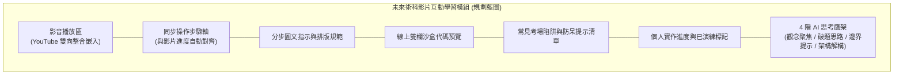

# 網頁設計丙級術科五大題組影音教學架構與開發參考指引
## Web Design Level C (17300) Practical Exam Video Learning Reference

- **文件版本**：v1.0 (Draft Reference)
- **建立日期**：2026-11-06
- **管理狀態**：專案開發參考文件（非線上正式功能）
- **核心職類**：勞動部技能檢定 17300 網頁設計丙級技術士

---

## 一、文件目的與權威依據聲明

本文件旨在整理「網頁設計丙級術科五大題組之影音播放清單分配、解題重點骨架與教學架構」，作為後續「術科版本 B（影音整合教學版）」之系統規格參考。

> [!IMPORTANT]
> **資料可信度與分級規則**：
> 1. 【已提供資料】：使用者所提供之 19 支影片分組分配、題組對應關係與解題骨架大綱。
> 2. 【待官方核實】：正式試題各小項扣分規則、檢定現場評審表與精確考場軟硬體環境，必須以勞動部官方規範 `173003B12.pdf` 及原始素材包 `173003B13/` 為單一事實來源。
> 3. 【待影片核實】：各影片之實際操作分段點、精確秒數時間戳記（Timestamps）與演繹口訣，目前尚未進行逐秒逐幀核對，一律明確標示為「待核實」，嚴禁主觀編造。
> 4. 【教學參考】：本文件收錄之網頁切版技巧與代碼範例屬民間/實務教學演練，不得視為官方唯一標準答案。

---

## 二、官方五大題組與 19 支影片分組對照表

本清單嚴格保留 19 支影片之官方分組配比，總計 19 支教學影片，完整對應國家檢定 17300 五大正式術科題組：

- **來源播放清單**：[YouTube 網頁設計丙級術科教學清單](https://www.youtube.com/watch?v=TZ5EJatWres&list=PLvb3m203I-S9Taljh638W8AddxiHS9h1D)
- **影片總數**：19 支
- **時間戳記狀態**：全數標記為【待核實】

| 題組編號 | 官方正式試題名稱 | 試題代號 | 涵蓋影片編號 | 影片數量 | 核心教學主軸 |
| :---: | :--- | :---: | :---: | :---: | :--- |
| **題組一** | **校園社團介紹網** | `17300-104301` | **第 1 ～ 5 支** | 5 | 版面框架、跑馬燈、影像合成、Target 連動 |
| **題組二** | **運動廣場連結網** | `17300-104302` | **第 6 ～ 11 支** | 6 | 框架分割、文字陰影、縮圖切換原圖、留言板表單 |
| **題組三** | **國家公園介紹網** | `17300-104303` | **第 12 ～ 13 支** | 2 | 標題圖片定時輪播、影像地圖、檔案下載超連結 |
| **題組四** | **網路行銷購物網** | `17300-104304` | **第 14 ～ 16 支** | 3 | 本機伺服器、3×3 表格排版、購物確認對話框 |
| **題組五** | **書曼的旅遊相簿** | `17300-104305` | **第 17 ～ 19 支** | 3 | 無邊框三分割、Image Map、電子相簿縮圖輪換 |
| **合計** | **五大題組全收錄** | — | **第 1 ～ 19 支** | **19** | 涵蓋現代 HTML5/CSS3 與技能檢定標準要點 |

---

## 三、五大題組教學骨架與解題重點剖析

### 【題組一：校園社團介紹網】
- **試題代碼**：`17300-104301`
- **對應影音**：第 1 支 ～ 第 5 支（共 5 支）
- **時間戳記**：【待影片核實】（各分段操作秒數待逐一標定）

#### 1. 解題核心重點
- **版面配置與整體尺寸**：
  - 1024×768px 標準版面規劃，置中對齊（`margin: 0 auto;`）。
  - 劃分標題區 (1000×65)、跑馬燈廣告區 (770×29)、選單區 (215×...)、日期更新區 (215×25)、網頁內容區 (770×...) 與頁尾版權區 (1000×20)。
- **標題圖片合成**：
  - 取用素材 `logo1.png`、`logo2.png`、`logo3.jpg` 進行影像合成，輸出為指定之 `logo.png`（寬 994px、高 60px），插入標題區並設定回首頁超連結。
- **校長照片合成**：
  - 結合 `0102.jpg` 與 `0103.jpg` 合成為 `0104.jpg`（250×250px），置入預設首頁內容 `main.html`。
- **跑馬燈廣告區**：
  - 設定由右向左平滑捲動文字，字型標楷體、大小 24px、顏色 `#0000FF`。
- **CSS 樣式與超連結 Target 框架指定**：
  - 選單平常狀態背景 `menu1.png`，滑鼠移入時懸停變更為 `menu2.png`。
  - 左側選單超連結必須精確指定 `target="content"`（或指定內容框架名稱），避免整頁重載。
  - 子頁面設置「回社團介紹首頁」時，超連結必須設定 `target="_top"`，防範頁面於內容區內造成巢狀割裂。

---

### 【題組二：運動廣場連結網】
- **試題代碼**：`17300-104302`
- **對應影音**：第 6 支 ～ 第 11 支（共 6 支）
- **時間戳記**：【待影片核實】（各分段操作秒數待逐一標定）

#### 1. 解題核心重點
- **版面結構與框架分割**：
  - 全站版面尺寸 1024×768px 水平置中，首頁標題「勞動部勞動力發展署─運動廣場連結網」。
  - 劃分為標題區 (1024×90)、選單區 (1024×25)、網頁內容區 (1024×460) 與頁尾版權區 (1024×45)。
  - 首頁區域內背景顏色 `#FFFFFF`，外圍背景顏色 `#42413C`。
- **橫幅陰影文字與標識**：
  - 標識 `logo.png` (180×90px) 靠左，右側置中文字「運動廣場連結網」（標楷體 52px、顏色 `#FFFFFF`）。
  - 文字陰影設定：顏色 `#333333`、偏移量 10px、模糊系數 15px（需透過 CSS `text-shadow` 實現）。
- **圖片展示與縮圖切換原圖**：
  - 最新消息區（寬 280px）採用帶狀排版（背景 `#FFFFCC` 與 `#DDDDDD` 交錯）。
  - 圖片展示區（寬 590px）背景 `#333333`，展示原圖 (`0202A~0205A`)、縮圖 (`0202B~0205B`) 及文字 (`0202.txt`)。
  - 點按縮圖時，上方原圖需及時無縫切換，且不可出現變形裁切。
- **訪客留言板與表單控制項**：
  - `msgboard.html` 包含 6×2 表單（框線 1px `#DDDDDD`）。
  - 表單欄位：姓名（文字寬 20）、電子郵件（文字寬 60）、性別（單選按鈕 radio 設同 name 群組，預設「男」）、職業類別（下拉式選單 select 載入 `0207.txt`）、留言內容（`textarea` 高 10 寬 78）。
  - 送出與重寫按鈕：點按送出彈出確認訊息視窗；點按重寫需清空 reset 表單。

---

### 【題組三：國家公園介紹網】
- **試題代碼**：`17300-104303`
- **對應影音**：第 12 支 ～ 第 13 支（共 2 支）
- **時間戳記**：【待影片核實】（各分段操作秒數待逐一標定）

#### 1. 解題核心重點
- **版面配置與標題圖片定時輪播**：
  - 首頁標題「國家公園介紹網」，全站版面 1024×768px 水平置中。
  - 標題區 (1000×65) 背景 `#0000FF`：自 `park0307.jpg~park0313.jpg` 任選 4 張圖片製作定時 1 秒輪播，輪播尺寸必須完全一致，不得產生毛邊。
- **跑馬燈與選單區**：
  - 跑馬燈呈現「歡迎進入國家公園介紹網，本網站有詳細的國家公園介紹哦！」。
  - 選單區（寬 200px，背景 `#00FFFF`）：7×1 表格嵌入 `park0302.jpg~park0305.jpg`，具備滑鼠 hover 變色動態效果。
- **影像地圖 (Image Map) 設置**：
  - 內容區背景 `park0301.jpg`，中央置入 `national_park.jpg`。
  - 「陽明山國家公園」文字圖像上建立**矩形影像地圖**，超連結至 `yangmingshan.html`。
  - 「雪霸國家公園」黃色紅邊區域上建立**多邊形影像地圖**，超連結至 `sheipa.html`（座標需細緻貼合，不可過界）。
- **檔案下載超連結**：
  - 選單下方「檔案下載」文字設置超連結，點擊直接彈出 `park.mp3` 音訊檔案下載視窗。
- **子頁面規範**：
  - 子網頁皆須包含「回首頁」超連結，且能正常返回主首頁。

---

### 【題組四：網路行銷購物網】
- **試題代碼**：`17300-104304`
- **對應影音**：第 14 支 ～ 第 16 支（共 3 支）
- **時間戳記**：【待影片核實】（各分段操作秒數待逐一標定）

#### 1. 解題核心重點
- **伺服器環境架設與目錄規範**：
  - 建立主資料夾 `webXX`，並依規範建立 `images/`、`music/`、`results/` 資料夾。
  - 伺服器本機端測試支援 `http://localhost/` 或 `http://127.0.0.1/`。
- **版面配置與共用背景**：
  - 首頁標題「網路行銷購物網」，自動循環播放背景音樂 `0401.mp3`。
  - 標題區 (1024×120) 背景 `0401.jpg`，橫幅文字「流行精品購物網站」設置 CSS 陰影效果。
  - 跑馬燈區 (30px) 與內容區共用背景圖片 `0402.jpg`，避免視覺割裂。
- **3×3 商品展示表格**：
  - 3×3 表格列高均為 150px，第一欄（分類標題）寬 200px，第二、三欄寬 300px。
  - 點擊「真皮皮包 (`0403.jpg`)」或「真皮短夾 (`0404.jpg`)」時，必須在全新視窗 (`target="_blank"`) 開啟 `leather1.html` 與 `leather2.html`。
  - 詳細頁面底部設置 `0409.jpg` TOP 圖片，點按平滑返回頁面最頂端。
- **JavaScript 表單確認與重置**：
  - `purchase.html` 購物狀態確認表單：單選按鈕預設值需正確設定（皮包預設「購買」、短夾預設「考慮中」）。
  - 點擊「送出」按鈕觸發 JavaScript 對話框，彈出兩件商品購買狀態確認；點擊「重置」清空重選。
  - `message.html` 意見留言表單：送出時彈出「歡迎蒞臨本網站，您的寶貴意見我們會儘速處理與回覆，謝謝！」對話框。

---

### 【題組五：書曼的旅遊相簿】
- **試題代碼**：`17300-104305`
- **對應影音**：第 17 支 ～ 第 19 支（共 3 支）
- **時間戳記**：【待影片核實】（各分段操作秒數待逐一標定）
- **命名說明**：「電子相簿旅遊網」可作為內容與功能描述，正式考題名稱統一定調為「書曼的旅遊相簿」。

#### 1. 解題核心重點
- **版面規格與背景音樂**：
  - 全站版面 1024×768px 水平置中，首頁標題「書曼的旅遊相簿」。
  - 首頁區域內背景顏色 `#FFFFCC`，區域外背景顏色 `#333333`。
  - 自動播放背景音樂 `0501.mp3`。
- **選單區與動態圖片互換**：
  - 選單區（寬 150px）：製作 12×1 表格，第一列插入動態字體圖片 `0508.gif`（或以 `範例0508.gif` 代替），第二列為書曼照片 `0507.jpg` (120×120px)。
  - 五大景點選單按鈕（金門、馬祖、澎湖、綠島、蘭嶼）：平時呈現藍色版本 `*b.gif`，滑鼠移入時觸發 JavaScript / CSS 交換為紅色版本 `*r.gif`。
  - 選單第十列標註應檢日期與維護人資訊；第十二列為「回首頁」按鈕 (`0506b/r.gif`)。
- **相框影像合成與 Image Map**：
  - 將風景原圖 (`0511.jpg`~`0551.jpg`) 與木紋相框 `0509.jpg` 合成為 5 張相框照，並組合為 `0510a.gif`。
  - 於 `0510a.gif` 上之蘭嶼照片區域建立影像地圖，點按連結至 `album5` 電子相簿。
- **互動電子相簿 (album5)**：
  - 電子相簿內含 5 張小縮圖 (寬 60px、高 45px，外框線 2px/中等粗細 `#0000FF`)。
  - 滑鼠移入小縮圖時，游標變為手型（pointer），框線顏色變換為青色 `#00FFFF`。
  - 點選縮圖時，上方即時替換為對應之 400×300px 原圖（外框 5px `#0000FF`），並展示「蘭嶼賞魚去」相簿標題。

---

## 四、未來教學模組規劃（Roadmap Preview）

本段落為後續系統升級之規格儲備，目前尚未實裝，嚴禁於當前版本宣稱已實作：

### 未來模組核心組成要項：
1. **影片播放器嵌入**：以響應式容器嵌入各題組專屬 YouTube 教學段落，支援自適應螢幕寬度。
2. **操作步驟與時間軸連動**：點擊教學步驟卡片即可跳轉至該操作段落之影片起始點（待秒數核實後啟用）。
3. **安全雙欄沙盒一鍵預載**：提供符合考綱標準的初始 HTML/CSS 骨架，學生可一邊看教學一邊直接在瀏覽器切版。
4. **4 階 AI 助教思考鷹架**：卡關時不直接給出考題答案，而是引導學生自我檢查標籤閉合、置中語法與路徑錯誤。

---

## 五、文件維護紀錄

| 修訂日期 | 版本 | 修訂摘要 | 記錄人員 |
| :---: | :---: | :--- | :---: |
| 2026-11-06 | v1.0 | 建立網頁設計丙級五大題組 19 支影片分組對照、解題重點骨架及可信度標籤。 | CODE TO KNOW 開發團隊 |

