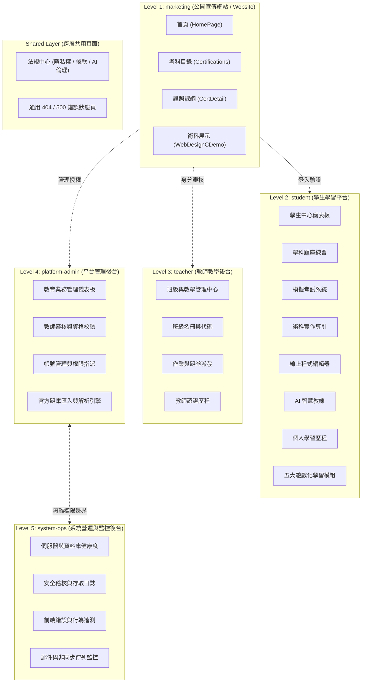
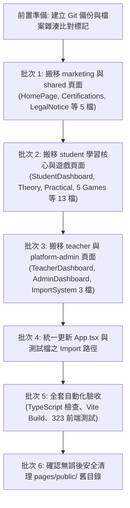

# CODE TO KNOW｜正式網頁資料夾架構與整理規範

**專案名稱**：碼上學｜CODE TO KNOW  
**英文品牌**：CODE TO KNOW（Learn Beyond Limits.）  
**架構規範版本**：v1.0.0  
**制定日期**：2026-11-17  
**適用範圍**：前端 React + TypeScript + Vite SPA 架構（`frontend/src/pages/`）  

---

## 目錄

1. [Website 與 Web Pages 正式名詞定義](#一website-與-web-pages-正式名詞定義)
2. [正式五層架構與職責邊界](#二正式五層架構與職責邊界)
3. [目標資料夾結構規劃](#三目標資料夾結構規劃)
4. [現有頁面清冊（共 21 個頁面）](#四現有頁面清冊共-21-個頁面)
5. [現有頁面與目標層級對照矩陣](#五現有頁面與目標層級對照矩陣)
6. [權限邊界混雜與待釐清頁面剖析](#六權限邊界混雜與待釐清頁面剖析)
7. [未來新增網頁之命名與歸檔規則](#七未來新增網頁之命名與歸檔規則)
8. [下一階段建議搬移順序與驗證步驟](#八下一階段建議搬移順序與驗證步驟)

---

## 一、Website 與 Web Pages 正式名詞定義

為避免團隊溝通混淆及維持架構嚴謹性，本專案確立以下名詞定義為唯一正式標準：

### 1. Website（網站）
- **定義**：專指**第一層公開宣傳用途**之對外形象入口與展示平台。
- **內容範圍**：品牌核心理念（碼上學，學無止境）、產品功能亮點展示、考科總覽、術科成果 Demo 展示、App 下載指引、社群連結及聯絡資訊。
- **存取特性**：完全公開（Public），無須登入即可存取，具備良好 SEO 與社群分享卡片（OpenGraph）。
- **目錄定位**：歸入 `frontend/src/pages/marketing/`。

### 2. Web Pages（網頁）
- **定義**：專指**網站後方的實際業務系統功能頁面**。
- **內容範圍**：使用者登入後存取之「學生學習平台」、「教師教學後台」、「平台管理後台」及「系統營運與監控後台」。
- **存取特性**：受身分驗證（Authentication）與角色型存取控制（RBAC, Role-Based Access Control）嚴格保護。
- **目錄定位**：依權限與業務角色分別歸入 `student/`、`teacher/`、`platform-admin/`、`system-ops/`。

> [!IMPORTANT]
> **技術架構鐵律**：
> 本專案為標準現代 **React 18 + TypeScript + Vite** 單頁應用程式（SPA）。所有頁面均為 TSX 元件（`*Page.tsx`）。**嚴禁將「網頁」之稱呼口語化誤解為多個分離的傳統 `.html` 檔案**，亦不得將正式系統擅自拆散成多個獨立 HTML 靜態站點。

---

## 二、正式五層架構與職責邊界

本專案頁面架構嚴格劃分為五個層次，並輔以共用層（`shared`）：



### 各層職責與權限隔離準則：
1. **Level 1 (`marketing/`)**：宣傳、吸引、引導。完全不設權限防護。
2. **Level 2 (`student/`)**：學科、術科、測驗、練習、AI、遊戲。限制 `STUDENT` 角色（展示模式支援示範學員）。
3. **Level 3 (`teacher/`)**：班級、教學、名冊、批改。限制 `TEACHER` 或 `ADMIN` 角色。
4. **Level 4 (`platform-admin/`)**：審查、帳號治理、班級監管、題庫維護。限制 `ADMIN` 或 `PLATFORM_ADMIN` 角色。
5. **Level 5 (`system-ops/`)**：伺服器負載、連線池指標、安全審計、遙測日誌。限制 `SYSTEM_OPERATOR` 專屬角色。
6. **Shared Layer (`shared/`)**：跨角色共同存取之通用頁面（如法律隱私聲明）。

> [!WARNING]
> **第四層與第五層之權限邊界隔離**：
> 平台管理員（`platform-admin`）屬於教育業務主管，負責人、課綱與內容治理，**無權存取未脫敏之系統連線日誌與伺服器硬體指標**；系統營運工程師（`system-ops`）僅負責技術架構維穩，**無權任意竄改教育內容或直接核定教學資格**。

---

## 三、目標資料夾結構規劃

在 `frontend/src/pages/` 下建立之目標結構如下：

```
frontend/src/pages/
├── marketing/                     # [Level 1] 公開宣傳網站
│   ├── README.md                  # 層級職責與存取規範說明
│   ├── HomePage.tsx
│   ├── CertificationsPage.tsx
│   ├── CertificationDetailPage.tsx
│   └── WebDesignCDemoPage.tsx
│
├── student/                       # [Level 2] 學生學習平台
│   ├── README.md                  # 層級職責與存取規範說明
│   ├── StudentDashboardPage.tsx
│   ├── TheoryPracticePage.tsx
│   ├── MockExamPage.tsx
│   ├── PracticalLearningPage.tsx
│   ├── CodeEditorPage.tsx
│   ├── AICoachPage.tsx
│   ├── LearningProgressPage.tsx
│   ├── GameCenterPage.tsx
│   ├── CodePuzzlePage.tsx
│   ├── CSSDesignerPage.tsx
│   ├── BugHunterPage.tsx
│   ├── QuizRushPage.tsx
│   └── WebBuilderPage.tsx
│
├── teacher/                       # [Level 3] 教師教學後台
│   ├── README.md                  # 層級職責與存取規範說明
│   └── TeacherDashboardPage.tsx
│
├── platform-admin/                # [Level 4] 平台管理後台
│   ├── README.md                  # 層級職責與存取規範說明
│   ├── AdminDashboardPage.tsx     # (目前包含業務管理，未來抽離運維功能)
│   └── QuestionBankImportSystemPage.tsx
│
├── system-ops/                    # [Level 5] 系統營運與監控後台
│   ├── README.md                  # 層級職責與存取規範說明
│   ├── SystemHealthPage.tsx       # (未來由 AdminDashboard 拆分)
│   ├── SystemAuditLogsPage.tsx    # (未來由 AdminDashboard 拆分)
│   └── SystemTelemetryPage.tsx    # (未來由 telemetryStorage 擴充)
│
├── shared/                        # [Shared Layer] 跨層共用頁面
│   ├── README.md                  # 層級職責與存取規範說明
│   ├── LegalNoticePage.tsx
│   └── NotFoundPage.tsx           # (可選)
│
└── public/                        # [舊有暫存目錄] (本階段完整保留，待下一階段搬移完成後淘汰)
    └── (既有 21 個頁面原檔維持不動)
```

---

## 四、現有頁面清冊（共 21 個頁面）

目前所有頁面檔案暫時存放於 `frontend/src/pages/public/`，清冊如下：

| 項次 | 既有檔案名稱 | 檔案大小 | 路由代碼 (`route.page`) | 核心功能摘要 |
|:---:|---|---|---|---|
| 1 | `HomePage.tsx` | 3.8 KB | `home` | 品牌著陸首頁、宣傳視覺與雙軌介紹 |
| 2 | `CertificationsPage.tsx` | 22.9 KB | `certifications` | 官方檢定證照與考科分類目錄 |
| 3 | `CertificationDetailPage.tsx` | 25.9 KB | `certification-detail` | 證照詳細課綱與合格標準總覽 |
| 4 | `WebDesignCDemoPage.tsx` | 42.5 KB | `web-design-demo` | 網頁設計丙級術科題組成果動態示範 |
| 5 | `TheoryPracticePage.tsx` | 80.2 KB | `theory-practice` | 學科題庫循序練習與 AI 解析 |
| 6 | `MockExamPage.tsx` | 48.0 KB | `mock-exam` | 官方學科模擬考試與交卷評分 |
| 7 | `PracticalLearningPage.tsx` | 31.6 KB | `practical-learning` | 術科五大題組分步實作教學環境 |
| 8 | `CodeEditorPage.tsx` | 17.9 KB | `code-editor` | 線上 HTML/CSS/JS 代碼編輯與即時渲染 |
| 9 | `AICoachPage.tsx` | 26.1 KB | `ai-coach` | AI 智慧解題教練對話與提示引導 |
| 10 | `LearningProgressPage.tsx` | 14.2 KB | `learning-progress` | 個人學習統計圖表、通過率與歷程 |
| 11 | `StudentDashboardPage.tsx` | 26.0 KB | `student-dashboard` | 學生個人中心主控台與班級加入 |
| 12 | `GameCenterPage.tsx` | 26.9 KB | `game-center` | 五大遊戲化學習大廳與成就總覽 |
| 13 | `CodePuzzlePage.tsx` | 26.1 KB | `code-puzzle` | 遊戲 1：語法積木拖曳重組挑戰 |
| 14 | `CSSDesignerPage.tsx` | 36.7 KB | `css-designer` | 遊戲 2：CSS 視覺樣式與版面設計挑戰 |
| 15 | `BugHunterPage.tsx` | 38.3 KB | `bug-hunter` | 遊戲 3：程式碼錯誤定位與除錯特工 |
| 16 | `QuizRushPage.tsx` | 37.5 KB | `quiz-rush` | 遊戲 4：檢定題庫極速連擊對戰挑戰 |
| 17 | `WebBuilderPage.tsx` | 44.4 KB | `web-builder` | 遊戲 5：視覺化即時網頁積木組裝工程 |
| 18 | `TeacherDashboardPage.tsx` | 78.0 KB | `teacher-dashboard` | 教師班級管理、學生成績與指派任務 |
| 19 | `AdminDashboardPage.tsx` | 63.4 KB | `admin-dashboard` | 平台管理員控制台（審核、帳號、日誌、健康） |
| 20 | `QuestionBankImportSystemPage.tsx` | 24.6 KB | `import-system` | 官方題庫來源登錄、結構解析與題庫管理 |
| 21 | `LegalNoticePage.tsx` | 22.5 KB | `legal` | 隱私權政策、服務條款與 AI 倫理守則 |

---

## 五、現有頁面與目標層級對照矩陣

依據實際功能、存取權限與系統職責，21 個頁面之歸類對照如下：

| 既有檔案 (`pages/public/`) | 權限狀態 | 目標層級 | 目標資料夾 | 歸類理由 |
|---|:---:|:---:|---|---|
| **`HomePage.tsx`** | Public | Level 1 | `pages/marketing/` | 官方品牌展示第一門面 |
| **`CertificationsPage.tsx`** | Public | Level 1 | `pages/marketing/` | 公開考科與認證目錄查詢 |
| **`CertificationDetailPage.tsx`** | Public | Level 1 | `pages/marketing/` | 公開考科規格與指引說明 |
| **`WebDesignCDemoPage.tsx`** | Public | Level 1 | `pages/marketing/` | 術科成果公開示範展示頁 |
| **`StudentDashboardPage.tsx`** | Protected (`STUDENT`) | Level 2 | `pages/student/` | 學生個人儀表板核心頁面 |
| **`TheoryPracticePage.tsx`** | Public / Student | Level 2 | `pages/student/` | 學生學科核心練習系統 |
| **`MockExamPage.tsx`** | Public / Student | Level 2 | `pages/student/` | 學生模擬測驗與評量系統 |
| **`PracticalLearningPage.tsx`** | Public / Student | Level 2 | `pages/student/` | 學生術科題組實作學習模組 |
| **`CodeEditorPage.tsx`** | Public / Student | Level 2 | `pages/student/` | 學生專用線上編輯器工具 |
| **`AICoachPage.tsx`** | Public / Student | Level 2 | `pages/student/` | 學生 AI 助教與教練互動中心 |
| **`LearningProgressPage.tsx`** | Protected (`STUDENT`) | Level 2 | `pages/student/` | 學生學習數據與弱點歷程 |
| **`GameCenterPage.tsx`** | Public / Student | Level 2 | `pages/student/` | 學生程式遊戲化大廳 |
| **`CodePuzzlePage.tsx`** | Public / Student | Level 2 | `pages/student/` | 學生程式拼圖遊戲 |
| **`CSSDesignerPage.tsx`** | Public / Student | Level 2 | `pages/student/` | 學生 CSS 視覺遊戲 |
| **`BugHunterPage.tsx`** | Public / Student | Level 2 | `pages/student/` | 學生除錯特工遊戲 |
| **`QuizRushPage.tsx`** | Public / Student | Level 2 | `pages/student/` | 學生極速題庫競速遊戲 |
| **`WebBuilderPage.tsx`** | Public / Student | Level 2 | `pages/student/` | 學生網頁積木組裝遊戲 |
| **`TeacherDashboardPage.tsx`** | Protected (`TEACHER`) | Level 3 | `pages/teacher/` | 教師專用教學管理主控台 |
| **`QuestionBankImportSystemPage.tsx`**| Protected (`ADMIN`) | Level 4 | `pages/platform-admin/` | 平台官方題庫管理引擎 |
| **`AdminDashboardPage.tsx`** | Protected (`ADMIN`) | Level 4 / 5 | `pages/platform-admin/` (過渡) | 平台業務管理；後續應拆分部分至 `system-ops/` |
| **`LegalNoticePage.tsx`** | Public | Shared | `pages/shared/` | 全站各系統共同引用之合規條款 |

---

## 六、權限邊界混雜與待釐清頁面剖析

本次盤點特別揭示以下關鍵架構問題，需在下一階段予以明確拆分與處置：

### 1. `AdminDashboardPage.tsx` 混雜 Level 4 與 Level 5 職責
- **現狀問題**：
  目前 `AdminDashboardPage.tsx` 內建 7 個分頁標籤（Tabs）：
  - `applications`（教師資格審查）$\rightarrow$ **Level 4 (platform-admin)**
  - `governance`（使用者帳號停權/重設）$\rightarrow$ **Level 4 (platform-admin)**
  - `classrooms`（全站班級監管）$\rightarrow$ **Level 4 (platform-admin)**
  - `standards` & `policies`（檢定標準與公告維護）$\rightarrow$ **Level 4 (platform-admin)**
  - `audit`（系統安全審計日誌）$\rightarrow$ **Level 5 (system-ops)**
  - `health`（資料庫連線、API 延遲、伺服器健康）$\rightarrow$ **Level 5 (system-ops)**
- **解法規劃**：
  - 在本階段過渡期，先將檔案置於 `pages/platform-admin/`。
  - 下一階段執行重構時，將 `health` 與 `audit` 抽離為獨立元件或獨立頁面（`pages/system-ops/SystemHealthPage.tsx` 與 `pages/system-ops/SystemAuditLogsPage.tsx`），落實 `ADMIN` 與 `SYSTEM_OPERATOR` 的權限隔離。

### 2. 證照相關頁面（`CertificationsPage.tsx` & `CertificationDetailPage.tsx`）歸屬
- **功能特性**：未登入訪客需透過此頁了解平台支援哪些官方證照（行銷用途）；登入後學生亦需透過此頁瀏覽並註冊新考科（學習用途）。
- **架構決策**：
  - 主頁面歸入 **`pages/marketing/`**（因為其本質為公開考科型錄，無身分門檻限制）。
  - 學生點擊註冊考科後，邏輯導向 `pages/student/StudentDashboardPage.tsx` 進行學習歷程紀錄。

### 3. `QuestionBankImportSystemPage.tsx` 的精確定位
- **現狀確認**：此頁面需要 `requiredRoles={['ADMIN']}` 保護，內部包含官方題庫來源登錄（勞動部勞動力發展署技檢中心規章）、題庫格式解析與資料驗證。
- **架構決策**：此功能屬於「教材與題庫治理」，直接影響學生練習題庫的正確性，歸屬於 **`pages/platform-admin/`**。

---

## 七、未來新增網頁之命名與歸檔規則

為維持後續開發之一致性，全體團隊成員及 AI Agent 必須嚴格遵循以下規範：

### 1. 檔案命名準則
- **副檔名**：必須為 `.tsx`。
- **命名規範**：大駝峰命名法（PascalCase），且必須以 `Page` 作為字尾。
  - 正確範例：`StudentProfilePage.tsx`, `SystemAuditPage.tsx`, `AssignmentGradingPage.tsx`。
  - 錯誤範例：`student-profile.tsx`, `system_audit.js`, `index.html`, `gradePage.jsx`。

### 2. 歸檔與分類原則
- 新增頁面時，必須先依【五層架構定義】確定所屬角色權限，直接置於對應資料夾，**嚴禁隨意丟置於根目錄或暫存目錄**：
  - 宣傳/首頁/產品 $\rightarrow$ `pages/marketing/`
  - 學生學習/練習/遊戲 $\rightarrow$ `pages/student/`
  - 教師班級/批改/教學 $\rightarrow$ `pages/teacher/`
  - 平台審核/題庫治理 $\rightarrow$ `pages/platform-admin/`
  - 系統監控/日誌/硬體 $\rightarrow$ `pages/system-ops/`
  - 跨角色通用/法規/錯誤 $\rightarrow$ `pages/shared/`

### 3. 元件結構規範
- 每個 Page 元件必須為具名匯出（Named Export）：
  ```tsx
  export const MyNewPage: React.FC<MyNewPageProps> = () => { ... };
  ```
- 若屬受保護頁面，必須在 `App.tsx` 中透過 `<ProtectedRoute requiredRoles={[...]}>` 包覆，不得由元件內部自行脆弱判斷。

---

## 八、下一階段建議搬移順序與驗證步驟

本階段已成功建立 6 大目標資料夾及其專屬 `README.md`，為確保既有系統零停機與零破壞，下一階段實體檔案搬移建議依以下五個批次進行：



### 具體受影響引用檔案清冊（Refactoring Impact）：
當啟動實體搬移時，僅需調整以下 2 個檔案之引用路徑，影響範圍極為集中且安全：
1. **`frontend/src/app/App.tsx`**：第 4~19 行與第 26~40 行的頁面 import 路徑。
2. **`frontend/tests/game-performance-stability.test.ts`**：第 36~48 行的動態 import 路徑。

### 驗收條件：
1. `npm --prefix frontend run build` 通過且 0 錯誤。
2. `npx vitest run frontend/tests` 36 個測試檔、323 項測試全數 PASS。
3. 瀏覽器手動檢測首頁、學生端、教師端、管理員端路由切換順暢無白屏。
