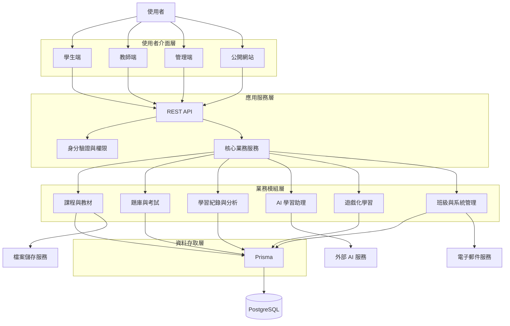
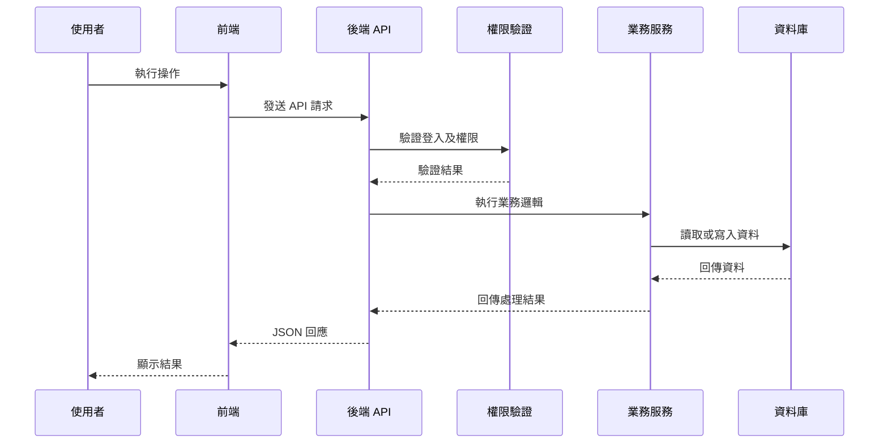
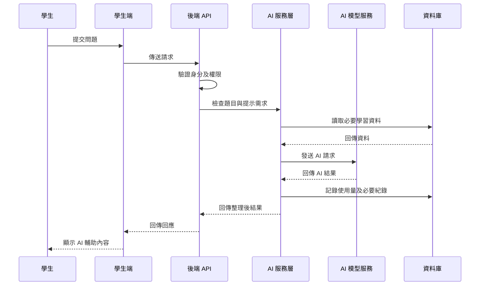
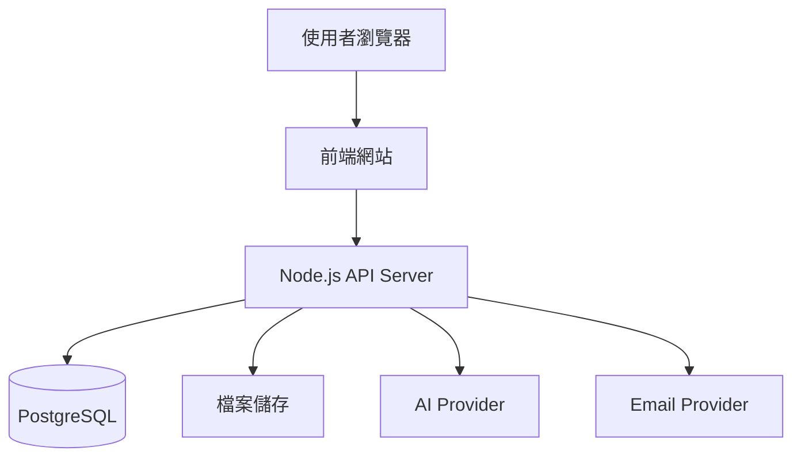

# 整體系統架構設計（SYSTEM ARCHITECTURE）

**專案名稱：** 碼上學｜CODE TO KNOW  
**文件路徑：** `docs/architecture/SYSTEM_ARCHITECTURE.md`  
**文件用途：** 定義平台整體系統組成、模組關係、資料流向、服務分工及未來擴充方式。

---

## 1. 系統架構目標

碼上學是一套以 AI 輔助學習為核心的教育科技平台。

系統必須支援學生、教師及管理員三種主要使用者，並提供課程、教材、題庫、考試、AI 學習助理、學習分析及遊戲化學習等功能。

整體架構目標：

1. 各功能模組能獨立開發及維護。
2. 前端、後端及資料庫有明確分工。
3. 使用者身分與權限由後端統一管理。
4. AI 服務與核心業務系統分離。
5. 支援未來新增科目、課程及學習功能。
6. 第一階段以響應式網站為主。
7. 未來可透過 API 擴充手機及桌面應用程式。
8. 系統具備測試、監控、備份及錯誤處理能力。

## 2. 整體架構概覽

系統採用分層式架構，主要分為：

1. 使用者介面層（Presentation Layer）
2. API 與應用服務層（Application Layer）
3. 業務邏輯層（Business Layer）
4. 資料存取層（Data Access Layer）
5. 資料儲存層（Data Layer）
6. 外部服務整合層（External Services）

### 2.1 架構示意



此圖為邏輯架構示意，實際部署時可依服務規模調整。

## 3. 使用者介面層

### 3.1 公開網站

提供尚未登入的訪客使用。

主要功能：

- 品牌首頁。
- 平台介紹。
- 功能介紹。
- 課程及學習特色介紹。
- 登入及註冊入口。
- 常見問題。
- 使用條款及隱私權政策。

### 3.2 學生端

主要功能：

- 學生註冊及登入。
- 個人學習首頁。
- 課程及教材。
- 題庫練習。
- 模擬考試。
- AI 學習助理。
- 錯題整理。
- 學習進度及分析。
- 點數、徽章及遊戲。

### 3.3 教師端

主要功能：

- 教師登入。
- 班級管理。
- 學生名單。
- 課程及教材管理。
- 題庫管理。
- 考試建立與發布。
- 成績查詢。
- 學習狀況分析。
- 班級公告。

### 3.4 管理員端

主要功能：

- 使用者管理。
- 角色及權限管理。
- 科目及課程管理。
- 題庫管理。
- 教師及班級管理。
- 系統設定。
- AI 服務設定。
- 操作紀錄及系統監控。

## 4. API 與應用服務層

前端不直接存取資料庫，所有需要讀取或修改的資料均透過後端 API 處理。

主要職責：

- 接收前端請求。
- 驗證使用者登入狀態。
- 檢查角色及資源權限。
- 驗證輸入資料。
- 呼叫對應業務服務。
- 回傳統一格式的結果。
- 處理錯誤及記錄必要事件。

### 4.1 API 請求流程



### 4.2 API 回應格式

成功回應建議：

```json
{
  "success": true,
  "data": {},
  "message": "操作成功"
}
```

錯誤回應建議：

```json
{
  "success": false,
  "error": {
    "code": "VALIDATION_ERROR",
    "message": "輸入資料不正確"
  }
}
```

實際 API 應依功能定義資料格式、HTTP 狀態碼及錯誤代碼。

## 5. 核心業務模組

### 5.1 使用者與權限模組

負責：

- 註冊及登入。
- 使用者資料。
- 角色管理。
- 權限驗證。
- 帳號狀態管理。
- Google 登入整合。

### 5.2 課程與教材模組

負責：

- 科目分類。
- 課程章節。
- 教材管理。
- 教材檔案。
- 課程發布。
- 學生課程進度。

### 5.3 題庫與考試模組

負責：

- 題目管理。
- 題型管理。
- 題目分類。
- 題目選項。
- 練習模式。
- 模擬考試。
- 作答及提交。
- 成績計算。

### 5.4 學習紀錄與分析模組

負責：

- 作答紀錄。
- 答題時間。
- 正確率。
- 錯題整理。
- 學習進度。
- 弱點分析。
- 學習報告。

### 5.5 AI 學習助理模組

負責：

- 題目解釋。
- 分層提示。
- 概念說明。
- 錯題分析。
- 學習建議。
- AI 使用紀錄及成本統計。

AI 模組不得直接繞過權限及資料驗證流程。

### 5.6 遊戲化學習模組

負責：

- 點數紀錄。
- 徽章及成就。
- 遊戲進度。
- 遊戲成績。
- 學習獎勵。
- 解鎖項目。

點數與獎勵必須由後端依照規則計算，不能只相信前端傳送的分數。

### 5.7 教師與班級管理模組

負責：

- 班級建立。
- 學生加入及退出。
- 教師班級權限。
- 作業及考試發布。
- 班級公告。
- 學習狀況查詢。

### 5.8 管理員與系統管理模組

負責：

- 使用者管理。
- 角色管理。
- 系統參數。
- 內容審核。
- 操作紀錄。
- 系統狀態管理。

## 6. 資料存取與儲存層

### 6.1 資料存取方式

採用 Prisma 作為 ORM，負責業務服務與 PostgreSQL 之間的資料存取。

基本原則：

- 業務服務不得任意繞過資料驗證。
- 資料庫操作集中管理。
- 重要資料修改應使用交易。
- 資料表應設定必要的關聯及限制。
- 敏感資料採取適當保護措施。

### 6.2 主要資料分類

| 資料類型 | 內容 |
| --- | --- |
| 使用者資料 | 帳號、個人資料、角色 |
| 組織資料 | 班級、成員、教師 |
| 課程資料 | 科目、課程、章節 |
| 教材資料 | 文件、圖片、教材資訊 |
| 題庫資料 | 題目、選項、答案 |
| 考試資料 | 考試設定、作答紀錄、成績 |
| 學習資料 | 進度、錯題、分析結果 |
| AI 資料 | 對話紀錄、使用量、成本 |
| 遊戲資料 | 點數、徽章、遊戲紀錄 |
| 系統資料 | 公告、設定、操作紀錄 |

完整資料表與欄位將在資料庫架構文件中定義。

## 7. AI 外部服務整合

AI 服務透過後端統一呼叫，不允許瀏覽器直接取得或使用伺服器 API Key。

### 7.1 AI 呼叫流程



### 7.2 AI 服務控制

- 使用後端環境變數管理 API Key。
- 限制每位使用者的請求量。
- 記錄必要的使用量及成本。
- 處理逾時、錯誤及服務中斷。
- 不將不必要的個人資料傳送給 AI Provider。
- 依照題目及學習情境選擇適當的提示層級。

## 8. 檔案儲存與電子郵件服務

### 8.1 檔案儲存

教材、圖片及其他大型檔案不應全部直接存放在關聯式資料庫中。

建議：

- 檔案放在專用檔案儲存服務。
- 資料庫只保存檔案識別資訊及必要 metadata。
- 設定檔案大小及格式限制。
- 私有教材使用權限控管或限時存取方式。
- 上傳檔案須檢查格式及安全性。

### 8.2 電子郵件

電子郵件服務可用於：

- 註冊驗證。
- 密碼重設。
- 教師公告。
- 考試通知。
- 系統通知。

寄信功能應透過後端服務執行，並避免暴露寄件服務憑證。

## 9. 系統安全與權限

### 9.1 基本安全原則

- 所有受保護 API 均需驗證身分。
- 所有敏感操作均需檢查角色及資源權限。
- 學生只能存取允許查看的個人資料。
- 教師只能管理授權班級及其相關資料。
- 管理員權限依實際工作職責分配。
- 不信任前端提供的 userId、role 或 teacherEmail。
- 防止未授權存取及跨班級資料洩漏。

### 9.2 資料保護

- 使用 HTTPS。
- 密碼使用安全雜湊方式儲存。
- 金鑰不得提交至 GitHub。
- 依資料敏感程度設定存取權限。
- 設定備份及還原程序。
- 保留必要的管理操作紀錄。
- 訂定個人資料保存及刪除政策。

## 10. 部署架構

第一階段以單一後端應用程式及模組化架構為主，不急著拆成微服務。

### 10.1 初期部署示意



### 10.2 環境區分

| 環境 | 用途 |
| --- | --- |
| Development | 本機開發 |
| Testing | 自動化及整合測試 |
| Staging | 上線前驗證 |
| Production | 正式使用 |

不同環境必須使用各自的設定及資料，避免測試資料影響正式資料。

## 11. 未來跨平台擴充

未來 Android、iOS、Windows 及 macOS 應共用主要後端 API。

基本原則：

- 不同前端共用同一套權限規則。
- 核心業務邏輯集中在後端。
- 不在手機 App 中重複實作重要業務判斷。
- 保持 API 版本管理。
- 跨平台 UI 可依裝置需求獨立調整。

## 12. 系統可靠性與維運

需要規劃：

- 錯誤日誌。
- API 請求紀錄。
- 系統健康檢查。
- 資料庫備份。
- 資料還原測試。
- AI Provider 異常處理。
- 電子郵件服務異常處理。
- 使用量及成本監控。
- 系統更新及回復程序。

重要外部服務故障時，應盡可能保留不依賴該服務的基本學習功能。

## 13. 架構驗收標準

- [ ] 完成整體系統架構圖。
- [ ] 明確定義學生端、教師端及管理端。
- [ ] 明確定義前端與後端的分工。
- [ ] 定義主要業務模組。
- [ ] 定義資料存取方式。
- [ ] 定義 AI 服務整合流程。
- [ ] 定義檔案及電子郵件服務方向。
- [ ] 定義使用者角色及權限原則。
- [ ] 定義部署環境。
- [ ] 定義未來跨平台擴充原則。

---

**文件狀態：** 整體架構初版，待後續模組設計及技術驗證。  
**重要說明：** 本文件描述預計採用的邏輯架構，不代表所有服務已經建置或正式上線。
