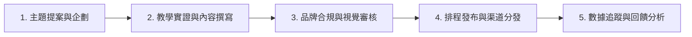

# 碼上學｜CODE TO KNOW 內容行銷、數位媒體與品牌推廣標準作業總冊 (Marketing & Media SOP)

**文件版本：** v2.0.0 (Phase 5 Canonical Full Edition)  
**更新日期：** 2026-11-18  
**權威維護：** CODE TO KNOW 數位媒體中心與品牌發展委員會  
**涵蓋 UID：** `P17-MED-001` 至 `P17-MED-010` 全量 10 項標準作業程序  

---

## 一、標準作業程序目的 (Purpose)

本文件為「碼上學｜CODE TO KNOW」品牌在進行社群運營、媒體發布、影音製作、學校產學合作、技術教學文章發布及數據追蹤時的最高規範。確保所有對外溝通皆堅守「真實、專業、啟發、尊重學習者、保護隱私」的品牌核心承諾，維護最高規格的教育科技公信力。

---

## 二、P17-MED-001：官方品牌核心帳號與管理規範

1. **單一核心品牌原則**：
   - 中文品牌：**碼上學**
   - 英文品牌：**CODE TO KNOW**
   - 全有名稱：**碼上學 AI 智慧學習與教育科技平台**
   - 品牌口號：**碼上學，學無止境。** (English: *Learn Beyond Limits.*)
2. **官方帳號統一識別代號**：
   - 主要識別子：`@codetoknow_tw`（台灣官方社群）
   - 教育識別子：`@codetoknow_edu`（學校與教師合作頻道）
   - 開源與技術庫：`Leonjay990414/CODE-TO-KNOW` (GitHub)
3. **授權代理人制度**：
   - 任何社群發言代表「碼上學」法人/專案立場，嚴禁使用個人未認證帳號代表平台發言。
   - 嚴禁於社群爭辯政治、敏感意識形態或發布非教育科技相關評論。

---

## 三、P17-MED-002：社群平台名稱可用性與渠道盤點

| 社群渠道 | 官方推薦 ID / 頻道 | 核心定位與溝通目標 | 當前可用性與佔位狀態 |
| :--- | :--- | :--- | :--- |
| **YouTube** | `@codetoknow_tw` | 長片教學、五大題組技術拆解、短影音 Shorts | 官方頻道籌劃中，腳本架構就緒 |
| **Instagram** | `@codetoknow.tw` | 視覺圖卡、每日題庫挑戰、連續學習 Streak 曬圖 | 視覺範本與品牌 Token 定稿 |
| **Threads** | `@codetoknow.tw` | 技術討論、考場踩坑心得、第一線教師互動 | 實作討論社群，即時互動回饋 |
| **Facebook** | `CodeToKnowTaiwan` | 學校合作公告、全國技術士檢定最新時程、家長專區 | 官方粉專維護，連結教育機構 |
| **GitHub** | `Leonjay990414/CODE-TO-KNOW` | 專案開源核心、開放教材規格、技術架構白皮書 | 主儲存庫正式受控營運中 |

---

## 四、P17-MED-003：帳號持有人、管理員與雙重驗證 (2FA) 安全規範

1. **最高所有權限（Root Ownership）**：
   - 官方核心信箱（如 `admin@codetoknow.edu.tw` 或登記法人信箱）作為各大平台註冊之唯一主要持有人。
   - 嚴禁用員工或外包人員之私人 Gmail 註冊官方帳號。
2. **強制雙重驗證 (Mandatory 2FA)**：
   - 所有管理員帳號**必須**啟用時間型一次性密碼（TOTP，如 Google Authenticator / 1Password）或 FIDO2 硬體金鑰。
   - 嚴格禁止使用簡訊（SMS）作為單一 2FA 驗證方式（防範 SIM 換卡攻擊）。
   - 2FA 備用金鑰（Backup Codes）必須儲存於具備端到端加密之實體密碼庫中。
3. **管理權限分層 (RBAC for Media)**：
   - **Admin（管理員）**：負責帳號安全、2FA 變更、商業合作簽核。
   - **Editor（主編）**：負責發文審稿、影音排程發布。
   - **Moderator（社群小編）**：僅具備回覆留言、客服轉介權限，無權刪除帳號或變更密碼。
4. **離職與移轉 SOP**：
   - 團隊成員異動當日 2 小時內，立即註銷該人員之平台管理權限並輪換管理員密碼。

---

## 五、P17-MED-004：內容企劃、發布日曆、審稿與授權流程

### 審稿五大檢核點 (5-Point Content Checklist)：
1. [ ] **代碼可重現性**：展示之 HTML/CSS/JS 必須在專案環境實際運行且 100% 正確。
2. [ ] **考場標準合規**：符合勞動部最新 10400 網頁設計丙級試題評分標準。
3. [ ] **拒絕直塞解答**：嚴守蘇格拉底教學引導原則，不提供抄襲捷徑。
4. [ ] **品牌視覺一致**：使用暖象牙白、深霧藍灰、沉穩香檳金與標準 Noto Sans TC / Inter 字型。
5. [ ] **誠信不誇大**：不出現「100% 保證及格」、「神級 AI 猜題」等浮誇宣稱。

---

## 六、P17-MED-005：短影音、教學影片、品牌介紹系列規劃

### 1. 三大核心影音系列：
- **系列 A：Academy 術科拆解（長片 10~15 分鐘）**
  - 五大題組版面架構、JavaScript 輪播與選單實作深度剖析。
- **系列 B：AI Lab 認知微步（短影音 60 秒）**
  - 「3 秒抓住考場地雷」、「margin auto 為什麼置中失敗？」、「float 高度塌陷秒解」。
- **系列 C：Challenge 遊戲實況（Shorts / Reels 30 秒）**
  - 「在 Quiz Rush 連擊 20 題是什麼感覺？」、「用 CSS Designer 滑桿 10 秒抓出盒模型破綻」。

### 2. 短影音黃金結構規範：
- `00:00 - 00:03` **Hook（痛點共鳴）**：「你是不是也遇過 float 浮動後父容器高度直接變 0 的慘劇？」
- `00:03 - 00:18` **Core（原理拆解）**：「因為浮動元素脫離了文件流，瀏覽器直接忽視它的高度！」
- `00:18 - 00:45` **Action（示範解方）**：「教你兩種標準解法：overflow hidden 與偽元素 clearfix。」
- `00:45 - 00:60` **CTA（行動引導）**：「在『碼上學』Bug Hunter 遊戲親手抓出這個漏洞，連結在個人檔案！」

---

## 七、P17-MED-006：AI 影音、圖像與商用授權檢驗

1. **字型商用授權**：
   - 僅允許使用 Google Fonts 開源商用字型（`Noto Sans TC`, `Inter`, `Roboto Mono`, `Cinzel`）。
   - 嚴格禁止未經授權使用微軟正黑體、華康、文鼎等商業字型於宣傳海報與影片字卡中。
2. **音訊與配樂商用授權**：
   - 僅使用 YouTube 音樂庫（Audio Library）完全免標明版權歌曲，或具有合法商業使用許可之音效。
   - 遊戲音效優先使用 Web Audio API 本機振盪器程式化合成，杜絕版權爭議。
3. **AI 生成圖文商業宣告**：
   - 若宣傳圖文包含 AI 輔助生成素材，必須符合該生成工具之 Commercial Use Terms。
   - 嚴禁利用 AI 生成包含名人肖像、他人版權 IP（如動漫人物、未授權標誌）之行銷資產。

---

## 八、P17-MED-007：Academy、AI Lab、Challenge 推廣系列矩陣

| 平台支柱 | 推廣標語 | 核心訴求 | 產品落地入口 |
| :--- | :--- | :--- | :--- |
| **Academy 學院** | 權威題庫，紮實奠基 | 全量 605 題官方有效題庫，章節精準解析 | `#theory-practice` |
| **AI Lab 實驗室** | 蘇格拉底啟發，思維躍升 | 四階段鷹架引導，杜絕死背硬套 | `#ai-coach` |
| **Challenge 挑戰** | 遊戲化試煉，秒懂本質 | 拼圖、排版、除錯、快答五大沉浸式挑戰 | `#games` |

---

## 九、P17-MED-008：社群留言、私訊、客服轉介與危機回應流程

1. **分級回應原則**：
   - **一級（一般諮詢）**：操作疑問、功能詢問 → 24 小時內友善回覆，導引至幫助中心或產品頁面。
   - **二級（技術 Bug / 試題疑義回報）**：用戶提出代碼報錯或試題爭議 → 2 小時內轉介技術組核實，由工程師確認後給予專業感謝與修正通知。
   - **三級（公關/資安危機）**：系統異常、資料疑慮或公開負面批評 → 15 分鐘內通報專案負責人，禁止在社群公開情緒化對嗆，統一發布透明事實聲明。

---

## 十、P17-MED-009：網站流量、社群觸及與轉換成效分析

1. **標準 UTM 規範**：
   - `utm_source`: `youtube`, `instagram`, `threads`, `facebook`, `direct`
   - `utm_medium`: `social`, `cpc`, `video_desc`, `bio_link`, `newsletter`
   - `utm_campaign`: `p5_game_center`, `exam_prep_2026`, `teacher_scaffolding`
2. **隱私至上原則**：
   - 嚴格遵守 GDPR / 台灣個人資料保護法，在正式載入第三方追蹤 SDK 前必須經由使用者同意 Cookie 橫幅。
   - 嚴禁於 URL 參數中攜帶學員真實姓名、信箱或身分代號。

---

## 十一、P17-MED-010：品牌合作、學校合作及活動紀錄清冊

1. **學校教師與技職專班合作規範**：
   - 提供公私立技術型高中、大專院校資訊科系免費教師後台體驗帳號。
   - 支援班級邀請碼機制（Join Code），方便整班匯入學情追蹤。
2. **合作申請審查流程**：
   - 前端點擊「教師身分申請」彈窗（`TeacherApplyModal`）提出學校單位、任教科目與證明。
   - 管理團隊於 3 個工作天內完成資格核實，開通班級派卷與作業指派權限。
3. **成果產出與紀錄**：
   - 定期發表「資訊教育推廣案例白皮書」，分享翻轉教育與遊戲化教學成果。
