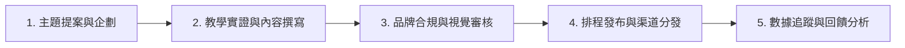

# 碼上學｜CODE TO KNOW 內容行銷與數位推廣標準作業程序 (Marketing SOP)

**文件版本：** v1.0.0 (Phase 5 Canonical Edition)  
**發布日期：** 2026-11-16  
**權威維護：** CODE TO KNOW 數位行銷與教育內容推廣小組  
**對應 UID：** `P17-MED-008`, `P17-MED-009`, `P17-MED-010`  

---

## 一、標準作業程序目的 (Purpose)

本文件確立「碼上學｜CODE TO KNOW」品牌在進行社群發文、技術教學文章發布、活動推廣及數位渠道營運時的標準流程。確保所有對外溝通皆秉持「真實、專業、啟發、尊重學習者」的品牌承諾，維護最高規格的教育科技公信力。

---

## 二、內容發布標準工作流程 (Publishing Workflow)

### 步驟 1：主題提案與企劃 (Planning)
- **選題範圍：** 聚焦於前端技術核心（HTML5 語意化、CSS 版面架構、JavaScript 互動非同步）、技檢術科解題思維、教育遊戲引導、AI 鷹架教學心法。
- **目標客群（ICP）明確化：**
  - 高中職與大專院校資訊科系學生（自學、檢定、實戰）。
  - 第一線資訊指導教師（備課資源、班級派卷、學情洞察）。
  - 轉職工程師初學者（紮實觀念建構、拒絕死記硬背）。

### 步驟 2：教學實證與內容撰寫 (Drafting & Proof)
- **代碼正確性驗證：** 所有文章或貼文中展示的程式碼，必須經由專案本地環境（`frontend`）或瀏覽器實際運行驗證，杜絕語法錯誤。
- **拒絕劇透原則：** 推廣 AI 輔導功能時，展示蘇格拉底式引導範例，不得宣傳「代寫作業」或「直接給全套代碼」。

### 步驟 3：品牌合規與視覺審核 (Brand & Visual Review)
- **視覺資產查核清單（Asset Checklist）：**
  - [ ] 配色符合品牌規範（暖象牙白、深霧藍灰、柔霧藍、沉穩香檳金、鼠尾草綠）。
  - [ ] 字型使用 `Noto Sans TC` 與 `Inter`。
  - [ ] 標誌周圍維持 50% 安全邊距，無變形或無授權縮放。
  - [ ] 圖片對比度符合 WCAG AA 易讀性標準。
- **文案合規查核：**
  - [ ] 檢查有無「保證通過」、「神級 AI」、「100% 猜題命中」等誇大虛假陳述。
  - [ ] 檢查有無 AI 行話套路（如「這不是...而是...」）。
  - [ ] 涉及功能狀態時，誠實說明目前版本與正式規劃，不造假未上線功能。

### 步驟 4：排程發布與渠道分發 (Distribution)
- **官方網站資源中心（Docs / Resources）：** 原創技術解構、題組指導文件。
- **技術社群（GitHub / Medium / IT 邦幫忙）：** 深度技術專題、開源貢獻分享。
- **教育與社群平台（Facebook / Threads / LinkedIn）：** 教師教學經驗交流、學習成果展示、學生闖關挑戰賽事。

### 步驟 5：成效分析與追蹤 (Analytics & Optimization)
- 採用標準化 UTM 參數標記，格式範例：
  `https://code-to-know.example.com/?utm_source=threads&utm_medium=social&utm_campaign=phase5_game_center`
- 嚴格遵守用戶隱私條款，不採集任何未授權之個人敏感數據。

---

## 三、道德行銷與誠信規範 (Ethical Marketing Guidelines)

1. **零虛假承諾：**
   - 絕不製造虛假的用戶評價、假見證（Testimonials）或偽造的通過率數據。
2. **誠實揭露系統狀態：**
   - 明確標示線上運行的模型版本與離線備援狀態（如 `v1.4.0-socratic-offline`）。
   - 對於正在開發中或受限之架構（如阻擋中的外部後端驗證），據實回報，不誤導大眾。
3. **推動獨立思考價值：**
   - 強調「工具是輔助，思維才是核心」。行銷核心聚焦於激勵學生主動建構知識體系，而非依賴捷徑。

---

## 四、社群互動與危機處理原則 (Social & Community Handling)

- **正面面對技術反饋：** 社群用戶若回報試題 Bug 或語法疑問，秉持技術討論精神，客觀核實並記入技術維護清單。
- **教師與教育機構合作諮詢：** 由專屬教育聯絡窗口一對一引導，提供完整的班級管理與實作教材展示。
