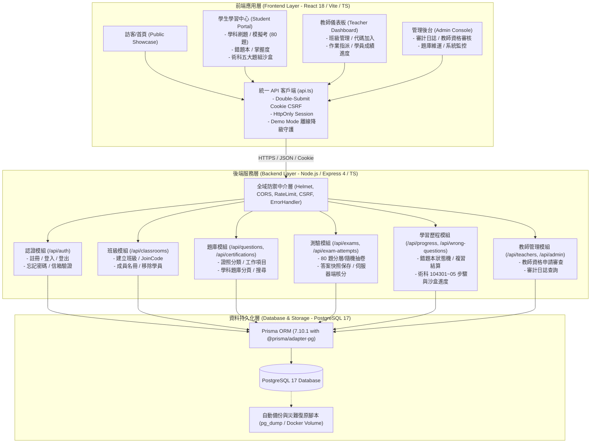

# CODE TO KNOW｜CTK-CORE-01 核心平台轉型建設計畫書
## CORE-FIRST Platform Transition & Acceleration Plan

**文件識別：** `docs/master/CTK_CORE_01_CORE_FIRST_TRANSITION_PLAN.md`  
**計畫代號：** `CTK-CORE-01`  
**計畫名稱：** 碼上學｜核心平台建構與智慧學習加速計畫 (Core Platform & Intelligent Learning Acceleration)  
**品牌識別：** 碼上學｜CODE TO KNOW (Slogan: 碼上學，學無止境。 / Learn Beyond Limits.)  
**核心策略：** **CORE-FIRST（核心優先、縱向貫穿、實質落地）**  
**生效日期：** 2026-11-25  
**治理狀態：** **OFFICIAL PLANNING BASELINE — APPROVED BY STRATEGY DIRECTIVE**  

---

## 一、計畫背景與轉型宗旨（Executive Context & Mission）

碼上學 (CODE TO KNOW) 平台經過前期的前端介面研發、官方考題彙整、教學模組切版以及認證與權限架構的基礎建設，已具備精緻的介面體驗與完整的官方題庫素材（包含學科 611 題與術科五大官方題組 104301～104305）。

然而，當前除了「使用者認證 (Auth)」、「教師審核 (Teacher Application)」與「班級管理 (Classroom)」三個模組已接通後端 Express API 與 PostgreSQL 之外，**核心的學科學科刷題、模擬考測驗、術科沙盒進度、錯題本與學習歷程目前多依賴前端 LocalStorage 與靜態 JSON 運行**。

為了盡快將 CODE TO KNOW 建設成真正可供全體學生、教師與管理員在真實網路環境下使用的完整教育科技平台，專案正式啟動 **`CORE-FIRST`** 轉型策略：

> [!IMPORTANT]
> **【CORE-FIRST 核心指導原則】**  
> 1. **核心功能優先：** 全力聚焦 P0 核心能力，集中突破資料庫持久化、核心 API 與前後端縱向串接。  
> 2. **非核心功能延後：** AI 教練、推薦演算法、進階遊戲連鎖機制、即時排行榜、裝飾性動畫等列為 P1/P2，在 P0 核心驗收完成前不搶佔核心工程資源。**P2 是延後，不是取消**。  
> 3. **品質底線絕不妥協：** 系統安全性（Authentication & RBAC）、資料備份與復原機制、資料庫外鍵約束與交易完整性、端對端測試永遠維持最高標準，不得以犧牲架構與安全換取表面進度。  
> 4. **縱向切片開發（Vertical Slice Architecture）：** 每一項核心功能的交付，必須自「資料模型 -> 資料庫遷移 -> 後端 API -> 前端串接 -> 權限防禦 -> 自動化測試」完整貫穿，杜絕只有前端畫面或只有空殼 API 的半成品。

---

## 二、專案目標與完成定義（Goals & Definition of Done）

### 1. 核心專案目標
在不破壞現有程式碼規範與官方五大術科題組的前提下，完成以下 9 大 P0 核心工程能力：
1. **資料庫架構與資料持久化：** 確認本機與正式環境 PostgreSQL 17 資料庫遷移管線、連線池最佳化與資料字典完整性。
2. **使用者帳號、身分與權限系統：** 完善學生、教師、管理員之 RBAC，杜絕 IDOR 水平與垂直越權。
3. **證照分類、題庫與題目管理：** 官方學科 611 題正式持久化入庫，提供高效索引查詢與章節分類 API。
4. **測驗建立、抽卷、作答、答案保存與成績計算：** 建立伺服器端 80 題分層/隨機抽卷、答案快照（Snapshot）防篡改存儲、伺服器端核分機制。
5. **學生學習紀錄、錯題本與學習進度：** 學生學科作答紀錄、錯題狀態機（未掌握/複習中/已掌握）、學習時長統計全面雲端同步。
6. **五大官方術科題組與術科學習進度：** 官方 104301～104305 題組之步驟檢核清單、沙盒代碼（HTML/CSS）快照與完成狀態雲端保存。
7. **教師及管理員必要的資料管理能力：** 教師掌握班級學員測驗成績與術科進度；管理員具備審計日誌檢索與題庫/用戶維運能力。
8. **API、資料完整性、安全性、備份及復原：** 完善自動化備份腳本、災難還原演練程序、全域 CSRF 與速率限制。
9. **前後端完整串接與整合測試：** 前端全面自 LocalStorage 遷移至正規 RESTful API，並保留離線展示模式（Demo Mode）作為安全降級手段。

### 2. P0 核心完成定義 (Definition of Done)
一項 P0 核心功能僅在滿足以下全部條件時，方得判定為 `COMPLETED`：
- [ ] **Data Model & Migration：** Prisma Schema 定義嚴謹，具備外鍵約束、唯一鍵、必要複合索引，Migration 腳本成功執行。
- [ ] **Backend Implementation：** 具備 Controller、Service、Zod Schema 驗證與嚴格錯誤捕捉，邏輯與資料庫交易（Transaction）正確。
- [ ] **Security & Authorization：** 通過 RBAC 角色查核、防偽造欄位過濾（`rejectForgedOwnerFields`）、IDOR 所有權校驗與 CSRF 防護。
- [ ] **Frontend Integration：** 前端頁面與元件成功串接 API，具備 Loading、Error、Empty 完整狀態處理，淘汰硬編碼與 LocalStorage 單向依賴。
- [ ] **Automated Testing：** 包含單元測試（Unit Test）與端點整合測試（Integration Test），覆蓋常規路徑與邊界異常。
- [ ] **Documentation & Zero Regression：** API 規格書與任務登記簿同步更新，未破壞既有題組與通過之測試。

---

## 三、功能分級標準（P0 / P1 / P2 Priority Matrix）

| 優先等級 | 定義與處置策略 | 涵蓋功能範疇 |
|:---:|---|---|
| **P0<br>(Core Platform)** | **核心基礎設施與學習主流程。**<br>必須立即實作、縱向打通、具備最高優先順序。任何阻礙 P0 完成之工作均應讓路。 | 1. PostgreSQL 17 資料持久化與連線池配置<br>2. 使用者帳號、登入/登出、JWT/Session、RBAC 角色<br>3. 證照分類 (17300 網頁設計丙級等) 與科目模型<br>4. 官方學科題庫資料庫入庫與分頁查詢 API<br>5. 80 題全真模擬考抽卷、作答交卷、伺服器端核分與快照<br>6. 個人錯題本狀態機（自動收錄/掌握度標記/移除）<br>7. 五大官方術科題組 (104301~104305) 學習與代碼進度同步<br>8. 教師班級學員名冊、作業指派與成績進度檢視<br>9. 管理員教師審核與安全性審計日誌<br>10. 資料庫備份還原機制與核心整合測試 |
| **P1<br>(Enhancement)** | **學習輔助與次要流程。**<br>待 P0 核心驗收後啟動，具備高度輔助價值但不阻礙基本學習行為。 | 1. 題目重點收藏標籤（Bookmarks）進階自訂標籤<br>2. 班級作業截止提醒與進度逾期警示<br>3. 學習時長（StudyTimeLog）視覺化統計圖表<br>4. 學生個人弱點分析（基於規則之弱點工作項目診斷）<br>5. 系統全域公告（Announcement）推播與已讀追蹤 |
| **P2<br>(Intelligent & Value-Add)** | **進階智慧功能、行銷與娛樂化體驗。**<br>暫時延後投入，確保專案快速進入核心可驗收狀態。 | 1. AI 助教鷹架對話（AIChatSession / AIChatMessage 整合外部 LLM API）<br>2. AI 智慧弱點推薦學習路徑演算法<br>3. 五大遊戲學習關卡（BugHunter, CSSDesigner, CodePuzzle 等）與後端進度連動<br>4. 全球/全校學習排行榜（Leaderboard）與點數積分<br>5. 遊戲成就徽章系統（GameAchievements）雲端同步<br>6. 複雜滾動動畫、音效庫與品牌互動特效<br>7. 外部第三方發信商正式串接（Resend / SendGrid 付費金鑰配置） |

---

## 四、核心平台整體架構（System Architecture）



---

## 五、資料庫與後端建置順序（P0 Implementation Sequence）

依據資料相依性（Dependency Order）與核心價值，制定以下 10 大建置階段：

```mermaid
flowchart LR
    S1["1. DB Foundation
    (連線/備份/驗證)"] --> S2["2. Identity & RBAC
    (帳號/角色/權限)"]
    S2 --> S3["3. Cert & Questions
    (證照/611題入庫)"]
    S3 --> S4["4. Exam & Answers
    (80題抽卷/核分/快照)"]
    S4 --> S5["5. Student Progress
    (進度/錯題本狀態機)"]
    S5 --> S6["6. Practical Tasks
    (五大題組沙盒進度)"]
    S6 --> S7["7. Teacher & Class
    (班級/成績檢視/作業)"]
    S7 --> S8["8. Frontend Connect
    (全頁面 API 縱向串接)"]
    S8 --> S9["9. Security & Testing
    (整合測試/災備演練)"]
    S9 --> S10["10. Acceptance
    (核心驗收完成)"]
```



### 階段詳細規格：

1. **Step 1: Database Foundation（資料庫基礎、連線、備份與復原）**
   - 驗證本機 Docker PostgreSQL 17 與正式環境連線設定。
   - 確認現有 2 個 Migration 腳本之可重現性。
   - 建立安全備份腳本（`scripts/db-backup.sh` 或 `.ps1`）與還原演練機制。
2. **Step 2: Identity & Permissions（使用者、角色、權限審查）**
   - 審查現有 `/api/auth` 流程，確保 `STUDENT`、`TEACHER`、`ADMIN` 角色權限隔離無漏洞。
   - 確保 Session 撤銷與密碼重設 Token 安全性。
3. **Step 3: Certification & Question Bank（證照分類及題庫入庫）**
   - 建立資料庫種子腳本（Seed Script），將 `officialTheoryQuestionBank.json` 之 611 題學科題目完整灌入 `Certification`, `Subject`, `Question`, `QuestionOption`。
   - 開發 `/api/certifications` 與 `/api/questions` 唯讀/查詢 API（支援工作項目分類與難度過濾）。
4. **Step 4: Exam & Answer（測驗抽卷、作答保存及成績結算）**
   - 開發 `/api/exams` 與 `/api/exam-attempts` 後端模組。
   - 實作伺服器端 80 題抽卷邏輯（依官方 4 大工作項目比例分層抽題）。
   - 實作交卷 API，伺服器端嚴格核分並將題幹/選項/正解完整寫入 `ExamAnswerSnapshot`，防範題庫日後變動影響既有成績。
5. **Step 5: Student Progress & Wrong Questions（學生學習紀錄與錯題本）**
   - 開發 `/api/progress/units` 與 `/api/wrong-questions` 後端模組。
   - 實作錯題本狀態機：測驗答錯自動入庫（`wrongCount + 1`，狀態為 `UNRESOLVED`）；連續重測答對 2 次自動標記為 `RESOLVED`。
6. **Step 6: Practical Progress（五大官方術科進度與代碼存儲）**
   - 確保五大題組（104301～104305）在 `PracticalTask` 與 `PracticalStep` 中完整就緒。
   - 開發 `/api/practical-progress`，支援學生儲存步驟完成狀態與沙盒 HTML/CSS 程式碼快照。
7. **Step 7: Teacher & Class Enhancement（教師、班級與學生成績管理）**
   - 擴充 `/api/classrooms`，增加教師檢視班級學員之「學科模擬考平均分」、「錯題率最高題目排行」、「術科題組完成率」API。
8. **Step 8: Core Frontend Integration（核心頁面與 API 完整串接）**
   - 修改前端 `frontend/src/services/api.ts`，增設 `questionApi`、`examApi`、`progressApi`、`practicalApi` 客戶端。
   - 改造 `TheoryPracticePage.tsx`、`MockExamPage.tsx`、`StudentDashboardPage.tsx`、`TeacherDashboardPage.tsx`，由 LocalStorage 讀寫切換為 API 呼叫，並保有 Demo Mode 容錯機制。
9. **Step 9: Security, Reliability & Disaster Recovery（安全性與整合測試）**
   - 執行 Vitest 整合測試，驗證跨模組呼叫（如交卷自動觸發錯題本更新）。
   - 執行端對端模擬攻擊測試（IDOR 越權測驗查詢、偽造交卷答案、高頻並發作答防刷）。
   - 執行備份檔還原演練，確認資料 100% 可還原。
10. **Step 10: Core Platform Acceptance（核心平台總體驗收）**
    - 召開正式核心平台驗收，確認所有 P0 驗收指標全數達成。

---

## 六、五大官方術科題組保護原則（Official Practical Tasks Protection）

五大題組為勞動部技能檢定中心法定之權威檢定內容，是本平台的立足基石，必須實施**最高等級防護**：

1. **五大官方題組清單：**
   - **題組一 (17300-104301)：** 校園社團介紹網（版面 1024×768、置中、跑馬燈、選單框架連動、影像合成）。
   - **題組二 (17300-104302)：** 運動廣場連結網（頁框佈局、多媒體音樂嵌入、動態選單切換）。
   - **題組三 (17300-104303)：** 國家公園介紹網（國家公園動態換圖、國家公園特色介紹子頁、表格排版）。
   - **題組四 (17300-104304)：** 網路行銷購物網（線上商品展示、購物清單、表單驗證、訂購確認彈窗）。
   - **題組五 (17300-104305)：** 書曼的旅遊相簿（相簿縮圖輪播、大圖預覽燈箱、音樂背景播放控制）。
2. **保護鐵律：**
   - **零修改與零替換：** 嚴禁刪除、改名、替換或合併五大官方試題。
   - **素材純淨：** 原始素材（`173003B13/`）與標準解答（`題組一答案/`～`題組五答案/`）嚴格獨立存放，非官方題目不得混入。
   - **規格防呆：** 題組中的扣分陷阱（Disqualification Traps）與評分關鍵檢核點（Scoring Checklist）必須完整呈現在教學引導中。

---

## 七、前後端整合與離線展示相容策略（Integration & Demo Compatibility）

為確保平台於展示會、無後端環境或網路中斷時仍具備極致可靠性，採用**雙軌驅動架構**：

```typescript
// frontend/src/services/api.ts 之核心策略
if (isDemoMode) {
  // 1. 降級至 sessionStorage / localStorage 模擬運作
  // 2. 顯示「展示模式」提示標籤，不中斷使用者操作體驗
  // 3. 確保無白屏、無未處理之 Promise Rejection
} else {
  // 1. 發送正式 RESTful API 請求至後端 Express (http://localhost:4000/api 或正式網域)
  // 2. 攜帶 HttpOnly Session Cookie 與 XSRF-TOKEN
  // 3. 伺服器端錯誤返回標準結構，由 UI 呈現精確提示
}
```

---

## 八、風險分析與因應對策（Risk Assessment & Mitigation）

| 風險項目 | 嚴重度 | 影響層面 | 預防與因應對策 |
|---|:---:|---|---|
| **題庫資料灌入格式錯誤** | 中 | 題目顯示異常、選項混亂 | 撰寫具備嚴格 Zod Schema 驗證之 Seed 腳本，入庫前逐題校驗題號、選項代碼與解答。 |
| **模擬考交卷並發效能瓶頸** | 中 | 學生同時交卷導致 DB 連線耗盡 | 答案快照採批次入庫（`createMany` 或交易單元），合理配置 PostgreSQL 連線池（`max: 20`）。 |
| **LocalStorage 與 DB 資料不同步** | 高 | 學生更換裝置後學習紀錄遺失 | 實作「首次登入雲端同步向導」，將舊有本機 LocalStorage 紀錄主動上傳合併至資料庫。 |
| **跨使用者越權查分成 (IDOR)** | 極高 | 學生窺探他人成績或修改作答 | 所有進度與測驗 API 強制使用 `req.user.id` 作為查詢條件，禁止由前端傳入 `studentId` 覆寫。 |
| **資料庫 Migration 執行失敗** | 高 | 伺服器無法啟動、資料表受損 | 嚴格落實 Migration 預檢機制，本機 Docker 測試庫驗證通過後，始得部署至正式環境。 |

---

## 九、計畫簽核與後續授權指示（Sign-off & Directive）

本轉型計畫自即日起作為 CODE TO KNOW 全專案工程開發之最高綱領。所有後續任務必須依據本計畫所列之優先等級與架構規範執行。

**核定狀態：** **OFFICIAL PLANNING BASELINE — READY FOR CORE EXECUTION**  

---

## 十、2026-11-25 衝刺進度與五大垂直整合批次結案進展 (Daily Milestones & Progress Tracking)

### 1. 今日核心成果交付清冊 (全部 100% 經由實測驗收通過)
1. **`CTK-CORE-01-INT-001` (Batch 1 - 官方 605 題學科題庫)：** **PASS**
   - 605 題官方有效題庫與 2,420 筆選項入庫（本機 PG17 隔離庫）。
   - 4 大工作項目查詢 API、`TheoryPracticePage` 真實串接與單元測試全數通過。
2. **`CTK-CORE-01-INT-002` (Batch 2 - 80 題全真模擬考與錯題本)：** **PASS**
   - 80 題加權分層抽題（31+31+9+9）、試卷脫敏防作弊、伺服器核分與 80 筆作答快照原子寫入。
   - 個人錯題本狀態機（UNRESOLVED -> REVIEWING -> MASTERED 連續 2 次答對解鎖）。
3. **`CTK-CORE-01-INT-003` (Batch 3 - 五大官方術科題組學習與沙盒代碼保存)：** **PASS**
   - 勞動部 17300 規範 5 大題組（104301~05）71 步驟種子寫入（0 筆非法第 6 題組）。
   - Version A (官方素材) 與 Version B (影音串流解題) 雙版本進度隔離與 HTML/CSS 代碼持久化。
4. **`CTK-CORE-01-INT-004` (Batch 4 - 學生歷程、教師班級成效與管理端治理)：** **PASS**
   - 學生儀表板真實動態聚合與防偽造提權（403 阻斷）。
   - 教師班級成效分析與個別學員歷程穿透查閱（非所屬學員/跨教師 403 阻斷）。
   - 管理員帳號啟用/停權開關與自鎖/自降權防呆（400 阻斷）。
5. **`CTK-CORE-01-INT-005` (Batch 5 - 比賽展示總體驗收與資安回歸)：** **PASS**
   - 27 項跨模組端對端查核點全數通過、8 種主流 RWD 螢幕寬度驗收、26 個測試套件 336 項測試全數綠燈。
6. **`CTK-CORE-01-INT-005-R` (Batch 5-R - 獨立資料庫災難備份還原演練)：** **PASS**
   - 指定備份檔 SHA-256 (`1A5C605554C53BE997522E347CBC8BD6B58F3AAE338495A5C90C6AA378C243B6`) 與 Manifest 驗證無損。
   - 於獨立暫存庫 `ctk_core01_int005_restore_verify` 完成還原（Exit 0），20 項跨庫對照全數符合（EXACT/BASELINE_MATCH），原始 Scratch DB 100% 完好未受覆蓋。
7. **`INT-005-R 補充稽核` (還原權限溯源、RLS 範圍查核與回歸測試)：** **PASS**
   - 追查實證所有 GRANT、ALTER TABLE DISABLE RLS 等操作 100% 僅發生於目標還原庫；原始庫 RLS 仍為 `true`。
   - 修改後 DB-003 單元測試（12/12）、離線測試套件（336/336）與前端生產建置全數通過。

### 2. 專案進度分項指標紀錄 (嚴格隔離分開記錄，不混淆)

| 進度項目 | 正式紀錄 | 說明備註 |
|---|:---:|---|
| **CTK-CORE-01 INT 批次** | **5／5 PASS** | 原定五大垂直整合衝刺批次全數通過 |
| **INT-005-R** | **PASS** | 獨立資料庫災難備份還原演練驗收通過 |
| **INT-005-R 補充稽核** | **PASS** | 權限操作溯源、原始庫唯讀保護與修改後回歸全數通過 |
| **CTK-CORE-01 加權完成率** | **尚未正式核算** | 待全專案需求盤點後依權重公式精確核算 |
| **原始專案整體基準** | **49.166860% LOCKED** | 既有進度基準凍結鎖定，未經正式審查不得擅改 |
| **原始 P10 階段** | **8.00%** | 既有 P10 階段進度基準 |
| **Master Wave** | **UNKNOWN，待核實** | 待整體 Roadmap 統整後確認 |
| **Preview Batch** | **UNKNOWN，待核實** | 待預覽環境重新對齊後確認 |

### 3. 明日交接與接續工作方針
1. **需求盤點優先：** 明日應先全面盤點剩餘之 P0/P1 核心功能需求與前後端待串接缺口，再評估決定下一項正式垂直整合任務。
2. **候選任務宣告：** `INT-006`（個人化智慧學習教練）僅列為候選任務，**尚未開始、尚未核准、尚未完成**；嚴禁在未完成剩餘核心需求盤點前擅自啟動。
3. **無重複開發原則：** 嚴禁為了增加任務數量而重複開發已交付之題庫、測驗或術科功能。
  
