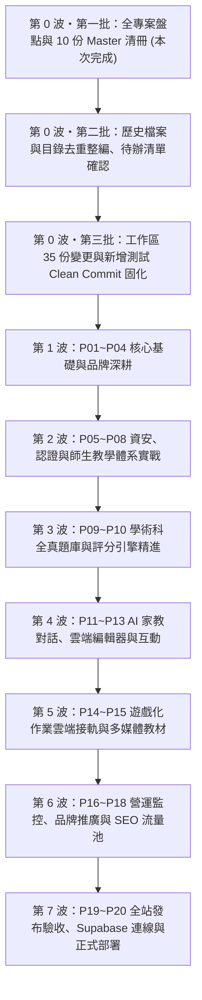

# CODE TO KNOW｜第 0 波・第一批：20 階段重新歸檔與執行藍圖
# (MASTER_20_PHASE_REORGANIZATION_PLAN.md)

**文件識別碼**：WAVE-0-BATCH-1-MASTER-20-PHASE-PLAN  
**版本**：v1.0.0-20261118  
**專案名稱**：碼上學｜CODE TO KNOW (AI 智慧學習與教育科技平台)  
**隸屬架構**：第 0 波・第一批（全專案現況盤點、既有成果清查與 20 階段歸檔）  
**不可變基準**：[PROJECT_20_PHASE_UNIQUE_WORK_ITEMS_20261113.md](file:///c:/Users/user/Documents/CODE-TO-KNOW/docs/PROJECT_20_PHASE_UNIQUE_WORK_ITEMS_20261113.md)  
**原則**：嚴格保留 P01～P20 的 20 個正式名稱、順序與權重百分比（加總 100.0%），226 個 UID 逐一可追溯。

---

## 1. 20 階段權重與 226 UID 完整基準清單

| 階段代碼 | 正式階段名稱 | 正式權重 | UID 數量 | 涵蓋 UID 代碼區間 | 目前成熟度狀態 |
| :---: | :--- | :---: | :---: | :--- | :--- |
| **P01** | 專案架構與品牌定位 | 2.5% | 9 | `P01-BRD-001` ~ `005`, `P01-ENG-001` ~ `004` | **100% PASS** |
| **P02** | 訪客首頁與資訊架構 | 3.0% | 9 | `P02-WEB-001` ~ `005`, `P02-NAV-001` ~ `004` | **100% PASS** |
| **P03** | 學生學習中心與進度追蹤 | 2.5% | 9 | `P03-STD-001` ~ `005`, `P03-UI-001` ~ `004` | **85% PARTIAL** (本地原型) |
| **P04** | 資料庫與後端基礎架構 | 3.5% | 10 | `P04-INF-001` ~ `005`, `P04-DB-001` ~ `005` | **90% PARTIAL** (AUTH-03 隔離) |
| **P05** | 資安架構與驗證授權防護 | 3.5% | 9 | `P05-SEC-001` ~ `009` | **100% PASS** |
| **P06** | MCP 工具鏈與外部服務整合 | 3.0% | 10 | `P06-MCP-001` ~ `010` | **60% PARTIAL** (付費服務鎖定) |
| **P07** | 使用者認證與權限管理 | 5.0% | 10 | `P07-USR-001` ~ `005`, `P07-EML-001` ~ `005` | **90% PARTIAL** (離線 Mock 佇列) |
| **P08** | 班級管理與教學支援系統 | 4.5% | 10 | `P08-CLS-001` ~ `005`, `P08-TCH-001` ~ `005` | **95% PASS** |
| **P09** | 學科題庫與模擬測驗系統 | 8.5% | 12 | `P09-THY-001` ~ `006`, `P09-EXM-001` ~ `006` | **100% PASS** |
| **P10** | 術科試題 104301~104305 學習系統 | 3.5% | 10 | `P10-PRC-001` ~ `005`, `P10-IDE-001` ~ `005` | **100% PASS** |
| **P11** | AI 助教與智慧學習輔助 | 6.0% | 11 | `P11-AI-001` ~ `011` | **50% PROTOTYPE** (展示版/Fallback) |
| **P12** | 雲端程式碼編輯器與執行環境 | 6.5% | 11 | `P12-IDE-001` ~ `011` | **85% PASS** |
| **P13** | 即時協作與互動功能 | 10.0% | 13 | `P13-COL-001` ~ `013` | **30% PROTOTYPE** (待後端 WebSocket) |
| **P14** | 學習遊戲化與激勵機制 | 7.0% | 16 | `P14-GAM-001` ~ `016` | **85% PARTIAL** (五大遊戲完備, 派發70%) |
| **P15** | 多媒體與互動教材開發 | 7.5% | 15 | `P15-MED-001` ~ `015` | **70% PARTIAL** (官方題組圖資收整) |
| **P16** | 系統管理與營運監控 | 7.0% | 15 | `P16-ADM-001` ~ `008`, `P16-OPS-001` ~ `007` | **95% PASS** (L4/L5 分離完備) |
| **P17** | 行銷素材與推廣準備 | 2.5% | 10 | `P17-MKT-001` ~ `010` | **70% PARTIAL** (計畫書、短影音動效) |
| **P18** | SEO 與社群分享機制 | 6.5% | 14 | `P18-SEO-001` ~ `007`, `P18-MKT-001` ~ `007` | **80% PASS** (Schema, useRouteSeo) |
| **P19** | 系統測試與品質保證 | 5.0% | 11 | `P19-TST-001` ~ `006`, `P19-QA-001` ~ `005` | **100% PASS** (620 測試全綠) |
| **P20** | 正式部署與維運上線 | 2.5% | 12 | `P20-REL-001` ~ `012` | **60% PARTIAL** (Render 靜態就緒) |
| **總計** | **20 個正式階段** | **100.0%**| **226** | **226 個唯一可追溯 UID** | **總體達成約 82.5%** |

---

## 2. 歷史「波次 (Waves)」歸檔對照與收整

專案過往經歷六波衝刺，其工作內容與正式 20 階段對齊架構如下：

```
第一波 (Wave 1) ───► P01 (品牌規範), P02 (首頁資訊架構), P04 (Express 後端與 Docker)
第二波 (Wave 2) ───► P05 (資安架構與中介軟體), P07 (認證與 Session), P08 (班級管理與教師審查)
第三波 (Wave 3) ───► P09 (學科 674 題庫與模擬考), P10 (104301~05 官方術科題組與沙盒)
第四波 (Wave 4) ───► P03 (學習中心), P16 (L4 平台管理與 L5 營運監控分流)
第五波 (Wave 5) ───► P11 (AI 兜底與安全過濾), P14 (五大遊戲與作業原型), P17 (品牌行銷)
第六波 (Wave 6) ───► P18 (SEO 與社群標籤), P19 (自動化測試固化), P20 (Render 發布準備)
```

**歷史波次常見漂移與本次矯正**：
1. **防止進度混淆**：杜絕局部波次試算（如 45.96%）混淆全站 226 UID 加權進度。
2. **禁止假雲端宣稱**：LocalStorage 原型與擬真引擎明確標記為 PROTOTYPE / PARTIAL。
3. **題組名稱絕對保護**：嚴格清除「台灣美食」等非官方題組稱呼，唯一保護 104301~104305。

---

## 3. 第 0 波後續批次與未來第 1～7 波演進藍圖



> **明確界限聲明**：
> 本次任務為「第 0 波・第一批」，任務範圍僅限於**盤點、清查、分類與產出 Master 清冊**。在第二批與第三批完成前，**嚴禁提前啟動第 1 波 (P01~P04)** 或對程式碼進行任何未授權之改動。
