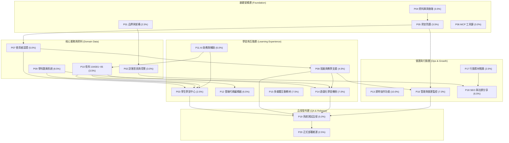

# CODE TO KNOW｜第 0 波・第一批：跨階段相依性拓撲與資料流向圖
# (MASTER_CROSS_PHASE_DEPENDENCY_MAP.md)

**文件識別碼**：WAVE-0-BATCH-1-MASTER-DEPENDENCY-MAP  
**版本**：v1.0.0-20261118  
**專案名稱**：碼上學｜CODE TO KNOW (AI 智慧學習與教育科技平台)  
**隸屬架構**：第 0 波・第一批（全專案現況盤點、既有成果清查與 20 階段歸檔）  
**目的**：視覺化 20 階段之依賴拓撲關係、追蹤核心資料生命週期，並剖析關鍵阻斷影響鏈。

---

## 1. 20 階段相依性拓撲圖 (Phase Dependency Graph)



---

## 2. 平台核心資料生命週期與流向 (Data Lifecycle)

```
[1. 訪客/使用者認證 (P05/P07)]
   │
   ├─► 訪客瀏覽首頁 (P02) 與 104301~05 題組展示
   ├─► 註冊/登入 (POST /api/auth/register, login) ──► 簽發 JWT Session Cookie 與 CSRF Token
   │
   ▼
[2. 學生個人學習平台 (P03)]
   │
   ├─► 網頁設計丙級學科 674 題刷題 (P09) ──────► 記錄錯題與知識點弱項 (WrongQuestionRecord)
   ├─► 80 題全真模擬考試 (P09) ────────────────► 產生成績單與歷程快照 (ExamAttempt)
   ├─► 術科題組 104301~104305 步進學習 (P10) ──► 即時沙盒切版預覽與語法分析 (P12)
   ├─► 五大教育遊戲關卡挑戰 (P14) ──────────────► 累積通關星級、徽章成就與積分
   │
   ▼
[3. 教師教學支援管理 (P08)]
   │
   ├─► 教師建立班級 (POST /api/classrooms) ────► 產出高熵 6 碼 joinCode (joinCode.ts)
   ├─► 學生輸入代碼加入 (POST /api/classrooms/join)
   ├─► 教師派發遊戲作業與星級目標 (P14-GAM-014 / ClassAssignment)
   └─► 檢視班級學員學習進度與作業繳交情況
   │
   ▼
[4. 平台管理與系統營運 (P16)]
   │
   ├─► L4 管理員審核教師資格申請 (POST /api/admin/teacher-applications/:id/approve)
   ├─► 系統寫入高權限操作審計追蹤 (AuditLog - 去識別化脫敏)
   └─► L5 系統營運監控即時連線健康度與資料庫延遲 (GET /api/health)
```

---

## 3. 關鍵阻斷因子與下游衝擊矩陣 (Blockers & Cascading Impact)

| 核心阻斷項目 | 當前受限狀態 | 直接衝擊階段 | 衍生連鎖效應 (Cascading Ripple) | 緩解與因應對策 |
| :--- | :--- | :--- | :--- | :--- |
| **AUTH-03 雲端 Supabase 資料庫隔離** | **嚴格隔離** (禁止網路寫入) | **P04, P07, P08, P16** | 學生歷程 (P03)、錯題本 (P09)、遊戲成就 (P14) 無法跨裝置雲端同步，目前停留於 LocalStorage | 前端 `api.ts` 自動切換雙模，展示模式降級運作，待正式授權後接通 |
| **L3/L4 遊戲管理 API 待接軌** | **70% 本地原型** (`P14-GAM-014/015`) | **P14, P08, P16** | 教師派發之遊戲作業僅存於本機瀏覽器，無法透過網路同步至真實學生端 | 已封裝為獨立 Utility (`teacherGameTaskManager.ts`)，介面標準化待後端接軌 |
| **雲端 LLM API 未開通** | **本機展示版** (`P11-AI-001`) | **P11, P03, P10** | AI 家教無法進行多輪動態智慧推理，目前依靠靜態知識庫與擬真兜底 | 內建 `aiFallbackEngine.ts` 與 `aiSafetyFilter.ts`，介面標記展示版 |
| **外部真實發信商未配置** | **離線 Mock** (`P07-EML-001`) | **P07** | 註冊信與重設密碼信僅於伺服器終端輸出 Token，未發送至真實外部信箱 | 採用 `emailQueueService.ts` 記憶體重試佇列，上線時注入 SendGrid/Resend API Key |
