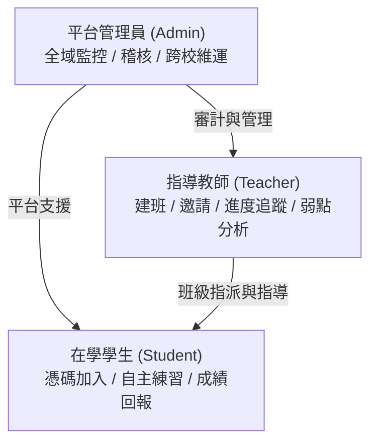
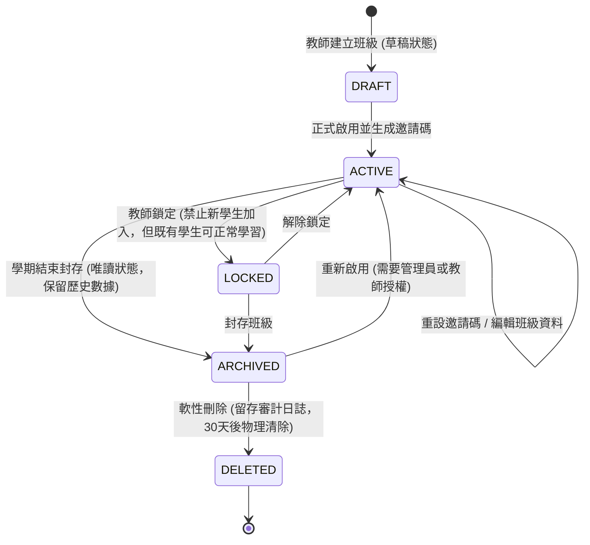

# 碼上學｜CODE TO KNOW
# 班級管理系統完整產品需求規格書（PRD）
**Classroom Management System Full Product Specification**

---

## 一、系統背景與產品願景

### 1.1 背景說明
「碼上學｜CODE TO KNOW」致力於為技術型高中、大專院校及職業技能培訓機構提供融合理論測驗與術科實作的智慧教育科技平台。在教學現場中，教師需要集中管理多個教學班級、追蹤學生在 605 題學科題庫與五大題組（104301～104305）的練習歷程、分析班級弱點，並進行個別化教學輔導。

### 1.2 產品願景
打造一個**直覺、零負擔、高隱私安全且支援大規模教學並行**的班級管理系統。透過一鍵生成 8 位英數邀請碼，學生可無縫加入班級；教師可即時掌握班級進度儀表板與個別學習曲線；系統管理員則擁有全域維運與審計權限，確保教學活動合規穩定。

---

## 二、三層式使用者角色與職責矩陣（User Roles & Responsibilities）

系統定義三類核心角色，嚴格實施職責分離與最小權限原則：

### 2.1 學生端核心功能清單（Student Tier · 10 大必備能力）
- **我的班級 (My Classes)**：檢視個人目前就讀與歷史加入之班級清單，呈現授課教師與學期資訊。
- **輸入邀請碼 (Input Join Code)**：直覺無障礙彈窗，支援 8 碼分段或連續輸入，自動正規化為大寫。
- **加入班級 (Join Class)**：向後端驗證邀請碼並發起入班選課，具備防重加入與額滿提示。
- **查看教師 (View Teacher Profile)**：查閱授課教師姓名、職稱、專業領域與公開聯絡方式。
- **查看課程 (View Curriculum)**：檢閱班級綁定之官方考科大綱（例如：17300 網頁設計丙級）。
- **查看教材 (View Materials)**：查閱五大題組（104301~104305）官方參考文件、素材清冊與提示包。
- **查看公告 (View Announcements)**：接收教師發布之班級考試通知、自學進度要求與即時叮嚀。
- **查看作業 (View Assignments)**：檢視教師指派之學科測驗組或術科指定題組作業與截止期限。
- **查看個人學習進度 (View Personal Progress)**：掌握自己在 605 題學科與 5 大題組之完成百分比與相對班級落點。
- **退出班級 (Leave Class)**：學生自主退出非正式輔導班級（若教師設定允許），保留個人作答紀錄。

### 2.2 教師端核心功能清單（Teacher Tier · 13 大必備能力）
- **班級總覽 (Class Overview)**：儀表板呈現名下所有班級卡片、即時在線人數、總體學科答題率與術科達標率。
- **建立班級 (Create Class)**：設定班級名稱、科目代碼、學期、年級與學生人數上限。
- **編輯班級 (Edit Class)**：調整班級基本資料、教學描述與開放狀態。
- **設定學期 (Set Semester)**：指定學年度與學期（例如：113 學年度第一學期），利於週期性歸檔。
- **管理邀請碼 (Manage Join Code)**：一鍵複製 8 碼高辨識邀請碼、重設換發新碼、產生大尺寸投影 QR Code。
- **學生名冊 (Student Roster)**：瀏覽班級學生姓名、學號、加入時間、最後上線時間與學習檔案。
- **審核加入 (Approve Join)**：提供「自由加入」或「教師手動審核」雙模式切換機制。
- **移除學生 (Remove Student)**：將誤入或退選學生移出班級，即刻註銷該班檢視權限。
- **課程管理 (Course Management)**：設定班級學習目標（例如：期中前完成 605 題、期末前通過 104301~104303）。
- **教材管理 (Material Management)**：組織與勾選官方素材、示範影音連結與注意事項。
- **公告管理 (Announcement Management)**：撰寫、置頂、排程發布與編輯班級公告。
- **作業管理 (Assignment Management)**：分派自選考題、模擬考卷與術科提交查核點。
- **學生學習分析 (Student Learning Analytics)**：視覺化呈現全班弱點分析、高頻錯題 Top 10、個別學生歷程折線圖。

### 2.3 平台管理員端核心功能清單（Admin Tier · 7 大必備能力）
- **全平台班級總覽 (Platform Class Overview)**：跨學校、跨教師調閱全站所有班級之即時運作狀態。
- **搜尋教師及班級 (Search Teacher & Class)**：支援依教師姓名、班級名稱、邀請碼或科目快速過濾。
- **查看成員 (Inspect Members)**：跨權限檢視特定班級之在冊名冊與選課異動紀錄。
- **異常班級管理 (Abnormal Class Governance)**：針對洗流量、幽靈班級或超額異常進行強制凍結或隔離。
- **班級停用 (Disable Class)**：手動將爭議班級標記為 LOCKED 或 ARCHIVED，阻斷非預期存取。
- **操作稽核 (Operation Audit Log)**：完整調閱建班、名冊移除、邀請碼重發與權限變更之 AuditLog 軌跡。
- **權限管理 (Role & Access Management)**：核發或撤銷使用者之 TEACHER 身份，管理全域資源配額。

---

## 三、班級完整生命週期狀態機（Class Lifecycle State Machine）

每個班級在其存續期間遵循清晰明確的狀態轉換，防止已結業班級干擾日常教學或誤收學生：

### 狀態詳細規範：
1. **DRAFT（草稿）**：班級已在資料庫初始化，但未生成邀請碼，學生端無法搜尋或加入。
2. **ACTIVE（啟用運作中）**：邀請碼有效，學生可自由加入，所有學習追蹤與統計即時更新。
3. **LOCKED（加入鎖定）**：邀請碼暫時失效，新學生無法加入；已加入之在冊學生維持所有學習權限。
4. **ARCHIVED（已封存）**：學期結束或課程結束。所有數據轉為「唯讀」，不在進行中的儀表板主頁展示，學生不可退班，僅供查閱過往成效。
5. **DELETED（軟刪除）**：標記 `deletedAt` 時間戳，前台完全隱藏，保留後端稽核軌跡以符合教育個資保護法規。

---

## 四、功能需求規格矩陣（Functional Requirements Matrix）

| 功能編號 | 功能模組 | 功能名稱 | 適用角色 | 優先級 | 規格說明 | 驗收標準 |
| :--- | :--- | :--- | :--- | :---: | :--- | :--- |
| **FR-CLS-01** | 班級建立 | 建立教學班級 | Teacher | P0 | 輸入班級名稱、科目（預設：網頁設計丙級）、年級/代號、人數上限（預設 50）。 | 成功送出後於資料庫建立紀錄，預設狀態為 ACTIVE。 |
| **FR-CLS-02** | 邀請機制 | 8 碼邀請碼生成 | System/Teacher | P0 | 系統自動產生高辨識度 8 碼英數代碼，排除易混淆字元（0, O, 1, I）。 | 確保全系統唯一性，具備衝突重試機制。 |
| **FR-CLS-03** | 邀請機制 | 邀請碼重設與停用 | Teacher | P1 | 教師可手動使當前代碼失效並換發新碼，或直接關閉外部加入。 | 原代碼立即無法加入，已加入學生不受任何影響。 |
| **FR-CLS-04** | 學生加入 | 憑碼加入班級 | Student | P0 | 學生於專屬對話框輸入 8 碼邀請碼，系統校驗後加入。 | 重複加入回傳友善提示；成功後班級立即出現在學生列表。 |
| **FR-CLS-05** | 名冊管理 | 班級學生名冊瀏覽 | Teacher | P0 | 呈現在冊學生姓名、學號/帳號、加入時間、近期練習時間。 | 支援關鍵字即時搜尋、分頁（預設 20 筆/頁）與升降冪排序。 |
| **FR-CLS-06** | 名冊管理 | 學生移除 | Teacher | P1 | 教師可將特定學生自班級移除。 | 移除後學生喪失該班檢視權限，學生自身的歷程資料予以保留。 |
| **FR-CLS-07** | 學習分析 | 班級學科統計概覽 | Teacher | P0 | 聚合班級所有學生於 605 題之答題率、平均分與常見易錯題 Top 10。 | 資料計算延遲在 3 秒內，直觀圖表呈現。 |
| **FR-CLS-08** | 學習分析 | 班級術科進度追蹤 | Teacher | P0 | 聚合題組一至五（104301~104305）班級完成率與各站點平均達成度。 | 矩陣化呈現班級全員完成狀態（未開始、進行中、已達標）。 |
| **FR-CLS-09** | 資料匯出 | 班級成效報表匯出 | Teacher | P1 | 一鍵匯出 CSV / Excel 格式，包含學生個人測驗成績與整體答題率。 | 產出之檔案格式正確、繁體中文無亂碼（UTF-8 with BOM）。 |
| **FR-CLS-10** | 平台治理 | 跨班級全域稽核 | Admin | P2 | 管理員後台查詢全站班級、調任教師、強制封存異常班級。 | 具備完整操作日誌，記錄操作者 ID、IP 與時間。 |

---

## 五、非功能性需求（Non-Functional Requirements）

### 5.1 效能指標（Performance）
- **邀請碼驗證延遲**：學生送出邀請碼至驗證通過，後端處理時間 $T_{\text{response}} \le 200\text{ ms}$（95th percentile）。
- **班級進度儀表板載入**：單班 100 名學生、總答題數 50,000 筆之聚合計算，初次載入不超過 800 ms，且支援快取。
- **並行處理能力**：支援全校 1,000 名學生同時憑碼簽到與加入班級，無死鎖或資料庫競爭衝突。

### 5.2 安全與隱私保護（Security & Privacy）
- **多租戶資料隔離**：教師僅能存取其擁有（Owner）或獲授權（Co-teacher）之班級資料，後端必須依據 JWT 身份進行 Row-Level Ownership 校驗。
- **防止邀請碼暴力破解**：對 `/api/v1/classes/join` 實施速率限制（Rate Limiting），單一使用者/IP 限制每分鐘最多嘗試 5 次錯誤代碼，超額則暫時封鎖 15 分鐘。
- **個人資料最小化**：班級公開資訊不得外洩學生真實身分證號、個人電子信箱或密碼雜湊。
- **CSRF 與 XSS 防護**：所有 API 請求均須附帶有效 Bearer Token，輸入欄位全面進行 HTML 轉義與 Schema 驗證。

### 5.3 容錯與可用性（Reliability & Fault Tolerance）
- **代碼衝突重試策略**：邀請碼生成演算法若遇碰撞（Unique Constraint Violation），後端具備最多 5 次自動隨機重新生成機制。
- **離線韌性**：學生離線時暫存操作意圖，連線恢復後自動提示重試；未儲存狀態不遺失。
- **資料庫交易完整性**：學生加入班級操作嚴格包裝於 Prisma `$transaction` 中，確保名冊增量與班級人數計數完全原子化。

---

## 六、邊界情況與例外處理（Edge Cases & Exception Handling）

1. **代碼過期或不存在**：
   - 學生輸入不存在的邀請碼，系統回傳 `404 Not Found` 及前端友善提示：「查無此班級邀請碼，請確認是否輸入正確或洽詢指導教師」。
2. **班級人數已達上限**：
   - 班級人數達到 `maxStudents`（預設 50），系統回傳 `409 Conflict` 及提示：「該班級名額已滿，請聯繫教師擴充名額」。
3. **學生重複加入**：
   - 學生重複送出相同邀請碼，系統檢測到既有 `ClassEnrollment`，回傳 `400 Bad Request`：「您已是該班級成員，無須重複加入」。
4. **教師誤將自己加入為學生**：
   - 系統驗證 `studentId !== class.teacherId`，防止角色權限混淆。
5. **已封存班級操作阻擋**：
   - 當班級處於 `ARCHIVED` 狀態，任何變更名冊（加入/移除）之 API 請求一律拒絕（`403 Forbidden`）。

---

## 七、現有資料庫模型對接與架構保護原則（Database Model Alignment & Safety Rules）

### 7.1 現有 Prisma DDL 基礎
系統嚴格建構於既有已遷移之資料模型之上（參照 `20261108000000_add_business_models/migration.sql`）：
- **`Class` 資料表**：
  - 欄位：`id` (PK, UUID), `name` (VarChar), `code` (即邀請碼 joinCode, Unique), `teacherId` (FK -> User), `description` (Text), `status` (Enum: ACTIVE, ARCHIVED, LOCKED), `createdAt`, `updatedAt`。
  - 約束：`CREATE UNIQUE INDEX "Class_joinCode_key" ON "Class"("joinCode");`
- **`ClassEnrollment` 資料表**：
  - 欄位：`id` (PK, UUID), `classId` (FK -> Class), `studentId` (FK -> User), `enrolledAt` (Timestamp), `status` (Enum: ACTIVE, DROPPED)。
  - 約束：`CREATE UNIQUE INDEX "ClassEnrollment_classId_studentId_key" ON "ClassEnrollment"("classId", "studentId");`

### 7.2 安全變更與架構保護守則
1. **零未經授權 Schema 異動**：本階段絕不擅自修改 `backend/prisma/schema.prisma` 或產生未審查之 Migration。
2. **未來擴充屬性提案機制（Future Schema RFC）**：
   - 若未來需要儲存 `semester`（學期代碼）、`maxStudents`（人數上限）或 `codeExpiresAt`（邀請碼過期時間），本期優先以 `Class.description` 之結構化 JSON Metadata 暫存或應用層邏輯處理。
   - 正式 Schema 變更必須先提出完整 RFC 審核提案，待使用者明確核可後方得排入未來的資料庫遷移計畫。
3. **敏感操作審計防護（AuditLog Integration）**：
   - 所有建班、解散班級、重發邀請碼、移除學生及退班操作，後端均自動寫入 `AuditLog` 資料表，記錄操作者 ID、IP、時間戳與操作前/後之脫敏摘要。
