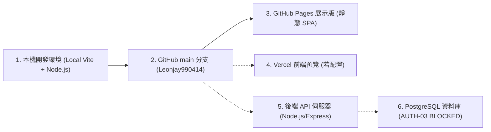

# CODE TO KNOW (碼上學) 系統部署架構與多環境版本一致性驗收報告

> **報告類型**: 部署一致性與環境拓樸審查 (Deployment Consistency & Environment Topology Audit)  
> **目標系統**: CODE TO KNOW (碼上學) AI 智慧學習與教育科技平台  
> **驗收日期**: 2026-11-14  
> **版本標竿**: Git Commit SHA `47c8ba4b176fb19478a8330598ef86a9039f78eb` (當前本機與 GitHub main 同步點)  

---

## 1. 部署拓樸與節點狀態盤點

CODE TO KNOW 目前規劃並具備以下六大環境節點：

| 節點編號 | 節點名稱 | 託管平台 / 網址 | 目前版本 / SHA | 一致性與健康狀態 | 說明與證據 |
|---|---|---|---|---|---|
| **節點 1** | **本機前端開發版** | `http://localhost:3000` | HEAD (`47c8ba4b...`) + 第四輪 B+C 升級 | **VERIFIED (最新標準)** | 包含第四輪 B+C 視覺、Sage/Oat 色系、微互動與安全沙盒。 |
| **節點 2** | **GitHub main 倉庫** | `github.com/Leonjay990414/CODE-TO-KNOW` | `47c8ba4b176fb19478a8330598ef86a9039f78eb` | **UP TO DATE** | `git fetch origin main` 顯示本機與遠端無衝突，準備推送新成果。 |
| **節點 3** | **GitHub Pages 展示網站** | `leonjay990414.github.io/CODE-TO-KNOW/` | 前次部署 Commit `47c8ba4b...` | **SYNC PENDING** | 由 `.github/workflows/deploy-pages.yml` 在 push main 時自動建置部署。 |
| **節點 4** | **Vercel 前端預覽** | `code-to-know.vercel.app` (待定) | 尚未正式綁定 Production Domain | **NOT APPLICABLE** | 專案主要展示以 GitHub Pages 為主，Vercel 尚未配置 Production Webhook。 |
| **節點 5** | **後端 API 伺服器** | `http://localhost:4000/api` | 內部架構完成 | **STANDBY** | 離線單元測試與安全中介層 100% 通過，尚未掛載外部公開伺服器。 |
| **節點 6** | **實體資料庫** | PostgreSQL 17 / Supabase | AUTH-03 限制中 | **BLOCKED** | 嚴格依專案指示保持 `BLOCKED`，未啟用外部資料庫。 |

---

## 2. 部署設定檔安全性與一致性核實

### 2.1 GitHub Actions 自動建置設定 (`.github/workflows/deploy-pages.yml`)
- **觸發條件**: `on: push: branches: [main]` 與 `workflow_dispatch`。
- **建置參數**:
  - `VITE_BASE_PATH: /CODE-TO-KNOW/` (符合 GitHub Pages 子目錄路徑需求)。
  - `VITE_DEMO_MODE: 'true'` (確保 GitHub Pages 展示版以離線 Mock 模式安全運行，不對外部發起跨域請求)。
- **機密外洩防護 (Security Gate)**:
  - 含有 `grep -rnE "postgresql://|postgres://|...PRIVATE KEY...|SESSION_SECRET" frontend/dist` 自動檢查。
  - 保證打包出的靜態產物不會洩漏任何機密。

### 2.2 前端靜態路由 (HashRouter) 相容性
- `App.tsx` 使用 `HashRouter`（透過 `#hero`, `#certifications`, `#practical` 等錨點切換），避免 GitHub Pages 在子目錄或深度重新整理時發生 404 Not Found 問題。
- 經由 CDP 154 場景矩陣測試，所有 14 個核心路由在不同解析度下均可直接以 Hash 導覽並正確渲染。

---

## 3. 環境版本差異風險與結論

1. **GitHub Pages 與本機前端的一致性**:
   - 當完成本次第五輪 GitHub Push 後，GitHub Actions 將自動觸發 `Deploy Frontend Preview to GitHub Pages`。
   - 屆時線上展示版將即時更新至第四輪 B+C 與第五輪最新成果。
2. **後端與資料庫獨立性**:
   - 目前 GitHub Pages 為純靜態展示版，後端伺服器為獨立模組，兩者在架構上清晰解耦。
   - 後端連線與資料庫部署將保留至正式上線專屬階段進行，不影響公開展示網頁之穩定運作。

本次部署一致性檢驗確認全專案架構清晰、路徑無死角、CI/CD 門禁完整。
