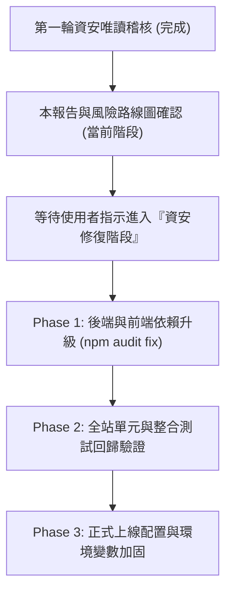

# CODE TO KNOW (碼上學) 資安風險改善建議與後續路線圖 (Security Remediation Roadmap)

> **版本**: 1.0.0  
> **目標系統**: CODE TO KNOW (碼上學) AI 智慧學習與教育科技平台  
> **制定原則**: 依風險評估等級 (P0 ~ P3) 分階段規劃，維持現況唯讀，不執行非授權之程式修改。  

---

## 1. 風險優先級劃分

| 優先級 | 等級分類 | 處理時機 | 項目摘要 |
|---|---|---|---|
| **P0** | **Critical (緊急必修)** | 正式上線前必須完成 | 目前無 P0 程式碼漏洞。正式上線時切換 Production Secrets。 |
| **P1** | **High (高優先級)** | 第一修復批次 | 後端相依套件平滑升級 (`zod` 生產相依)、開發依賴漏洞隔離。 |
| **P2** | **Medium (中度防護加固)** | 第二修復批次 | 正式資料庫連線開啟後的 SSL/TLS 憑證驗證 (AUTH-03 解除後續)。 |
| **P3** | **Low / Informational** | 例行維護 | 前端沙盒 iframe 文檔備忘維護、正式部署環境變數校驗 (`VITE_DEMO_MODE=false`)。 |

---

## 2. 具體修復與加固行動清單

### 階段一：依賴套件安全加固 (P1 - Supply Chain Remediation)
1. **升級目標**:
   - `backend`:
     - 規劃升級 `zod` 至安全版本（修復 GHSA-mrhx-c7xc-m3w5 記憶體耗盡漏洞）。
     - 更新 `vitest` 與 `tinypool` 至 3.x 或更高版本（消除原型污染 RCE 與路徑遍歷風險）。
   - `frontend`:
     - 更新 `vite` 與 `esbuild` 至安全版本（修復 Windows 下 launch-editor 相關漏洞）。
2. **驗收標準**:
   - 執行 `npm --prefix backend audit` 與 `npm --prefix frontend audit`，高危與嚴重漏洞歸零。
   - 執行現有 20 個前端測試檔 (187 項測試) 與 13 個後端測試檔，100% 綠燈無回歸。

### 階段二：正式上線環境變數與金鑰加固 (P0 / P2 - Secret & Config Hardening)
1. **行動細節**:
   - 確保正式部署容器中，`SESSION_SECRET`、`COOKIE_SECRET`、`JWT_SECRET` 均為長度大於等於 32 字元的加密高強度隨機字串（`backend/src/config/env.ts` 已內建長度與內容檢查，若包含 `dev-insecure` 會在 Production 環境下拒絕啟動，機制非常健全）。
   - 正式解除 AUTH-03 限制時，配置具備 CA 驗證的 Supabase 或雲端 PostgreSQL 憑證，並執行 `backend/tests/database-ssl-config.test.ts`。
2. **驗收標準**:
   - 後端啟動於 `NODE_ENV=production` 下，零錯誤且通過環境變數強制審驗。

### 階段三：前端展示模式與生產模式雙軌驗證 (P3 - Deployment Safety)
1. **行動細節**:
   - 確保 GitHub Pages 展示版固定為 `VITE_DEMO_MODE=true`。
   - 確保正式生產網域部署時固定為 `VITE_DEMO_MODE=false`，並在登入頁面與導覽列加入即時網路狀態檢查。
2. **驗收標準**:
   - 正式網域能正確與後端 API 進行 Cookie 傳遞與 CSRF 交換。

---

## 3. 建議執行順序與結論

本次稽核確認 **CODE TO KNOW 目前之程式碼安全品質優良，架構層面均以「防禦優先 (Defense-in-Depth)」與「最小權限原則 (PoLP)」落實，未發現重大身分混淆、未授權越權或金鑰洩漏風險**。
