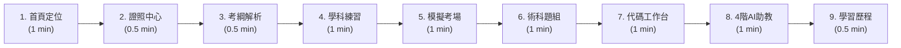

# CODE TO KNOW（碼上學）正式展示操作指南與評審演示手冊

**適用版本**：v1.0 (Phase 6 正式展示交付版)  
**文件目標**：提供專案團隊、現場簡報者、評審及競賽導師一套清晰、標準、可在 5～8 分鐘內完整展現產品精華的展示指南。

---

## 一、專案核心價值與品牌介紹

### 1. 品牌識別
- **中文品牌**：碼上學
- **英文品牌**：CODE TO KNOW
- **全稱**：碼上學 AI 智慧學習與教育科技平台
- **品牌精神標語**：碼上學，學無止境。
- **英文 Tagline**：Learn Beyond Limits.

### 2. 產品使命與核心理念
傳統教育科技往往陷入兩極：要麼是呆板靜態的題庫刷題，要麼是讓生成式 AI 直接拋出完整解答，剝奪了學生的思考歷程。  
**CODE TO KNOW（碼上學）** 定位為下一代「AI 智慧學習與程式證照教育平台」，致力於：
1. **AI 輔助自主思考，而非取代思考**：獨創「4 階思考鷹架（Scaffolding）」導引，由觀念聚焦到架構解構，絕不劇透解答。
2. **學科與術科雙軌並進**：從學科考點詳解，到 100% 符合勞動部規範的五大術科題組逐步拆解。
3. **沉浸式即時代碼工作台**：無需安裝本機開發環境，在瀏覽器內即可享受左側寫 Code、右側即時渲染的雙欄沙盒。
4. **師生協同與弱點複盤**：為學生建立智能錯題本，為教師提供可視化班級儀表板。

---

## 二、展示環境與執行方式

### 1. 支援瀏覽器
- **最佳推薦**：Google Chrome (v110 以上)、Microsoft Edge (Chromium 核心)
- **相容支援**：Mozilla Firefox、Apple Safari (支援 iOS / iPadOS 及 macOS)

### 2. 如何開啟 Prototype
本 Prototype 為**高相容性純前端架構**，無須安裝 Node.js、Python 或後端資料庫，亦無須建置 Docker：
- **方式一（最推薦 / 極簡離線）**：直接以檔案總管開啟 `prototype/index.html`（雙擊檔案，瀏覽器以 `file:///` 協定開啟即可完全正常運作）。
- **方式二（本機伺服器）**：若使用 VS Code，可透過 `Live Server` 外掛點擊右下角「Go Live」，以 `http://127.0.0.1:5500/prototype/index.html` 瀏覽。

### 3. 本機離線可展示功能 vs. 正式雲端功能
- **無需後端、完全本機可實測**：
  - 首頁所有導航、信任指標與四階鷹架視覺展示。
  - 證照中心關鍵字搜尋（內建 150ms 防抖）、考科與領域膠囊篩選。
  - 證照大綱頁 URL 參數動態載入（開放證照 vs. COMING SOON 籌備視圖）。
  - 學科單選題即時作答與考點詳解動態展開。
  - 模擬考 60 分鐘即時計時器、提前交卷評分 Modal 淡入與三種關閉方式。
  - 術科五大題組即時切換、切版線稿圖自適應更新、評分地雷檢核。
  - 線上代碼編輯器即時修改、即時渲染 iframe、重設示範代碼、手機端雙頁籤切換。
  - AI 助教快速提問滑動、四階鷹架漸進式提示對話串。
  - 學習進度 2x2 指標網格、考證目標進度條、弱點診斷清單。
- **需正式伺服器與雲端金鑰之功能**（展示時應說明屬於全端架構規劃）：
  - 真正的外部 LLM 即時流式推理（Vertex AI / Gemini 2.5 API）。
  - 學生個人歷史跨裝置雲端資料庫儲存（Prisma + PostgreSQL / SQLite）。
  - 正式 JWT 身分驗證與學校教師管理後台。

---

## 三、九大頁面功能詳細解說

### 1. 首頁 (`index.html`)
- **頁面用途**：建立專業、溫潤、國際化的教育科技品牌第一印象，向學生與教師傳達平台核心價值。
- **主要操作**：點擊「開始學習」直通證照中心；點擊「體驗 4 階 AI 導引」跳至鷹架理念區；點擊精選證照卡跳轉實作。
- **展示重點**：介紹「碼上學，學無止境」品牌精神；展示暖象牙、深岩灰與香檳金的高級配色；展示首頁 3 大信任指標在行動端的無溢出流動排版。
- **展示限制**：教師登入演示為 Toast 模擬。

### 2. 證照智慧學習中心 (`pages/certifications.html`)
- **頁面用途**：聚合國家技術士檢定與知名程式認證之統一學習入口。
- **主要操作**：於搜尋列輸入代碼（如 `17300`）或點擊領域膠囊；點擊卡片進入各別大綱。
- **展示重點**：
  - **強大的前端即時檢索**：輸入 17300 即可瞬間過濾出「網頁設計丙級」與「網頁設計乙級」。
  - **誠實的發布管理**：網頁設計丙級清楚標註「正式示範中 (611 題 / 5 大題組)」；其餘五項證照嚴格標註「COMING SOON」，展現嚴謹專業。

### 3. 證照檢定大綱與學習地圖 (`pages/certification-detail.html`)
- **頁面用途**：呈現各考科的知識單元架構、考試規範與實作模組指引。
- **主要操作**：透過頂部麵包屑快速返回；點擊各考點右側「練習此單元」按鈕；展示不同網址參數（`?id=web-design-c` 與 `?id=software-design-c`）之動態畫面。
- **展示重點**：示範開放證照的「四大考點分佈 + 五大術科題組」；對比示範 COMING SOON 證照的「籌備中通知 + 預計開放之 AI 功能」。

### 4. 學科全真題庫智慧練習 (`pages/theory-learning.html`)
- **頁面用途**：模擬真實技術士學科測驗之單選題練習介面。
- **主要操作**：點擊選項 B (`<article>` 標籤)，點擊「送出檢驗」按鈕。
- **展示重點**：送出後即刻由系統自動批改，並於下方滑出具有 W3C 規範根據的淡綠色考點解析；右側題號導覽網格具備答對、進行中與未作答狀態。

### 5. 全真模擬測驗考場 (`pages/mock-exam.html`)
- **頁面用途**：沉浸式重現 60 分鐘限時檢定考場環境。
- **主要操作**：觀察頂部倒數計時器動態遞減；點擊「提前交卷評分」按鈕；操作彈窗內「檢視錯題」或點擊背景關閉。
- **展示重點**：展示考場防作弊標語；展示 0.25s 溫和淡入之成績結算 Modal（88.75 分達標，及格門檻 60 分），彈窗支援點擊遮罩關閉、按鈕關閉與 ESC 鍵關閉。

### 6. 術科題組實作工作區 (`pages/practical-learning.html`)
- **頁面用途**：提供官方四大題組之試題分解、架構線稿與關鍵地雷提醒。
- **主要操作**：點擊頂部題組 Pills（題組一至四切換）；點擊「開啟題組代碼編輯器」帶參數跳轉。
- **展示重點**：
  - **100% 官方標準**：切換四大題組（校園社團介紹網、國家公園、體育活動中心、台灣美食），線稿圖與試題代號即時連動。
  - **自適應線稿佈局**：展示 Header 1024x65、Marquee、左側 200px 選單、右側 iframe main 824x470、Footer 1024x20 之官方標準結構。
  - **避坑指南**：右側即時更新該題組常見失分陷阱。

### 7. 線上即時代碼工作台 (`pages/code-editor.html`)
- **頁面用途**：提供免安裝、零配置、開箱即用的 HTML/CSS 雙欄沙盒工作區。
- **主要操作**：在左側代碼區隨意修改文字或 CSS（例如將背景改為 `#526B7B`），點擊「執行代碼預覽」或按 `Ctrl+Enter`；點擊「重設範例代碼」恢復；在手機尺寸下點擊 `[代碼編輯] / [即時預覽]` 頁籤。
- **展示重點**：**真槍實彈的即時編譯**！右側 iframe 即時同步更新，證明 CODE TO KNOW 是可動手實作的教育平台而非死板文件；展示手機端雙頁籤 0.2s 平滑過渡動態。

### 8. 4 階 AI 智慧學習助教 (`pages/ai-coach.html`)
- **頁面用途**：演繹「以引導代替直接給答案」的教育科技核心價值。
- **主要操作**：橫向滑動快速提問標籤；點選「❓ 題組一版面如何置中？」；或於下方輸入框鍵入問題發送。
- **展示重點**：AI 助教依序展示「觀念聚焦 → 破題思路 → 邊界提點 → 架構解構」四階提示，引導學生使用 `margin: 0 auto` 與固定寬度解決版面置中，而非直接生成整段答案讓學生抄襲。向評審點出這是教育科技與一般 AI 工具的根本差異。

### 9. 個人學習歷程與弱點診斷 (`pages/learning-progress.html`)
- **頁面用途**：統整學生的做題量、模考分數、微光啟發點數與知識弱點分佈。
- **主要操作**：瀏覽四大指標卡；檢視網頁設計丙級 45% 進度條；檢視右側專題弱點與 AI 複盤建議。
- **展示重點**：展示 320px 手機端極為緊湊舒適的 2 欄 × 2 列指標網格；展現雙軌進度管理（學科 68%、術科 2/4 題組）之清晰儀表板。

---

## 四、競賽與評審展示流程設計 (5～8 分鐘標準腳本)

本流程專門為時間緊湊的黑客松、創客大賽、教育科技評選或 Demo Day 設計。整體節奏明快、重點鮮明，**完全不依賴外網，零網路環境下 100% 穩定展示**。

---

### 第一站：首頁理念與平台定位（預計 1 分鐘）
- **操作步驟**：開啟 `prototype/index.html`，展示首頁 Hero、向下捲動至「4 階 AI 學習引導」與「雙軌學習」。
- **講解重點**：
  > 「各位評審好，我們是『碼上學 CODE TO KNOW』。這是一套專為國家技術士檢定與程式先修打造的 AI 智慧學習平台。我們的核心理念是『碼上學，學無止境』——讓 AI 成為引導自主思維的導師，而不是剝奪思考、直接給答案的抄襲工具。」
- **預期畫面**：溫潤典雅的淺色 UI、流動自適應排版、4 階鷹架階梯互動卡。
- **注意事項**：不要停留過久，快速點擊右上角「開始學習」按鈕切入證照中心。

---

### 第二站：證照智慧學習中心（預計 0.5 分鐘）
- **操作步驟**：於搜尋列鍵入 `17300`，展示卡片即時過濾；點擊「重設篩選」。
- **講解重點**：
  > 「在證照中心，我們收錄了國家級技術士與國際檢定。大家可以看到我們內建了極為靈敏的 150ms 防抖搜尋引擎。針對題庫已完整的『網頁設計丙級』，我們提供完整學科與術科入口；而籌備中的項目我們誠實標示 COMING SOON，杜絕虛假資料。」
- **預期畫面**：輸入 17300 後卡片瞬間過濾為 3 張；重設後恢復 7 張。
- **注意事項**：點擊「網頁設計丙級技術士」卡片之「查看完整大綱」。

---

### 第三站：證照檢定大綱與學習地圖（預計 0.5 分鐘）
- **操作步驟**：展示 `certification-detail.html` 的四大考點單元與五大術科題組。
- **講解重點**：
  > 「檢定大綱頁將官方龐雜的題本拆解為可執行的模組化地圖。左側是學科單元與官方四大題組，右側是檢定標準。點擊各單元即可直接展開專項訓練。」
- **預期畫面**：2fr : 1fr 的清晰主側雙欄，文字排版自然平衡。
- **注意事項**：點擊「單元 2：HTML5 基礎結構」右側的「練習此單元」按鈕進入學科頁。

---

### 第四站：學科全真題庫智慧練習（預計 1 分鐘）
- **操作步驟**：選取選項 (B) `<article>` 標籤，點擊「送出檢驗」。
- **講解重點**：
  > 「在學科練習中，學生不只是看答案，而是獲得即時反饋。點擊送出後，系統立即自動批改，並展示符合 W3C 標準的深度解析，幫助學生真正理解語意標籤的獨立性原則。」
- **預期畫面**：選項變更為選取狀態，下方滑出綠色背景考點詳解，右側題號導覽對應點亮。
- **注意事項**：直接點擊頂部導航或右側「進入模擬考場」切換至全真模擬考。

---

### 第五站：全真模擬測驗考場（預計 1 分鐘）
- **操作步驟**：展示倒數計時器動態走動；點擊「提前交卷評分」；彈窗呈現後點擊「關閉視窗」或按鍵盤 `ESC`。
- **講解重點**：
  > 「進入模擬考場，系統啟動 60 分鐘即時倒數計時與防弊模式。當學生作答完畢提前交卷，系統會以平滑淡入動畫呈現成績報告與及格判定，錯題會自動沉澱至個人的錯題複盤庫。」
- **預期畫面**：計時器平順倒數；點擊交卷後 0.25s 溫和淡出成績 Modal（88.75 分），點擊 ESC 鍵順暢關閉。
- **注意事項**：透過頂部導航切換至「術科實作」。

---

### 第六站：術科五大題組切換與拆解（預計 1 分鐘）
- **操作步驟**：點擊題組二（國家公園）、題組三（體育活動）、題組四（台灣美食），展示線稿圖與步驟動態切換。
- **講解重點**：
  > 「術科是技術士檢定最容易因規格不符而失分的環節。我們 100% 還原了勞動部官方五大術科題組，並將複雜試題視覺化為自適應線稿圖。從 Header 1024x65、跑馬燈、左側選單到右側 iframe，考題尺寸一目了然，右側更提供考場避坑檢核表。」
- **預期畫面**：點擊題組按鈕，標題、代號、線稿示意圖與步驟秒級動態更新。
- **注意事項**：點擊下方「開啟題組代碼編輯器」按鈕直接帶參數切入代碼工作台。

---

### 第七站：線上即時代碼工作台（預計 1 分鐘）
- **操作步驟**：
  1. 在左側編輯器中將標題文字修改（例如改為 `<h1>碼上學實作展示成功！</h1>`）。
  2. 點擊「執行代碼預覽」按鈕（或按快捷鍵 `Ctrl + Enter`）。
  3. 展示右側 iframe 畫面即時更新。
  4. 按下「重設範例代碼」恢復預設。
- **講解重點**：
  > 「這是我們的沉浸式代碼工作台。學生無需在本機繁瑣安裝編輯器，左側寫 HTML/CSS，點擊執行，右側原生沙盒即時編譯渲染！我們甚至針對手機端設計了雙頁籤切換，小螢幕切版同樣流暢。」
- **預期畫面**：右側畫面隨程式碼輸入即時變更，證明平台具備真正可動手操作的實作力。
- **注意事項**：透過導航列進入「AI 助教」。

---

### 第八站：4 階 AI 智慧學習助教（預計 1 分鐘）
- **操作步驟**：點選快速提問標籤「❓ 題組一版面如何置中？」，展示 AI 助教的四階段回答。
- **講解重點**：
  > 「現在我們看到最關鍵的『AI 思考助教』。當學生問版面如何置中時，傳統 AI 會直接吐出全部 CSS 碼，學生複製貼上就結束了。但碼上學的 AI 會分四階引導：先聚焦水平置中觀念，再提示容器寬度與 auto 邊距思路，最後點出邊界細節。我們誠實說明目前展示的是教學提示範本，正式版本將串接 Gemini 2.5 進行真正的動態推理。」
- **預期畫面**：對話泡泡由「觀念聚焦」逐步展開至「架構解構」，對話串自然滾動。
- **注意事項**：點擊頂部導航進入最後一站「學習進度」。

---

### 第九站：個人學習進度與弱點診斷（預計 0.5 分鐘）
- **操作步驟**：瀏覽頂部四大指標卡、網頁設計丙級進度條與右側弱點專題分析。
- **講解重點**：
  > 「最後，學生的所有努力都會沉澱在學習歷程中。頂部是 2x2 精緻指標網格，記錄答題數與代表自主思維的『微光點數』；下方以雙軌進度條追蹤考照準備度；右側則以專題弱點引導學生進行最後衝刺。以上就是『碼上學 CODE TO KNOW』的完整閉環。」
- **預期畫面**：精緻儀表板、無水平溢出、資料排版工整。
- **結尾語**：
  > 「碼上學，讓程式思維真正生根。謝謝各位評審！」

---

## 五、展示注意事項與應變指南

1. **不可宣稱非真實資料**：
   - AI 助教對話為「四階思考鷹架之示範流程」，不得宣稱為伺服器連線即時 AI。
   - 模擬考成績 88.75 分為標準示範資料，非真實學生歷史紀錄。
2. **常見狀況快速排除**：
   - **狀況一：誤按了縮放導致版面看起來過大**：按鍵盤 `Ctrl + 0` 即可瞬間還原 100% 標準比例。
   - **狀況二：代碼編輯器輸入亂碼或想重頭示範**：點擊「重設範例代碼」按鈕，立即恢復乾淨官方骨架。
   - **狀況三：搜尋列找不到卡片**：點擊搜尋框右下方的「重設篩選條件」，立即還原所有卡片。
   - **狀況四：模擬考評分彈窗遮住畫面**：直接按下鍵盤 `Escape` 鍵或點擊彈窗外的深色背景即可瞬間關閉。

